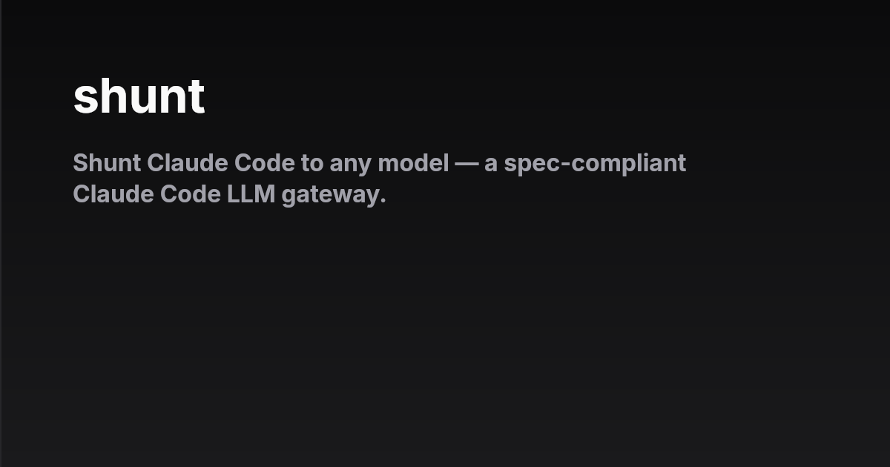
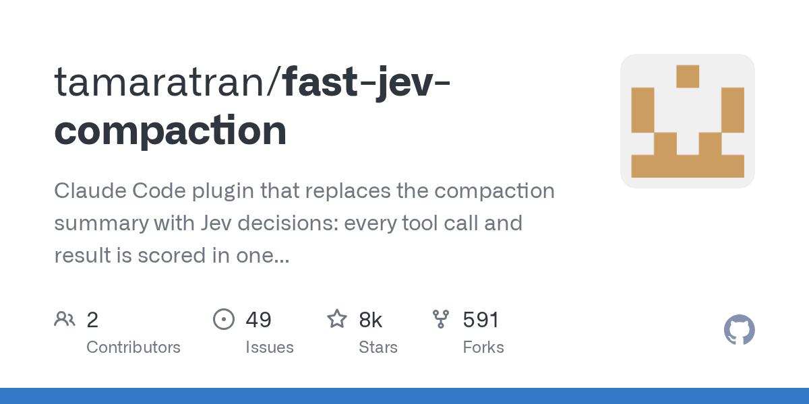
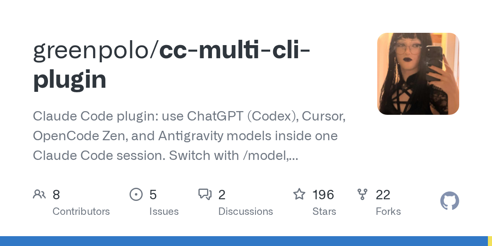
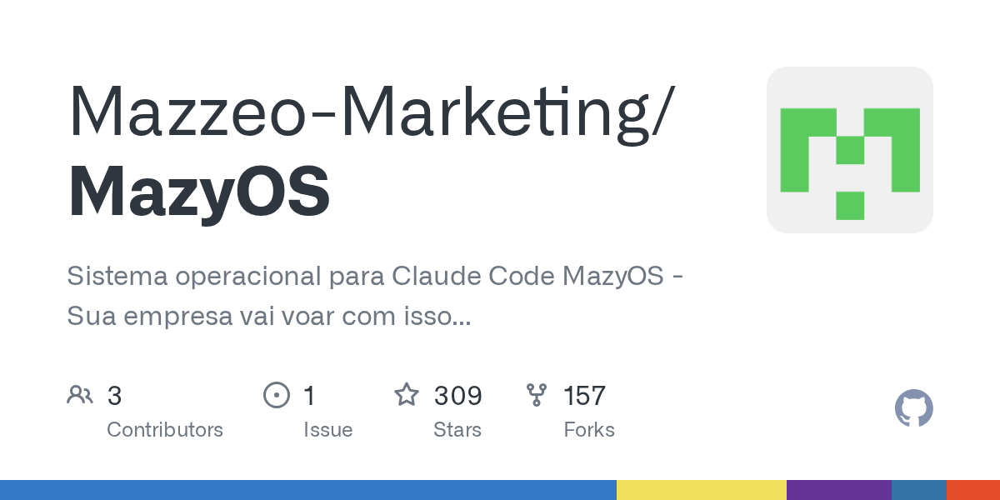

# Claude Code: selección de mods

[English](https://github.com/claude-code-mods/best-claude-code-mods) · [简体中文](https://github.com/claude-code-mods/claude-code-mods-zh) · [繁體中文](https://github.com/claude-code-mods/claude-code-mods-zh-tw) · [日本語](https://github.com/claude-code-mods/claude-code-mods-ja) · [한국어](https://github.com/claude-code-mods/claude-code-mods-ko) · **Español** · [Français](https://github.com/claude-code-mods/claude-code-mods-fr) · [Deutsch](https://github.com/claude-code-mods/claude-code-mods-de) · [Português (Brasil)](https://github.com/claude-code-mods/claude-code-mods-pt-br) · [Русский](https://github.com/claude-code-mods/claude-code-mods-ru)

**Seleccionados, validados y fijados a una versión. Añádelos una vez y tendrás 40 mods.**

> **Los 40 mods están completamente localizados al español.** Todas las etiquetas, los comandos, los paneles, las sugerencias y la documentación están traducidos; las fuentes de los plugins se incluyen en este repositorio, así que la interfaz ya está en español después de instalarlos, sin configuración adicional. Solo los identificadores de código, los nombres de eventos de hooks, las skills y las instrucciones dirigidas al modelo permanecen en inglés para no alterar el comportamiento.

Los mods son plugins de Claude Code escritos con hooks de funciones: pueden observar, modificar o tomar el control del comportamiento de Claude Code, y también dibujar su propia interfaz. Este mercado reúne los mejores mods de la comunidad. Cada uno se ha validado con `claude plugin validate` y se ha fijado al commit verificado, de modo que los cambios posteriores de sus autores no te llegan sin revisión.

Se necesita Claude Code 2.1.287 o superior.

## Instalación

Escribe esto en una sesión de terminal de Claude Code:

```
/plugin marketplace add claude-code-mods/claude-code-mods-es
/plugin install <nombre-del-mod>@claude-code-mods-es
```

Por ejemplo: `/plugin install terminal-browser@claude-code-mods-es`. Ejecuta `/plugin marketplace update claude-code-mods-es` para obtener mods nuevos y actualizaciones.

## Catálogo

Los **permisos** de cada tarjeta indican, según informa el validador, qué puede hacer ese mod además de dibujar la interfaz. Revisa su código antes de instalarlo: la validación solo lee el código de forma estática, no lo ejecuta y no equivale a una auditoría de seguridad.

### Paneles y uso

[](https://github.com/alexgreensh/token-optimizer/tree/e3f1a2dcad8d8999096b8a881c4d98cdba4ef1a5/desktop/token-optimizer-desktop)

#### [`token-optimizer`](https://github.com/alexgreensh/token-optimizer/tree/e3f1a2dcad8d8999096b8a881c4d98cdba4ef1a5/desktop/token-optimizer-desktop)

*Por alexgreensh* · Una barra de estado de optimización de tokens que muestra adónde van los tokens y cómo gastar menos.

**Permisos:** Ejecutar comandos, Llamar al modelo, Leer y escribir archivos

`/plugin install token-optimizer@claude-code-mods-es`

---

[](https://github.com/hex/claude-council/tree/f2f7f42122b288599cef8cea97dcc490acea98a5)

#### [`council`](https://github.com/hex/claude-council/tree/f2f7f42122b288599cef8cea97dcc490acea98a5)

*Por hex* · Consulta a varios agentes de IA a la vez para obtener perspectivas diversas, con un panel en streaming y una comprobación lateral opcional.

**Permisos:** Ejecutar comandos, Llamar al modelo, Leer y escribir archivos

`/plugin install council@claude-code-mods-es`

---

[](https://github.com/chipfighter/context-attachment-manager/tree/d68a721b7432059c9056d546ff2a26b11b3c0e0c)

#### [`codex-attachment-manager`](https://github.com/chipfighter/context-attachment-manager/tree/d68a721b7432059c9056d546ff2a26b11b3c0e0c)

*Por chipfighter* · Envía las imágenes anteriores como marcadores cortos y recupera los originales por identificador, para que las sesiones largas con imágenes conserven la caché de prompt.

**Permisos:** Red, MCP

`/plugin install codex-attachment-manager@claude-code-mods-es`

---

[](https://github.com/karanb192/cache-tax/tree/535ff33225e666e605e731d78f5ac5efe243c7c3)

#### [`cache-tax`](https://github.com/karanb192/cache-tax/tree/535ff33225e666e605e731d78f5ac5efe243c7c3)

*Por karanb192* · Mantiene caliente la caché de prompt de una hora durante las pausas, pregunta antes de un envío en frío y muestra el coste de reescritura.

**Permisos:** Llamar al modelo

`/plugin install cache-tax@claude-code-mods-es`

---

[](https://github.com/Atoll92/agent-standup/tree/846d5324f7c00f06d598c86e87ed8b51d774b3ac/plugin-band)

#### [`agent-standup-band`](https://github.com/Atoll92/agent-standup/tree/846d5324f7c00f06d598c86e87ed8b51d774b3ac/plugin-band)

*Por Atoll92* · Una línea sobre el prompt cuando otra sesión local te necesita, y una notificación cuando termina.

**Permisos:** Ejecutar comandos, Leer y escribir archivos

`/plugin install agent-standup-band@claude-code-mods-es`

---

[](https://github.com/pleaseai/shunt/tree/57182b328e92d3c70bc9ca5a1fd1ee9104cfbabb/plugins/shunt)

#### [`shunt`](https://github.com/pleaseai/shunt/tree/57182b328e92d3c70bc9ca5a1fd1ee9104cfbabb/plugins/shunt)

*Por pleaseai* · Una barra de uso de la pasarela shunt: gasto y hora de reinicio de cada ventana, además de un desglose completo con /shunt:usage.

**Permisos:** Red, Ejecutar comandos

`/plugin install shunt@claude-code-mods-es`

---

[](https://github.com/localixai/tokendoctor/tree/051fa9598f0a50ed30974b618f2911381b7dcf90)

#### [`tokendoctor`](https://github.com/localixai/tokendoctor/tree/051fa9598f0a50ed30974b618f2911381b7dcf90)

*Por localixai* · Reproduce tus sesiones anteriores para mostrar cuánto habría ahorrado cada cambio y aplica solo lo que tú eliges.

**Permisos:** Ejecutar comandos, Llamar al modelo

`/plugin install tokendoctor@claude-code-mods-es`

---

[](https://github.com/hellosverre/claude-skins/tree/cf0d39f3785d5c5a4b6189ecc487b1ac479efea0)

#### [`skins`](https://github.com/hellosverre/claude-skins/tree/cf0d39f3785d5c5a4b6189ecc487b1ac479efea0)

*Por hellosverre* · Skins y quince temas para la transcripción, con tarjetas enriquecidas y una barra de uso; /skin las cambia en directo.

**Permisos:** Red, Ejecutar comandos, Llamar al modelo, Leer y escribir archivos

`/plugin install skins@claude-code-mods-es`

---

[](https://github.com/cablate/ctx-handoff-mod/tree/a416713a0495be799a31f3650e18458e242270c7)

#### [`ctx-handoff`](https://github.com/cablate/ctx-handoff-mod/tree/a416713a0495be799a31f3650e18458e242270c7)

*Por cablate* · Convierte lo que enseñas a Claude en notas del proyecto, detecta errores comunes, mantiene la caché caliente y reanuda sesiones largas.

**Permisos:** Llamar al modelo, Leer y escribir archivos

`/plugin install ctx-handoff@claude-code-mods-es`

---

[](https://github.com/PBJ-2/clauderipple/tree/c1c6b76a9e4e7a51df2ec5907d6e41d6bf8591e3/packages/mod)

#### [`ripple`](https://github.com/PBJ-2/clauderipple/tree/c1c6b76a9e4e7a51df2ec5907d6e41d6bf8591e3/packages/mod)

*Por PBJ-2* · Elige el esfuerzo de razonamiento por prompt y un trabajador por tarea delegada, mantiene la caché caliente y muestra adónde fue cada solicitud.

**Permisos:** Red, Ejecutar comandos, Llamar al modelo, MCP, Leer y escribir archivos

`/plugin install ripple@claude-code-mods-es`

---

[](https://github.com/LiarMTTT/TavernWeave/tree/f9863d2b05305457fe9ed8b0c5688d52aca400a5)

#### [`tavernweave-agent-skills`](https://github.com/LiarMTTT/TavernWeave/tree/f9863d2b05305457fe9ed8b0c5688d52aca400a5)

*Por LiarMTTT* · 23 skills compartidas para tarjetas de personaje, trabajo de software y tareas cloud acotadas, además de un interruptor de modo Soul sobre el prompt.

**Permisos:** —

`/plugin install tavernweave-agent-skills@claude-code-mods-es`

---

[](https://github.com/rbartoli/agent-usage-guard/tree/02594c2620be9eb60c32e2f77d9d512d9f61b205)

#### [`agent-usage-guard`](https://github.com/rbartoli/agent-usage-guard/tree/02594c2620be9eb60c32e2f77d9d512d9f61b205)

*Por rbartoli* · Frena la expansión de subagentes, los prompts de contexto extenso y los bucles de reintento antes de que consuman tu ventana de uso.

**Permisos:** Llamar al modelo, Leer y escribir archivos

`/plugin install agent-usage-guard@claude-code-mods-es`


### Agentes y subagentes

[](https://github.com/Paradigm-Study/claude-share/tree/9d88f996ac4245c756a89b34e98cfde375028950/plugin)

#### [`shared-session`](https://github.com/Paradigm-Study/claude-share/tree/9d88f996ac4245c756a89b34e98cfde375028950/plugin)

*Por Paradigm-Study* · Comparte una sesión con un enlace o con tu equipo; tus compañeros se unen desde su propio Claude Code y ven cada turno en directo.

**Permisos:** —

`/plugin install shared-session@claude-code-mods-es`

---

[](https://github.com/scasella/claude-flightdeck/tree/626cc0b46d417f81bbff9f5ba3b49abaf8912a85)

#### [`flightdeck`](https://github.com/scasella/claude-flightdeck/tree/626cc0b46d417f81bbff9f5ba3b49abaf8912a85)

*Por scasella* · Un panel de agentes en vivo: signos vitales del modelo, arquitecto de guardia, comprobaciones de permisos, tarjetas de subagentes y registro de sesión.

**Permisos:** —

`/plugin install flightdeck@claude-code-mods-es`

---

[](https://github.com/rsmdt/the-startup/tree/e803d51fdb423271d3dde189f5416f3ec51386a9/plugins/start)

#### [`start`](https://github.com/rsmdt/the-startup/tree/e803d51fdb423271d3dde189f5416f3ec51386a9/plugins/start)

*Por rsmdt* · Comandos de orquestación de flujos de trabajo para desarrollo de software agéntico.

**Permisos:** Leer y escribir archivos

`/plugin install start@claude-code-mods-es`

---

[](https://github.com/VKirill/claude-lane-stack/tree/8bac2b876b72053aa445bb9d1c7c6079bfc4ba8c/plugins/lane-stack)

#### [`lane-stack`](https://github.com/VKirill/claude-lane-stack/tree/8bac2b876b72053aa445bb9d1c7c6079bfc4ba8c/plugins/lane-stack)

*Por VKirill* · Una cinta transportadora de gestor de producto en solitario: agentes orquestadores, manuales de carril y comandos de incorporación y reanudación.

**Permisos:** Red, Llamar al modelo

`/plugin install lane-stack@claude-code-mods-es`


### Productividad y contexto

[](https://github.com/Kuddev/pebrel/tree/ed9b2331340877ba3d775e38c4df6bd1a2abb1fe/pebrel_app/res/prompt-suggestions/claude)

#### [`pebrel-prompt-suggestions`](https://github.com/Kuddev/pebrel/tree/ed9b2331340877ba3d775e38c4df6bd1a2abb1fe/pebrel_app/res/prompt-suggestions/claude)

*Por Kuddev* · Sugerencias nativas de prompt en el campo vacío a través del puente de sesión Pebrel.

**Permisos:** Red

`/plugin install pebrel-prompt-suggestions@claude-code-mods-es`

---

[](https://github.com/tamaratran/fast-jev-compaction/tree/e3f262a7f4d42bd8dd32ced30d26176f7cb545b0)

#### [`fast-jev-compaction`](https://github.com/tamaratran/fast-jev-compaction/tree/e3f262a7f4d42bd8dd32ced30d26176f7cb545b0)

*Por tamaratran* · Compresión guiada por Jev y literal para sesiones de Claude Code.

**Permisos:** Red, Llamar al modelo

`/plugin install fast-jev-compaction@claude-code-mods-es`

---

[](https://github.com/alexeyw/lot-map/tree/ad60f057902765d778eedde770d337be45fac3af)

#### [`lot-map`](https://github.com/alexeyw/lot-map/tree/ad60f057902765d778eedde770d337be45fac3af)

*Por alexeyw* · Un mapa en vivo junto al chat: memoria, archivos, shell, web, modelo, agentes, skills y hooks se iluminan al usarse.

**Permisos:** —

`/plugin install lot-map@claude-code-mods-es`

---

[](https://github.com/Storybloq/storybloq/tree/f0b4c08e3a15ffb9841e5a3058c6b1ca57607154/plugins/storybloq)

#### [`storybloq`](https://github.com/Storybloq/storybloq/tree/f0b4c08e3a15ffb9841e5a3058c6b1ca57607154/plugins/storybloq)

*Por Storybloq* · Memoria del proyecto: tickets, incidencias, traspasos y lecciones guardados en una carpeta .story/ de tu repositorio.

**Permisos:** Leer y escribir archivos

`/plugin install storybloq@claude-code-mods-es`

---

[](https://github.com/Lifecycle-Innovations-Limited/claude-ops/tree/e434ef7e612f2ff5769def6101fc9d984888d377/claude-ops/skills/ops-jdi/plugin)

#### [`just-do-it`](https://github.com/Lifecycle-Innovations-Limited/claude-ops/tree/e434ef7e612f2ff5769def6101fc9d984888d377/claude-ops/skills/ops-jdi/plugin)

*Por Lifecycle-Innovations-Limited* · Continúa el trabajo autorizado hasta la verificación y la entrega, y muestra los problemas de configuración que hay que reparar.

**Permisos:** Ejecutar comandos, Llamar al modelo

`/plugin install just-do-it@claude-code-mods-es`

---

[](https://github.com/data-goblin/claude-code-filetree/tree/1fdc3a963f2dc22a939f661ff0ff5a76646c9112)

#### [`filetree`](https://github.com/data-goblin/claude-code-filetree/tree/1fdc3a963f2dc22a939f661ff0ff5a76646c9112)

*Por data-goblin* · Un árbol de archivos estilo IDE que muestra qué está haciendo Claude y dónde en tus archivos.

**Permisos:** Ejecutar comandos, Llamar al modelo, Leer y escribir archivos

`/plugin install filetree@claude-code-mods-es`

---

[](https://github.com/notque/vexjoy-agent/tree/c68ac1fea2a03e437ccc95112d1e56e467a9bd00/plugins/jev-auto-compact)

#### [`jev-auto-compact`](https://github.com/notque/vexjoy-agent/tree/c68ac1fea2a03e437ccc95112d1e56e467a9bd00/plugins/jev-auto-compact)

*Por notque* · Al 60 % de contexto, poda llamadas a herramientas obsoletas sin generar nada; omite en lugar de recurrir a un resumen LLM.

**Permisos:** Red, Llamar al modelo

`/plugin install jev-auto-compact@claude-code-mods-es`

---

[](https://github.com/caliber-ai-org/ai-setup/tree/f5dbc002022a8a10acad25c1cce23ddefdc19d0d/plugin/caliber-jev-compaction)

#### [`caliber-jev-compaction`](https://github.com/caliber-ai-org/ai-setup/tree/f5dbc002022a8a10acad25c1cce23ddefdc19d0d/plugin/caliber-jev-compaction)

*Por caliber-ai-org* · Compresión guiada por Jev y literal para sesiones de Claude Code.

**Permisos:** Red, Llamar al modelo

`/plugin install caliber-jev-compaction@claude-code-mods-es`

---

[](https://github.com/aerovato/operator-memory/tree/93c3fce64f0a72adeb89fa868600eb418548ec07/packages/claude-code)

#### [`operator`](https://github.com/aerovato/operator-memory/tree/93c3fce64f0a72adeb89fa868600eb418548ec07/packages/claude-code)

*Por aerovato* · Memoria persistente de proyectos y usuarios para desarrollo dirigido por agentes.

**Permisos:** —

`/plugin install operator@claude-code-mods-es`

---

[](https://github.com/gwittebolle/claude-carbon/tree/9ad53f1dd07fb0e11fcdb94d294ed794d660cf4b)

#### [`carbon`](https://github.com/gwittebolle/claude-carbon/tree/9ad53f1dd07fb0e11fcdb94d294ed794d660cf4b)

*Por gwittebolle* · Registra la huella de carbono de tus sesiones de Claude Code en la terminal y en la aplicación de escritorio.

**Permisos:** Leer y escribir archivos

`/plugin install carbon@claude-code-mods-es`

---

[](https://github.com/danyuchn/claude-work-mode/tree/e19eda1e8465308bd79a74fad295cf9b6d9cdf71/plugins/work-mode)

#### [`work-mode`](https://github.com/danyuchn/claude-work-mode/tree/e19eda1e8465308bd79a74fad295cf9b6d9cdf71/plugins/work-mode)

*Por danyuchn* · Modos de sesión: auto (sin preguntas a mitad de tarea), out (delegar trabajo por lotes) y wrap (converger y terminar).

**Permisos:** Ejecutar comandos, Leer y escribir archivos

`/plugin install work-mode@claude-code-mods-es`

---

[](https://github.com/iamumeransari/claude-show-your-work/tree/71e546044e3ba61b98a6938a03270da791f9ca2e)

#### [`show-your-work`](https://github.com/iamumeransari/claude-show-your-work/tree/71e546044e3ba61b98a6938a03270da791f9ca2e)

*Por iamumeransari* · Muestra el trabajo terminado en la terminal: capturas de pantalla, vídeos de clics y comparaciones antes/después sincronizadas.

**Permisos:** Red, Ejecutar comandos, Llamar al modelo, Leer y escribir archivos

`/plugin install show-your-work@claude-code-mods-es`

---

[](https://github.com/petekp/inbox/tree/02e441cd447edf86fc30fbd03e9117a8ead9da7a)

#### [`inbox`](https://github.com/petekp/inbox/tree/02e441cd447edf86fc30fbd03e9117a8ead9da7a)

*Por petekp* · Reúne las preguntas, tareas, hallazgos y PR que te esperan en una sesión.

**Permisos:** —

`/plugin install inbox@claude-code-mods-es`

---

[](https://github.com/kunchenguid/compact-adviser/tree/37fa1a665b8933de68c90014312060e862cf121a/packages/claude-mod)

#### [`compact-adviser`](https://github.com/kunchenguid/compact-adviser/tree/37fa1a665b8933de68c90014312060e862cf121a/packages/claude-mod)

*Por kunchenguid* · Sugiere o ejecuta /compact al terminar un punto de control, evaluado por TypeSafe Jev.

**Permisos:** Red, Llamar al modelo, Leer y escribir archivos

`/plugin install compact-adviser@claude-code-mods-es`


### Renderizado y vista previa

[](https://github.com/zenbu-labs/terminal-browser/tree/fa9e5eb053d2a1da11f7ccba720a0d3d389c05a6/claude-code-plugin)

#### [`terminal-browser`](https://github.com/zenbu-labs/terminal-browser/tree/fa9e5eb053d2a1da11f7ccba720a0d3d389c05a6/claude-code-plugin)

*Por zenbu-labs* · Un navegador dentro de Claude Code: previsualiza sitios y HTML y deja que el agente maneje el navegador integrado.

**Permisos:** Red, Ejecutar comandos, Llamar al modelo, Leer y escribir archivos

`/plugin install terminal-browser@claude-code-mods-es`

---

[](https://github.com/NahumLitvin/prismantis/tree/3718a40abc57b836108a65bd9f01d06d3237e52d/plugin)

#### [`prismantis`](https://github.com/NahumLitvin/prismantis/tree/3718a40abc57b836108a65bd9f01d06d3237e52d/plugin)

*Por NahumLitvin* · Renderizado colorido y personalizable de las respuestas: tablas, encabezados, código, números, rutas y enlaces.

**Permisos:** Ejecutar comandos, Leer y escribir archivos

`/plugin install prismantis@claude-code-mods-es`


### Seguridad y protección

[](https://github.com/amontlabs/lcu/tree/1bd45b304295c7665b559fcc32f7b3a8f1b1d859/adapters/claude-mod/lcu-approve)

#### [`lcu-approve`](https://github.com/amontlabs/lcu/tree/1bd45b304295c7665b559fcc32f7b3a8f1b1d859/adapters/claude-mod/lcu-approve)

*Por amontlabs* · Aprobación por aplicación para el uso del ordenador: permitir esta conversación, permitir siempre o denegar, además de un panel de aplicaciones aprobadas.

**Permisos:** Ejecutar comandos, MCP, Leer y escribir archivos

`/plugin install lcu-approve@claude-code-mods-es`

---

[](https://github.com/sd0xdev/sd0x-harness/tree/b0206637edd2e44c993da12b6b30858f96bc3cdc/mods/agentctl)

#### [`agentctl`](https://github.com/sd0xdev/sd0x-harness/tree/b0206637edd2e44c993da12b6b30858f96bc3cdc/mods/agentctl)

*Por sd0xdev* · Un plano de control de agentes para una sesión: alcance de tareas, evidencia y traspaso.

**Permisos:** Ejecutar comandos, Llamar al modelo, Leer y escribir archivos

`/plugin install agentctl@claude-code-mods-es`

---

[](https://github.com/greenpolo/cc-multi-cli-plugin/tree/66d9b0a6b06b25fd648ecd53311a647bb57e2fb4/plugins/multi-core)

#### [`multi-core`](https://github.com/greenpolo/cc-multi-cli-plugin/tree/66d9b0a6b06b25fd648ecd53311a647bb57e2fb4/plugins/multi-core)

*Por greenpolo* · Usa modelos de ChatGPT, Cursor, OpenCode y Antigravity en una sola sesión, cambiando con /model.

**Permisos:** Red, Llamar al modelo

`/plugin install multi-core@claude-code-mods-es`

---

[](https://github.com/Avinash-jetwani/jevmem/tree/c29753ccb2c9706e417fda25efa422682358955b/pane)

#### [`jevmem-pane`](https://github.com/Avinash-jetwani/jevmem/tree/c29753ccb2c9706e417fda25efa422682358955b/pane)

*Por Avinash-jetwani* · Un panel lateral que muestra qué recordó jevmem, qué decidió su guardia y qué guardó el último turno.

**Permisos:** Ejecutar comandos, Leer y escribir archivos

`/plugin install jevmem-pane@claude-code-mods-es`


### Git, PR y despliegue

[](https://github.com/kunchenguid/firstmate/tree/427056c4181c41074ad24f051f79919330df0fa5/.claude/mods/firstmate-calm)

#### [`fm`](https://github.com/kunchenguid/firstmate/tree/427056c4181c41074ad24f051f79919330df0fa5/.claude/mods/firstmate-calm)

*Por kunchenguid* · Animación de navegación y transcripción exclusiva de la conversación, con una preferencia de modo calm compartida entre sesiones.

**Permisos:** Leer y escribir archivos

`/plugin install fm@claude-code-mods-es`

---

[](https://github.com/tobihagemann/turbo/tree/3bc6b4436d96be22497109e16e68fe4dfa323531/claude)

#### [`turbo`](https://github.com/tobihagemann/turbo/tree/3bc6b4436d96be22497109e16e68fe4dfa323531/claude)

*Por tobihagemann* · Una fábrica de software agéntica con control humano: tú decides qué construir y juzgas el resultado; las skills lo construyen y lo entregan.

**Permisos:** Llamar al modelo, Leer y escribir archivos

`/plugin install turbo@claude-code-mods-es`

---

[](https://github.com/Mazzeo-Marketing/MazyOS/tree/d2b65b392f1ee230afb088d155fc734def5f105d)

#### [`mazyos`](https://github.com/Mazzeo-Marketing/MazyOS/tree/d2b65b392f1ee230afb088d155fc734def5f105d)

*Por Mazzeo-Marketing* · Un plugin de sistema de negocio en portugués: la memoria de tu empresa en cada sesión, identidad de marca en las salidas y 17 skills de marketing y SEO.

**Permisos:** Leer y escribir archivos

`/plugin install mazyos@claude-code-mods-es`

---

[](https://github.com/swingerman/engineer/tree/ae4cb5fe32007dd6a3d717c9998dcfb12b1f348e/engineer)

#### [`engineer`](https://github.com/swingerman/engineer/tree/ae4cb5fe32007dd6a3d717c9998dcfb12b1f348e/engineer)

*Por swingerman* · Un kit de metodología de ingeniería agéntica disciplinada: entrada, descubrimiento de criterios, especificación, planificación, implementación, verificación y endurecimiento.

**Permisos:** Ejecutar comandos, Llamar al modelo

`/plugin install engineer@claude-code-mods-es`

## Recomienda un mod

Abre un issue con el enlace al repositorio del mod. También puedes añadirlo tú mismo: agrega una entrada en `community.json` (repositorio, directorio, commit verificado, categoría y licencia), escribe una descripción de una línea en `readme/summaries.json`, ejecuta `python3 scripts/build-catalog.py` y envía un pull request.

## Agradecimientos y localización

Cada mod pertenece a su autor original y conserva su propia licencia. Además de recopilarlos, este repositorio ofrece una **localización al español**: los plugins se incluyen en el directorio `mods/`, se traducen sus etiquetas, descripciones de comandos, paneles y sugerencias, y también se traduce la documentación de cada mod (el original se conserva como `README.en.md`). El autor original y la licencia se indican al final de cada documento. Si quieres que se retire una copia localizada o que se cambie su atribución, abre un issue.

Proyecto no oficial, sin relación con Anthropic.
