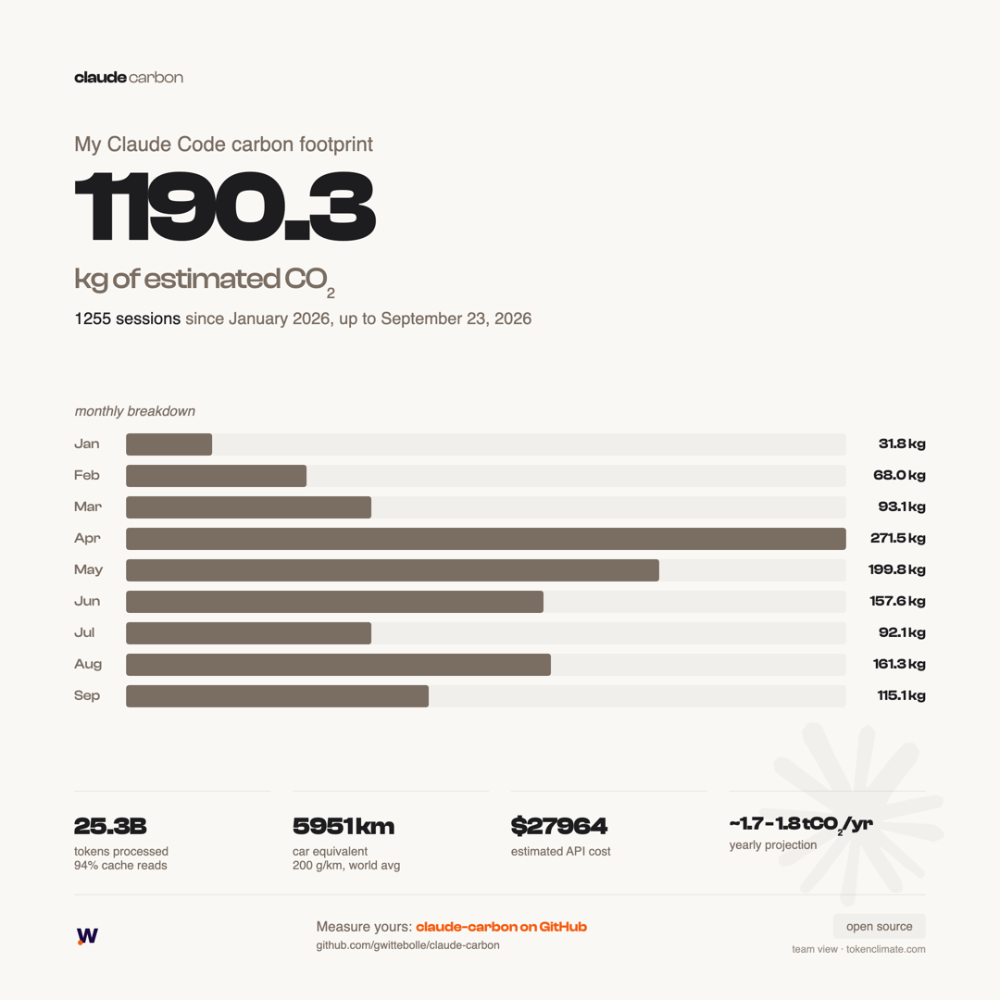
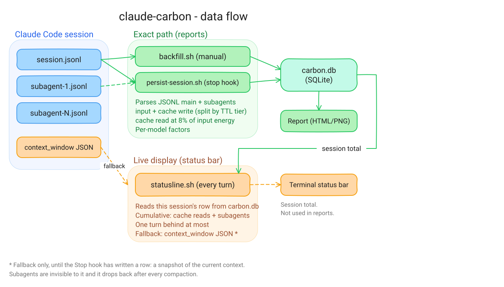

<p></p>

[](https://github.com/gwittebolle/claude-carbon/stargazers)
[](LICENSE)
[](https://github.com/gwittebolle/claude-carbon/releases)
[](https://www.npmjs.com/package/claude-carbon)
[](https://github.com/gwittebolle/claude-carbon/actions/workflows/ci.yml)

claude-carbon es un plugin de Claude Code de código abierto que sigue la huella de carbono de tus sesiones: una estimación de CO2 en directo calculada localmente a partir de tu consumo de tokens, en la línea de estado de la terminal y en la pestaña Code de la app de escritorio de Claude, junto al coste equivalente a API de la sesión. En la app de escritorio, `/carbon-panel` abre un panel con una molécula de píxeles coloreada según el CO2 de esta sesión frente a la mediana de tus sesiones pasadas, tu consumo durante el periodo que elijas, sus franjas de calentamiento y un botón para tu tarjeta anual.

<p align="center"></p>

## Qué hace claude-carbon

- `/carbon-panel`: un panel en la app de escritorio de Claude con tu molécula de CO2, tu consumo y las franjas de calentamiento de tus sesiones (en una terminal, la sesión en la banda sobre el prompt). Consulta [el mod](#the-mod-carbon-panel-and-the-co2-of-each-answer)
- Añade una estimación de CO2 en directo a la línea de estado de Claude Code y el CO2 de la sesión bajo el prompt en la app de escritorio de Claude, cada uno junto al coste equivalente a API de la sesión
- Guarda cada sesión en una base de datos SQLite local, para que el historial sobreviva a la purga de transcripciones de 30 días
- Rellena datos históricos a partir de las transcripciones `~/.claude` existentes
- Comandos de barra: `/carbon-report` (texto), `/carbon-card` (PNG), `/carbon-pr` (huella de un pull request)
- Una insignia para tu README con tu total acumulado y una metodología pública con todos los factores documentados

> **Sobre la cifra en $.** Es un equivalente de API: lo que costaría tu sesión a los precios de lista de pago por uso de la API de Anthropic. En una suscripción Pro, Max o Ultra no lo pagas; muestra el valor de lo que usaste, junto a su CO2. Consulta [Cómo funciona](#how-it-works).

## Instalación

En Claude Code, escribe:

```text
/plugin install claude-carbon@claude-code-mods-es
```

Claude Code te pide confirmar el marketplace, muestra qué instala el plugin y después pregunta dónde instalarlo: elige **Install for you**. La misma línea funciona en macOS, Linux y Windows. En la pestaña **Code** de la app de escritorio de Claude, si la línea no surte efecto, pega en su lugar este mensaje y acepta cuando Claude lo pida:

```text
Install the claude-carbon plugin for me: claude plugin install claude-carbon --marketplace gwittebolle/claude-carbon
```

Después cierra Claude Code por completo, vuelve a abrirlo e inicia una sesión nueva. Ahora tu CO2 aparece junto al coste de la sesión:

- en una terminal, en la línea de estado: `$0.50 · 65gCO₂`
- en la app de escritorio, bajo el prompt: `This session: 3.6 gCO₂ · $0.12`

El plugin configura esa línea de estado una sola vez, en el primer inicio de sesión, y solo cuando no tienes ninguna: la línea de estado de otra herramienta se deja como está (para añadirle el CO2, consulta [ccstatusline](#using-with-ccstatusline)). `/carbon-report` da tus totales y `/carbon-panel` abre el panel en la app de escritorio. El `$` es un coste equivalente a API, no lo que factura tu suscripción. Para actualizar después, ejecuta `/carbon-update`.

<p align="center"></p>

<details>
<summary><b>Si la instalación se detiene</b></summary>

- **macOS abre una ventana sobre «command line developer tools».** Es `git`, que Claude Code necesita para descargar el plugin y que un Mac sin herramientas de desarrollador todavía no tiene. Haz clic en **Install**, espera a que termine (unos minutos) y vuelve a instalar.
- **«jq is not installed» o «sqlite3 is not installed».** Di a Claude: «Install what is missing.» y reinicia Claude Code. Todos los Mac tienen `sqlite3`, y macOS 15 y posteriores también `jq`. En un Mac más antiguo, Claude puede instalar `jq` con Homebrew, o el instalador (en Other ways to install) descarga el `jq` oficial y comprueba su suma de verificación publicada. En Windows, `/carbon-panel` nombra el que falta y Claude puede instalarlo con `winget`. Si `winget` responde «Access is denied», el software de seguridad del PC lo está bloqueando: autoriza `winget` allí y vuelve a intentarlo.
- **Windows dice que falta Git Bash.** Instala [Git for Windows](https://git-scm.com/downloads/win) (Claude Code lo necesita en Windows de todos modos), cierra la app por completo y vuelve a abrirla, e instala de nuevo en una sesión nueva. Claude Code busca Git Bash al iniciar una sesión, así que una sesión abierta durante la instalación de Git sigue funcionando sin él.
- **¿Instalado desde el marketplace de la comunidad de Anthropic y el plugin no se carga?** La entrada `co2-tracker@claude-community` está fijada a una versión de agosto de 2026 que el Claude Code actual rechaza («Duplicate hooks file detected»). Ejecuta `/plugin uninstall co2-tracker@claude-community` y después instala como se indicó arriba.

</details>

<details>
<summary><b>Otras formas de instalar</b></summary>

- **El instalador**, un script que clona este repositorio y lo configura todo en `~/.claude/settings.json`. Pega este mensaje en Claude Code, o ejecuta tú mismo en una terminal el comando tras los dos puntos:

  ```text
  Install claude-carbon for me by running this command:
  curl -fsSL https://raw.githubusercontent.com/gwittebolle/claude-carbon/main/install.sh | bash
  ```

  En Windows, en PowerShell (necesita primero [Git for Windows](https://git-scm.com/downloads/win) y dos paquetes, consulta [Windows](#windows)):

  ```text
  Install claude-carbon for me by running this command in PowerShell:
  irm https://raw.githubusercontent.com/gwittebolle/claude-carbon/main/install.ps1 | iex
  ```

  Si el selector de modo bajo el prompt muestra **Auto**, elige antes **Manual**: el modo automático bloquea un comando que descarga un script y lo ejecuta. Puedes leer [install.sh](install.sh) antes de ejecutarlo.
- **Con Node.js:** `npx claude-carbon` ejecuta el mismo instalador.

Usa una sola forma: el plugin y el instalador juntos ejecutarían cada hook dos veces. ¿Ya instalaste con el instalador? No hay que cambiar nada; `/carbon-update` lo mantiene al día.

</details>

No se cubren: las pestañas de chat y Cowork ni la app web (claude.ai/code). Sus sesiones se ejecutan en los servidores de Anthropic, así que nada llega a tu equipo para contarlo.

## Informe de ejemplo

<p align="center">
  
</p>

Genera la tuya con `/carbon-card` en Claude Code. Las tarjetas PNG de resumen y detalle van a
`~/Downloads/claude-carbon/` (la carpeta Descargas de Windows sigue la configuración del sistema, así que se respeta una redirigida a OneDrive) y la carpeta se abre en tu gestor de archivos, con la tarjeta seleccionada en macOS. `CLAUDE_CARBON_EXPORT_DIR` elige otra carpeta;
`CLAUDE_CARBON_NO_OPEN=1` omite la apertura.

Sin Playwright ni Chromium no hay PNG y el comando termina igualmente: la tarjeta de resumen se guarda como página HTML en la misma carpeta y se abre en el navegador, ajustada a la ventana, y una captura de pantalla sirve.
El recuento de tokens de la tarjeta es cada token que Claude procesó, incluidas las lecturas de caché, tal como las cuenta `ccusage`; la línea gris de debajo indica la proporción de lecturas de caché. El pie de la tarjeta dice dónde encontrar la herramienta, `claude-carbon sur GitHub` / `claude-carbon on GitHub`, con la dirección debajo.

Del 1 al 10 de cada mes, la línea de estado termina con `📊 September: 84.2kgCO₂ · /carbon-card`:
el total del mes recién cerrado, la barra que la tarjeta dibuja para él, en el mismo formato que la cifra de la sesión. Se lee de carbon.db una vez al día mientras aparece el recordatorio y se conserva en
`~/.claude/claude-carbon/last-month-total`. Un mes con menos de 7 días de sesiones no recibe recordatorio, para que una instalación nueva no te empuje a compartir una tarjeta casi vacía. Generar una tarjeta lo borra para ese mes; desaparece por sí solo después del día 10. En diciembre da en cambio el año en curso, `📊 2026: 1444.4kgCO₂ · /carbon-card`, y permanece todo el mes, porque la tarjeta cubre el año natural. Del 1 al 10 de enero da el año recién terminado, y en esos días `/carbon-card` cubre ese año completo, salvo que pases un periodo o que ese año no tenga sesiones (la tarjeta conserva esos diez días aunque el recordatorio esté desactivado). `CLAUDE_CARBON_CARD_NUDGE_UNTIL_DAY`
cambia la fecha de corte (0 elimina el recordatorio, también en diciembre) y `CLAUDE_CARBON_NO_CARD_NUDGE=1` lo elimina. Nada se publica en ningún sitio:
compartir sigue siendo una decisión humana.

<details>
<summary>Opciones avanzadas (CLI)</summary>

```bash
# Desde una fecha concreta
bash ~/code/claude-carbon/scripts/generate-report.sh --since 2026-03-01

# Todo el tiempo
bash ~/code/claude-carbon/scripts/generate-report.sh --all

# Un periodo cerrado (--until es un límite superior exclusivo: este se detiene el 30 de junio)
bash ~/code/claude-carbon/scripts/generate-report.sh --since 2026-01-01 --until 2026-07-01
```

</details>

<details>
<summary>Directorio de instalación personalizado</summary>

```bash
curl -fsSL https://raw.githubusercontent.com/gwittebolle/claude-carbon/main/install.sh | CLAUDE_CARBON_DIR=~/my-path/claude-carbon bash
```

La variable de entorno tiene que estar al lado de `bash` en la tubería, no al de `curl`, o el instalador nunca la ve.

</details>

<details>
<summary>Segundo entorno de Claude (CLAUDE_CONFIG_DIR)</summary>

Si ejecutas un segundo entorno de Claude Code con su propio directorio de configuración, p. ej.

```bash
alias claude-work="CLAUDE_CONFIG_DIR=~/.claude-work claude"
```

instala claude-carbon en ese mismo directorio pasando `CLAUDE_CONFIG_DIR` al instalador:

```bash
curl -fsSL https://raw.githubusercontent.com/gwittebolle/claude-carbon/main/install.sh | CLAUDE_CONFIG_DIR=~/.claude-work bash
```

La línea de estado, los hooks, la base de datos y los comandos `/carbon-*` viven bajo ese directorio de configuración, así que cada entorno sigue sus propias sesiones de forma independiente. Cuando `CLAUDE_CONFIG_DIR` no está definido, todo vuelve a `~/.claude` como antes.

</details>

<details>
<summary>Instalación manual</summary>

```bash
git clone https://github.com/gwittebolle/claude-carbon.git ~/code/claude-carbon
bash ~/code/claude-carbon/scripts/setup.sh
bash ~/code/claude-carbon/scripts/configure-settings.sh
```

El segundo script fusiona el bloque siguiente en `~/.claude/settings.json` (de forma aditiva: una línea de estado existente o hooks de terceros se dejan intactos) y crea enlaces simbólicos a los comandos `/carbon-*`. Para configurarlo a mano, omítelo y añade:

```json
{
  "statusLine": {
    "type": "command",
    "command": "~/code/claude-carbon/scripts/statusline.sh"
  },
  "hooks": {
    "Stop": [
      {
        "matcher": "",
        "hooks": [
          {
            "type": "command",
            "command": "~/code/claude-carbon/scripts/persist-session.sh"
          }
        ]
      }
    ],
    "SessionEnd": [
      {
        "matcher": "",
        "hooks": [
          {
            "type": "command",
            "command": "~/code/claude-carbon/scripts/persist-on-exit.sh"
          }
        ]
      }
    ],
    "SessionStart": [
      {
        "matcher": "",
        "hooks": [
          {
            "type": "command",
            "command": "~/code/claude-carbon/scripts/safety-rescan.sh"
          }
        ]
      }
    ],
    "SubagentStop": [
      {
        "matcher": ".+",
        "hooks": [
          {
            "type": "command",
            "command": "~/code/claude-carbon/scripts/agent-stop.sh"
          }
        ]
      }
    ]
  }
}
```

El hook `Stop` registra la sesión tras cada turno y `SessionEnd` la registra una vez más al cerrarse, para que un último turno interrumpido antes de que se disparara `Stop` también cuente. El de `SessionStart` vuelve a buscar sesiones tanto perdidas (bloqueo, kill) como las que impulsan la comprobación diaria de actualizaciones que lee la línea de estado; sin él nunca te enterarías de que existe una versión nueva. `SubagentStop` registra la rama en la que trabajó un agente, para `/carbon-pr`.

Reinicia Claude Code.

</details>

## Para equipos

claude-carbon mide las sesiones de un desarrollador, en local. Si la pregunta viene de tu CTO, de una RFP de un cliente o de un comité de RSC, la misma metodología existe como capa alojada:

- [Calculadora gratuita](https://tokenclimate.com/en/calculator?ref=github) y [hojas de factores por modelo](https://tokenclimate.com/en/models?ref=github): los mismos factores versionados de este repo, navegables.
- [TokenClimate](https://tokenclimate.com/en?ref=github): paneles de equipo alojados. Ambas partes comparten los vectores dorados de este repo, verificados semanalmente en CI.

El OSS apunta allí desde cinco lugares: un pie de una línea en `/carbon-report`, un pequeño crédito en los PNG de `/carbon-card`, la última línea de un comentario de `/carbon-pr`, el pie del panel `/carbon-panel` y el campo `url` de `CITATION.cff`. Sin promoción en la línea de estado, sin captura de correos: nada sale de tu equipo.

### Huella de desarrollo de un PR (/carbon-pr)

La cifra que los revisores rara vez ven es lo que costó desarrollar el PR: tus sesiones locales de Claude Code mientras construías la rama. `/carbon-pr` (o `scripts/generate-pr-report.sh`) suma las sesiones registradas de la rama actual y publica un comentario fijo en su PR abierto, mediante tu propia autenticación `gh`. Ejecútalo tras tu push; volver a ejecutarlo actualiza el mismo comentario.

```
**Claude Code carbon report** · developing this PR

| CO2e | Cost* | Tokens (in + cache write + out) | Cache reads | Sessions |
|---|---|---|---|---|
| **124 g** | $3.00 | 180k | 1.5M | 2 |
```

Bajo la tabla vienen el equivalente en coche, un detalle de tokens por modelo plegable y un pie de una línea.

Cómo se atribuyen las sesiones: el hook Stop guarda la rama git de cada sesión (leída de la transcripción) y el informe selecciona `proyecto + rama`. Las sesiones registradas antes de que existiera esta columna no tienen rama; `scripts/backfill.sh` las repara mientras sus transcripciones sigan en disco (unos 30 días). Una sesión cuya última carpeta es una subcarpeta del repositorio se guarda bajo el nombre de la subcarpeta y queda fuera de la suma. Una sesión que termina en otra rama distinta de la que empezó se atribuye a donde terminó.

Cómo se atribuyen sus agentes: un agente cuenta con su sesión, salvo que trabajara en una rama propia. Una sesión en `main` que envía agentes a construir un PR en un worktree pone su parte en la rama del PR, y el comentario dice entonces cuántas sesiones registradas en otro lugar incluye. Un hook `SubagentStop` (`agent-stop.sh`) lee la rama al terminar cada agente, mientras su worktree todavía existe:

- un agente que se ejecutó en un worktree propio (agentes aislados y de flujo de trabajo de Claude Code) cuenta en la rama que tenga ese worktree entonces, salvo que Claude Code lo haya nombrado (`worktree-agent-*`, `worktree-wf_*`) o esté desvinculado;
- un agente que se ejecutó en la carpeta de la sesión cuenta en el worktree que sus llamadas a herramienta nombran en al menos la mitad de las que dan un lugar (un comando, una ruta de archivo), y en ningún otro con la misma frecuencia: rutas absolutas, `~/`, `../` desde la carpeta del repositorio cuando el worktree está a su lado, `./` cuando está dentro. Nunca la carpeta principal del repositorio ni la propia de la sesión. Esto es una deducción a partir de los comandos del agente.

El hook guarda los tokens, el CO2 y el coste de ese agente, por modelo, en una tabla `agent_usage`, con el repositorio y la carpeta del worktree; la fila de la sesión no cambia. El informe saca esos agentes de la rama de su sesión y los añade a la suya, siempre que la fila de la sesión contenga a todos sus agentes (`agents_collected = 2`: el hook Stop o el reescaneo leyó cada transcripción de agente), se escribiera después de que el agente terminara (en un segundo posterior) y se registrara con el método actual (no una fila v1). Un agente que trabajó en otro repositorio distinto al de su sesión no se registra, y uno registrado antes de que se moviera su repositorio se queda con su sesión. Las bifurcaciones se dejan fuera (reproducen los mensajes de su padre), y también el trabajo que la sesión hace ella misma en un worktree. Solo se atribuyen los agentes que terminan con esta versión instalada: no se reconstruye nada para sesiones pasadas.

El hook necesita Claude Code 2.1.69 o posterior, la primera que da a `SubagentStop` el tipo del agente (su id y su transcripción llegaron en 2.0.42); con una versión anterior no registra nada. Los propios agentes de Claude Code (sugerencias de solicitudes, `/btw`) se dejan fuera. En una sesión ejecutada sin `--agent` su tipo está vacío: el matcher del hook los omite desde 2.1.275, y el script antes de esa versión. Con `--agent` llevan el nombre de ese agente y pasan el matcher; el script los omite porque su transcripción no es una que lea la fila de la sesión.

El hook se ejecuta de forma síncrona, antes de que el resultado del agente llegue a la sesión: en un Mac, unos 0,1 a 0,3 s para la mayoría de agentes, hasta 1 o 2 s para uno cuya transcripción supera los 100 MB, porque la lee entera. Claude Code escribe las transcripciones de forma asíncrona: cuando el mensaje final del agente todavía no está, el hook lo vuelve a leer cada 0,2 s, durante 1 s como máximo, y después cuenta lo que hay. Una base de datos ocupada más de unos 10 s (una lectura larga en otro sitio) pierde el registro y el agente cuenta con su sesión.

#### Para cada PR de un repositorio

Un repositorio puede pedir el informe en sus pull requests. Sus mantenedores confirman esto en `.claude/settings.json`, un cambio que el equipo revisa como cualquier otro:

```json
{ "env": { "CLAUDE_CARBON_PR": "1" } }
```

Solo con eso no se publica nada. La primera vez que un desarrollador con el plugin abre una pull request allí con Claude Code (`gh pr create`), Claude le pregunta una vez si quiere publicar el informe de sus propias sesiones bajo su propia cuenta de GitHub. Su respuesta se queda en su equipo, por repositorio (`pr-consent.tsv` en la carpeta de datos):

- **sí**: el comentario se publica al terminar esa respuesta y después se actualiza en el sitio tras cada `git push` o `gh pr create` que Claude ejecute allí, una vez registrada la respuesta que envió y mientras la rama enviada siga siendo la que está desplegada. Un push que escribas tú en una terminal no dispara nada. Un comentario por PR, y nunca por sí solo en un PR cuya rama viva en un fork.
- **no**, o sin respuesta: no se publica nada y la pregunta no vuelve. `/carbon-pr` sigue funcionando cuando lo ejecutan.

Cambia tu respuesta desde el repositorio con `scripts/generate-pr-report.sh --consent yes` o `--consent never` (tras un sí escrito en una terminal, el primer comentario llega con tu próximo push o `gh pr create` en Claude Code); un sí solo se acepta una vez que te hicieron la pregunta allí, lo que cubre también una pregunta que no apareció porque se interrumpió el turno. La respuesta se guarda bajo la URL `origin` del repositorio (sin credenciales): renombra el remoto y la pregunta vuelve una vez. Un repositorio no puede responder por ti: las respuestas nunca se leen de una carpeta de configuración ni de una base de datos dentro del repositorio, y el comentario publicado por sí solo va solo al repositorio que nombra `origin`, diga lo que diga `GH_REPO`. `CLAUDE_CARBON_NO_PR_AUTO=1` en tu propio entorno desactiva la pregunta y la publicación en todas partes. Para detenerlo en el repositorio, quita la línea `CLAUDE_CARBON_PR`. Necesita los hooks del plugin (una instalación desde marketplace): un clon instalado solo con el instalador no recibe la pregunta y no publica nada por sí solo. Está pensado para el repositorio de un equipo; en un proyecto público, los colaboradores de fuera verían comentarios que no pidieron.

#### El total del repositorio

`scripts/generate-pr-report.sh --summary` vuelve a leer, mediante `gh`, los informes ya publicados en los pull requests fusionados del repositorio y los totaliza por mes de fusión y por autor. `--since 2026-10-01` lo acota. Lo imprime solo en tu terminal, no publica nada ni lee tu base de datos: las cifras son las que publicó cada autor.

```
Month merged             PRs  Sessions       CO2e       Cost
2026-09                    2         4     1.8 kg     $57.26
2026-10                    1         1       69 g      $1.92

Author                   PRs  Sessions       CO2e       Cost
alice                      2         2      644 g     $19.18
bob-dev                    1         3     1.2 kg     $40.00

Total: 3 PRs, 5 sessions, 1.8 kg CO2e, $59.18 at API list price.
```

Un comentario en el formato antiguo de una línea, o editado a mano, se cuenta como ilegible y se deja fuera. Cubre los pull requests que llevan un informe, no toda la huella del repositorio, y lee como máximo 100 a la vez.

Fuera de ese tipo de repositorio, la opción por defecto es no publicar: nada se publica salvo que lo ejecutes. `--dry-run` previsualiza el comentario, `--pr <número>` apunta a un PR concreto del repositorio (uno abierto desde un fork se rechaza: ejecuta el comando desde el clon del fork) y borrar el comentario en GitHub es la limpieza completa. Una vez registrados los agentes del repositorio, el informe cuenta, desde cualquier carpeta en que se ejecute, las sesiones de la carpeta principal del repositorio, del worktree en que está desplegada la rama y de los worktrees en que trabajaron sus agentes, aunque se hayan eliminado. Una rama desplegada en ningún sitio cuyo nombre también lleven sesiones de otras carpetas se rechaza: no se publica nada antes que una cifra que podría omitirlas.

## Cómo funciona



**Tres rutas de datos, dos niveles de precisión:**

| Script               | Disparador                 | Fuente de datos       | Subagentes    | Lecturas de caché         | Precisión       |
| -------------------- | -------------------------- | --------------------- | ------------- | ------------------------- | --------------- |
| `backfill.sh`        | Manual / configuración     | Archivos JSONL        | Incluidos     | Contadas (8 % de energía) | Mejor estimación |
| `persist-session.sh` | Hooks Stop + SessionEnd    | Archivos JSONL        | Incluidos     | Contadas (8 % de energía) | Mejor estimación |
| `statusline.sh`      | Cada turno (en directo)    | Fila de `carbon.db`  | Incluidos     | Contadas (8 % de energía) | Un turno de retraso |

**backfill** y **persist-session** analizan las transcripciones JSONL en bruto (sesión principal, archivos de subagentes y las transcripciones de los agentes que inicia un flujo de trabajo), aplicando factores de emisión por modelo. Deduplican los mensajes del asistente por `(message.id, requestId)`, para que las sesiones reanudadas y compactadas no se cuenten dos veces (esto coincide con `ccusage`; sin ello la suma de tokens se infla unas 3 veces). Cada sesión guarda su desglose bruto de tokens (entrada, escritura de caché, lectura de caché, salida), que alimenta la base de datos SQLite usada por los informes.

La transcripción de un agente deja de cambiar cuando este termina, así que sus totales se conservan en `~/.claude/claude-carbon/usage-cache/` (un archivo pequeño por sesión, eliminado por el reescaneo diario 45 días después de su última escritura) y solo se vuelven a leer cuando cambian el tamaño, la modificación, el momento de cambio o el inode del archivo (el archivo al que apunta un enlace simbólico). Un agente con una línea que aún no se analiza, cortada por una escritura en curso, nunca se conserva. La transcripción principal siempre se lee completa. `CLAUDE_CARBON_NO_USAGE_CACHE=1` lee todo cada vez y no escribe caché.

**El coste** es el valor teórico de lista de API (pago por uso), no el precio de tu suscripción: entrada, salida, escritura de caché y lectura de caché (0,1x entrada) a las tarifas actuales de Anthropic, definidas en `data/prices.json`. Las escrituras de caché se facturan por nivel de TTL, 1,25x entrada para el nivel de 5 minutos y 2x para el de 1 hora; el desglose de cada sesión se lee de su transcripción en lugar de suponerse (Claude Code escribe en el nivel de 1 hora). Sobre datos deduplicados coincide con `ccusage`.

**statusline** lee la fila de esta sesión de `carbon.db` en cada turno, así que el CO2 que muestra es el total de la sesión con la misma base que los informes, con un turno de retraso como máximo. Antes de que exista esa fila (primer turno, o sin base de datos todavía), recurre a una estimación a partir de `context_window.total_input_tokens`, que es el tamaño del contexto actual y no un total acumulado: los subagentes son invisibles para ella y cada compactación la reduce. De todos modos, la línea de estado muestra, nunca alimenta los informes.

### La línea de estado

Segmentos, de izquierda a derecha: proyecto + rama git, modelo + % de ventana de contexto, coste equivalente a API de la sesión + CO2, % de cuota de suscripción + hora de reinicio. La cuota es la ventana de 5 horas, o la semanal cuando no hay ninguna ventana de 5 horas abierta (siempre, en una cuenta Ultra verificada; en Pro y Max, entre el reinicio de una ventana de 5 horas y tu siguiente solicitud): `Use 41% 7d ↻Thu`, el reinicio como día de la semana cuando falta más de un día. Aparece un prefijo 🔥 cuando la tasa de consumo sostenida superaría el 100 % del límite al final de la ventana (a partir del 15 % de uso, tras una gracia de 15 minutos para la ventana de 5 horas y de un día para la semanal).

> **Dónde aparece el CO2.** La línea de estado es una función de la interfaz de terminal de Claude Code. Solo se muestra cuando ejecutas `claude` en una terminal, incluidas las terminales integradas de VS Code o JetBrains. El panel de chat de las extensiones de IDE no tiene línea de estado, así que allí no se muestra nada aunque los hooks sigan ejecutándose y tus sesiones se registren: `/carbon-report` las cubre. Si usas el panel de VS Code y quieres el CO2 en directo, abre una terminal en VS Code (`` Ctrl+` ``) y ejecuta `claude` desde allí. La app web (claude.ai/code) no ejecuta ni la línea de estado ni los hooks, así que allí no se muestra ni se registra nada. La app de escritorio tampoco muestra la línea de estado; el [mod](#the-mod-carbon-panel-and-the-co2-of-each-answer) del plugin dibuja el CO2 en su pestaña Code.

**Fuente de la cuota.** El porcentaje es el propio de Anthropic, los mismos datos que Claude Code muestra en `/usage`. Sin heurística ni archivo de límite de tokens que sembrar. Dos fuentes, en orden:

1. **stdin** (preferido): los `rate_limits` que Claude Code pasa en el JSON de la línea de estado, primero `five_hour` y si no `seven_day`. Cuando `rate_limits` está presente, una ventana que omita no existe y no se pregunta nada más.
2. **Respaldo de la API OAuth**, solo cuando stdin no tiene `rate_limits` (antes de la primera respuesta de la sesión, o con un Claude Code más antiguo): `GET https://api.anthropic.com/api/oauth/usage` con el token bearer del llavero de macOS, `CLAUDE_CODE_OAUTH_TOKEN` o `~/.claude/.credentials.json`, como máximo una vez por ministro tanto si responde como si no. La respuesta se guarda en caché en `~/.claude/claude-carbon/oauth-usage.json`; una ventana sin hora de reinicio, o cuyo reinicio ya pasó, se deja fuera.

Preciso en Pro, Max y Ultra.

### Sobrevivir a la purga de transcripciones de 30 días

Claude Code elimina las transcripciones JSONL después de unos 30 días, así que la base de datos SQLite es el registro duradero. Los hooks `Stop` y `SessionEnd` capturan cada sesión antes de que su transcripción envejezca, y un reescaneo en segundo plano una vez al día (hook `SessionStart`, `safety-rescan.sh`) recoge cualquier sesión que hayan perdido mientras su transcripción siga existiendo, incluida una cuya transcripción siguió creciendo después de escribirse su fila. Como cada fila guarda recuentos brutos de tokens, `recompute.sh` regenera el coste y el CO2 a partir de `data/factors.json` + `data/prices.json` en cualquier momento, sin necesidad de transcripciones. Cuando Anthropic cambia un precio o se revisa un factor, edita la configuración y ejecuta:

```bash
bash scripts/recompute.sh
```

Las sesiones registradas desde septiembre de 2026 se derivan modelo por modelo, exactamente. Las sesiones antiguas sin desglose por modelo conservan sus valores guardados; `--include-unsplit` las vuelve a derivar con su modelo dominante, una aproximación (consulta METHODOLOGY.md, «Surviving the 30-day transcript purge»).

## Comandos

| Comando          | Qué hace                                        |
| ---------------- | ----------------------------------------------- |
| `/carbon-report` | Informe de texto con totales, equivalente en coche, parte de un presupuesto de 2 t y mejores sesiones |
| `/carbon-card`   | Genera tarjetas PNG compartibles                 |
| `/carbon-badge`  | Insignia shields.io de tu huella total para tus README |
| `/carbon-pr`     | Publica la huella de desarrollo de la rama actual en su PR |
| `/carbon-update` | Actualiza a la última versión, sea cual sea tu forma de instalación |

<details>
<summary>Scripts (se ejecutan automáticamente, rara vez se necesitan a mano)</summary>

| Script               | Qué hace                                                                              |
| -------------------- | ------------------------------------------------------------------------------------- |
| `setup.sh`           | Inicia la base de datos, rellena sesiones históricas, muestra el total                  |
| `statusline.sh`      | Script de la línea de estado (lo llama Claude Code automáticamente)                   |
| `persist-session.sh` | Hook Stop (guarda datos de la sesión tras cada turno)                                 |
| `persist-on-exit.sh` | Hook SessionEnd (guarda la sesión una vez más al cerrarse, en segundo plano)             |
| `safety-rescan.sh`   | Hook SessionStart (reescaneo limitado en segundo plano, recoge sesiones perdidas)        |
| `agent-stop.sh`      | Hook SubagentStop (la rama en que trabajó un agente, para `/carbon-pr`)                       |
| `backfill.sh`        | Vuelve a analizar todas las transcripciones JSONL históricas (incl. subagentes)               |
| `recompute.sh`       | Deriva de nuevo coste/CO2 a partir de tokens guardados tras un cambio de precio/factor (sin transcripciones) |
| `generate-report.sh` | Exporta tarjetas PNG (CLI, con `--since` / `--until` / `--all`)                                   |
| `generate-badge.sh`  | Imprime el markdown + URL de la insignia shields.io (CLI)                                           |
| `generate-pr-report.sh` | Publica la huella de desarrollo de la rama en su PR (CLI, `--dry-run` / `--pr`)                  |

Nota: backfill ahora deriva los nombres de proyecto del `cwd` de la transcripción (coincidiendo con el hook en directo). Las sesiones rellenadas antes de este cambio conservan sus nombres antiguos, quizá truncados; elimina esas filas y vuelve a ejecutar `backfill.sh` para normalizarlos.

</details>

## Insignia

`/carbon-badge` imprime una insignia shields.io lista para pegar con tu huella total medida y el mes en que se tomó, con enlace a la metodología:

[](https://github.com/gwittebolle/claude-carbon/blob/main/METHODOLOGY.md)

<sub>Esa insignia es real, no una maqueta: el total del propio autor, 1.208 sesiones medidas entre el 15 de enero de 2026 y el 16 de septiembre de 2026. Es la huella de un desarrollador, no del proyecto.</sub>

```markdown
[](https://github.com/gwittebolle/claude-carbon/blob/main/METHODOLOGY.md)
```

La insignia es una imagen estática construida a partir de tu base de datos local, así que la cifra está medida, no estimada al vuelo, y no se envía nada a ningún sitio. El mes en el mensaje dice qué antigüedad tiene la cifra; vuelve a ejecutar `/carbon-badge` cuando quieras actualizar ambas.

Es el total de un desarrollador, así que su lugar es el README de tu perfil o un proyecto personal. En un repositorio de equipo u organización, los revisores preguntarán qué produjo la cifra y por qué enlaza fuera de la organización, y harán bien en preguntar.

Los números siguen la configuración regional del informe (`fr` imprime `12,4 kg`, `us` y el valor mundial por defecto imprimen `12.4 kg`); `CLAUDE_CARBON_LOCALE` fuerza una.

## El mod: /carbon-panel y el CO2 de cada respuesta

El plugin claude-carbon incluye también un [mod de Claude Code](https://code.claude.com/docs/en/plugins/mods/overview) que muestra el CO2 de cada respuesta cuando termina, calculado localmente con la misma fórmula y factores que la línea de estado, y el total de la sesión con su coste a precios de API.

- **Terminal**, incluida la terminal integrada de un editor y el plugin de JetBrains: al final derecho de la línea que cierra cada respuesta, `✻ Worked for 38s · done 10:32 PM          16 gCO₂`. Una línea conserva la cifra de su propia respuesta cuando se vuelve a dibujar (un redimensionamiento, un desplazamiento, ctrl+o); una línea que se dibuja por primera vez más tarde, como una que solo muestra ctrl+o, no recibe cifra.
- **App de escritorio, pestaña Code**: una línea bajo la respuesta, solo para una respuesta inhabitual.
- **Una respuesta inhabitual** muestra la ratio y la parte de los subagentes cuando influyeron en ella: `230 gCO₂ · 14× your median`. Una respuesta es inhabitual cuando supera el percentil 97 de tus últimas 200 respuestas, más de 3 veces su mediana y al menos 10 g, lo que equivale aproximadamente a una respuesta de cada 27; no se marca ninguna antes de registrar 50 respuestas.
- **El total de la sesión** está fijo bajo el prompt, CO2 y coste a precios de API: `This session: 142 gCO₂ · $3.41`, en francés `Cette session : 142 gCO₂ · 3,41 $`. Se muestra salvo que la línea de estado de claude-carbon ya lo dé o la opción `showSessionTotal` esté desactivada (ambas solo en terminal, consulta [ccstatusline](#using-with-ccstatusline)). El coste es el precio de lista de pago por uso de API de las mismas peticiones que el CO2, de `data/prices.json` con la fórmula de `/carbon-report`, con escrituras de caché en el nivel de 1 hora que usa Claude Code; por debajo de un centavo indica `< $0.01`, y se deja fuera cuando no se puede leer la lista de precios, y hasta que el total empiece de nuevo, para que el coste nunca cubra solo parte de las peticiones. Es lo que costaría el consumo en la API, no lo que factura una suscripción. En una suscripción, la entrada termina con la cuota tal como muestra la línea de estado, `Use 23% ↻14:00` (`Usage 23 % ↻14:00`): la parte de la ventana de 5 horas usada y la hora local de reinicio, o sin ventana de 5 horas la semanal, `Use 41% 7d ↻Sat` (`Usage 41 % 7j ↻sam.`), leído del propio Claude Code tras cada respuesta, sin llamada de red. Después vienen las dos pistas de la línea de estado: `⬆ 1.18.0 /carbon-update` cuando hay una versión newer, y del 1 al 10 del mes el mes recién cerrado con su total, `📊 September: 84.2 kgCO₂ · /carbon-card`, hasta que hagas la tarjeta. Los subagentes en segundo plano, que es como Claude Code inicia la mayoría, cuentan solo en el total de la sesión: nunca en una respuesta ni en tu mediana. Un subagente en primer plano cuenta en la respuesta que lo inició, no en la siguiente.
- **`/carbon-panel` abre un panel** con la mascota, una molécula de CO2 de píxeles. Su color compara esta sesión con la mediana de tus sesiones pasadas, del azul oscuro (menos de una octava parte de ella) al rojo oscuro (más de ocho veces). Hasta registrar 10 sesiones compara con una referencia inicial de 0,5 kgCO₂, para que tenga color desde la primera respuesta. Salta un píxel arriba y abajo mientras Claude trabaja, más rápido cuanto más rojo se pone, y hace caras: mira alrededor antes de la primera respuesta, parpadea y mira de lado mientras trabaja, sonríe en una sesión ligera y suda en una pesada, reacciona a cada respuesta, guiña el ojo en reposo y se duerme tras cinco minutos sin turno.

  <p align="center"></p>

  - **En la app de escritorio** el panel se abre a la derecha, con su pestaña titulada «claude-carbon», en dos bloques. Bajo la molécula, la escala de color, los ocho colores del azul al rojo, con un marcador bajo el de esta sesión. *Esta sesión*: su CO2, respuestas, subagentes y modelo, el llenado de su ventana de contexto y su valor a precios de API, y una molécula pequeña por subagente, coloreada según su propio CO2. *Mi consumo*: el periodo que elijas (últimos 7 o 30 días, 12 meses, todo, o dos fechas que escribas, `01/05/2026`), sus cifras en mosaicos (CO2 tal como lo suman los informes, cambio respecto al mismo tiempo anterior, sesiones, valor a precios de API, equivalente en coche) y después las franjas de calentamiento de ese periodo, una franja por día, semana o mes según su longitud, cada una coloreada frente a la mediana de los periodos mostrados. La franja bajo el puntero se ilumina y su fecha, total y sesiones aparecen bajo las franjas. Un mosaico con una (i) muestra su nota al hacer clic en la (i), y la oculta en un segundo clic: el valor a precios de API es lo que costaría este consumo facturado a través de la API, y una suscripción Pro, Max o Ultra cubre parte o todo (no se registra qué sesión se facturó cómo, así que el panel nunca dice qué pagaste). Un engranaje junto a «Mi consumo» activa o desactiva el cambio, el valor a precios de API, el coche, el desglose por proyecto (desactivado hasta que lo actives, cada carpeta con su parte y kgCO2) y el detalle; el panel conserva tus elecciones para la siguiente sesión. El detalle (desactivado hasta que lo actives) divide el periodo por tipo de token: entrada sin caché, escrituras de caché, lecturas de caché y salida; dos barras coloreadas dan la parte de cada tipo en los tokens y en el CO2 (la parte bajo el puntero se ilumina y sus cifras aparecen bajo la barra) y después una línea por tipo con sus tokens, energía y CO2 con sus partes. El CO2 de cada sesión es el guardado, repartido con los pesos que los factores dan a cada tipo (lecturas de caché 0,08 de un token de entrada, salida unas 21 veces uno), de modo que las partes suman lo guardado; una sesión guardada con factores antiguos (anteriores a julio de 2026), cuyo CO2 ya no coincide con sus tokens, se deja fuera y el bloque dice sobre cuántas sesiones reparte; la energía es la que los factores toman como punto de partida (energía por token, con PUE incluido, convertida a CO2 con la red us-east de AWS a 287 gCO2/kWh), recuperada dividiendo ese CO2 por la misma intensidad. Necesita los tokens por tipo en `sessions-history.tsv`, que los hooks escriben desde esta versión: tras una actualización, el detalle aparece desde la siguiente respuesta. Un botón «Get my 2026 card» pone `/carbon-card` en un prompt vacío para que lo envíes (la tarjeta cubre el año natural en curso, sea cual sea el rango que muestre el panel); nunca lo envía y deja intacto un borrador que hayas empezado. Unas líneas cortas al pie enlazan este repositorio, el perfil de LinkedIn del autor y TokenClimate, la versión empresarial.
  - **En la terminal**, `/carbon-panel` escrito en el prompt muestra esta sesión en la banda justo encima, tanto en el renderizado clásico como en el de pantalla completa (enviado desde la app de escritorio o un teléfono a una sesión que se ejecuta en una terminal, mediante Remote Control, abre en su lugar el panel lateral allí): una molécula pequeña de 13 columnas por 4 filas en bloques medios, y junto a ella el CO2 de la sesión, respuestas, subagentes (un punto cada uno, en su color), modelo, ventana de contexto y valor a precios de API. El periodo y las franjas viven en la app de escritorio.
  - Ejecuta `/carbon-panel` de nuevo para cerrar el panel o limpiar la banda. El comando también es un skill del plugin, así que la app de escritorio lo enumera; donde el mod no se ejecuta (panel de chat de VS Code, sesión en la nube) solo indica dónde se abre el panel.
- **El historial de las franjas** es `sessions-history.tsv`, que el hook Stop escribe junto a `carbon.db` tras cada respuesta, solo lectura sobre la base de datos. En él está cada sesión registrada, las filas antiguas tal como se guardaron (conservan los factores de su época y nunca se recalculan), así que las franjas, la mediana y los totales cuentan lo que cuenta `/carbon-report`. Otra sesión que se ejecute al mismo tiempo cuenta con su total hasta ese momento. Sin base de datos todavía (antes del primer inicio de sesión de un plugin instalado por separado, o sin `jq` ni `sqlite3`), el panel muestra la molécula y dice qué espera el historial.

Claude Code dibuja los mods en la terminal y en la pestaña Code de la app de escritorio solamente: no aparece nada en el panel de chat de la extensión de VS Code, en sesiones en la nube ni con `claude -p`. Los mods necesitan Claude Code 2.1.287 o posterior (2.1.286 en la app de escritorio).

El mod viene con el plugin. Ya instalado desde el marketplace: ejecuta `/plugin marketplace update claude-carbon` y `/plugin update claude-carbon@claude-carbon`, y reinicia Claude Code.

El plugin solo registra tus sesiones y configura la línea de estado de la terminal cuando no tienes ninguna (consulta [Instalación](#install)):

```
/plugin install claude-carbon@claude-code-mods-es
```

En el primer inicio de sesión tras la instalación, el plugin crea su base de datos en `~/.claude/claude-carbon/` y la rellena con las sesiones cuyas transcripciones siguen en disco (unos últimos 30 días, todos los proyectos), y después registra cada sesión a medida que avanza. Un mensaje único lo indica en uno de los siguientes inicios de sesión. Necesita `jq` y `sqlite3`: si falta uno no se crea nada y `/carbon-panel` lo nombra. Esto ocurre una vez: una base de datos que borres no se restaura (elimina el archivo `auto-setup` junto a ella para pedir una nueva), una ruta de base de datos definida con `CLAUDE_CARBON_DB` nunca se crea por ti, y `CLAUDE_CARBON_NO_AUTOSETUP=1` lo desactiva. A partir de entonces, la comprobación diaria en segundo plano de versiones nuevas se ejecuta como con el instalador (`CLAUDE_CARBON_NO_UPDATE_NOTIFIER=1` para no participar).

#### En un repositorio de equipo

Para ofrecer el plugin a todos los que trabajan en un repositorio, confirma esto en su `.claude/settings.json`:

```json
{
  "extraKnownMarketplaces": {
    "claude-carbon": { "source": { "source": "github", "repo": "gwittebolle/claude-carbon" } }
  },
  "enabledPlugins": { "claude-carbon@claude-carbon": true }
}
```

Activarlo en el repositorio no lo descarga en el equipo de nadie, porque el plugin viene de un marketplace remoto: cada colaborador ejecuta una vez `claude plugin install claude-carbon@claude-carbon --scope project` en su clon, tras confiar en la carpeta. Quien no lo quiera pone `"claude-carbon@claude-carbon": false` bajo `enabledPlugins` en su propio `.claude/settings.local.json`. Las cifras de cada persona permanecen en su equipo.

Los instaladores curl, PowerShell y npm configuran la línea de estado, la base de datos y los hooks, y copian solo el mod a `~/.claude/skills/claude-carbon/`, que Claude Code carga como `claude-carbon@skills-dir`. `/carbon-update` mantiene esa copia al día. La copia no contiene ningún hook, así que nada se ejecuta dos veces. Reinicia Claude Code tras la instalación; el mod se carga cuando la carpeta que abres sea de confianza. Su mediana arranca de cero: las respuestas registradas por otra instalación del mod no se trasladan. Con esta copia, el mod aparece en la terminal, en la terminal integrada del editor y en la pestaña Code de la app de escritorio.

Para desactivarlo, ejecuta `claude plugin disable claude-carbon@skills-dir`. Para quitarlo, ejecuta el instalador con `CLAUDE_CARBON_NO_MOD=1` al lado de `bash` (`curl … | CLAUDE_CARBON_NO_MOD=1 bash`); mantén la variable definida, en tu shell o en el bloque `env` de `settings.json`, o el próximo `/carbon-update` lo volverá a poner. El instalador deja intacta una carpeta `skills/claude-carbon/` que no haya creado y omite la copia mientras el plugin claude-carbon esté activado. Elige uno de los dos: el plugin añadido encima de un instalador ejecuta los hooks dos veces.

Desactiva la cifra por respuesta con la opción `showPerTurn` en `/config`. El mod no escribe base de datos, no inicia procesos, no hace llamadas de red y nunca cambia lo que hace Claude; aparte de sus propios archivos de datos, solo lee `sessions-history.tsv`, las dos banderas de versión de la comprobación diaria (`plugin-update-check.json`, `update-check.json`), `last-card-month` y los dos archivos que deja el hook SessionStart cuando no encuentra base de datos (`setup-needed`, `auto-setup`). El texto está en francés cuando el primero de `CLAUDE_CARBON_LOCALE`, `LC_ALL`, `LC_MESSAGES` y `LANG` que esté definido empieza por `fr`, y en inglés en caso contrario. Cuando ninguno está definido, como en la app de escritorio y a menudo en Windows, decide el ajuste `language` (`Français`, `English`), y después el francés.

Las pruebas propias del mod se ejecutan con `bash tests/run-mod-kit.sh`, bajo `claude plugin test`, que simula el motor: no hace falta inicio de sesión. CI las ejecuta en cada push con Claude Code 2.1.296.

## Uso con ccstatusline

Claude Code acepta un solo comando `statusLine`, así que la línea de estado completa de claude-carbon y [ccstatusline](https://github.com/sirmalloc/ccstatusline) no pueden ejecutarse a la vez. Si ccstatusline controla tu línea de estado, integra en su lugar el segmento de CO2: en la TUI de ccstatusline, añade un widget `Custom Command` que apunte a

```
~/code/claude-carbon/scripts/statusline.sh --segment
```

(ajusta la ruta si instalaste con `CLAUDE_CARBON_DIR`). El widget recibe el mismo JSON de estado en stdin e imprime solo el par coste + CO2, p. ej. `$0.68 · 35gCO₂`. El modo segmento nunca toca la red. El registro en la base de datos local no se ve afectado de ninguna forma: la persistencia la hacen los hooks, no la línea de estado.

Con el segmento en ccstatusline, la entrada de sesión del [mod](#the-mod-carbon-panel-and-the-co2-of-each-answer) bajo el prompt muestra el total por segunda vez. Desactívala con la opción `showSessionTotal` en `/config`; la app de escritorio, que no tiene línea de estado, la conserva.

## Factores de emisión

Factores de [Jegham et al. 2025](https://arxiv.org/abs/2505.09598), un preprint de arXiv que estima el consumo de energía de la inferencia de LLM en infraestructura de AWS a partir de datos públicos de rendimiento de API (latencia, rendimiento) sobre configuraciones de hardware inferidas.

| Modelo  | Primera lectura (entrada, escritura de caché) | Relectura (lectura de caché) | Escritura (salida) | Base                       |
| ------- | --------------------------------------------- | --------------------------- | ------------------ | -------------------------- |
| Fable  | 156                                          | 12,5                        | 3304               | Extrapolado (2x Opus)      |
| Opus   | 78                                           | 6,2                         | 1652               | Extrapolado (2x Sonnet)    |
| Sonnet | 39                                           | 3,1                        | 826                | Ajuste de 3 puntos (Jegham v6) |
| Haiku  | 10                                           | 0,8                         | 207                | Extrapolado (0,25x Sonnet) |

En gCO2e por millón de tokens. En una sesión de Claude Code, alrededor del 98 % de los tokens son contexto que Claude vuelve a leer en cada paso. Cada uno pesa poco, pero juntos suponen cerca del 60 % del CO2; el texto que escribe Claude es menos del 1 % de los tokens y alrededor del 30 % del CO2 (30 días de sesiones del autor, octubre de 2026).

**Importante: son estimaciones de orden de magnitud, no mediciones precisas.**

- Los factores de Sonnet son un ajuste de mínimos cuadrados de 3 puntos a las tres energías por consulta de Claude 3.7 Sonnet estimadas en Jegham et al. v6 (0,950 / 2,989 / 5,671 Wh), que da una ratio salida:entrada de ~21:1; estimaciones públicas independientes caen en el mismo orden de magnitud. Fable, Opus y Haiku se extrapolan (Anthropic no publica datos de consumo energético por modelo): Opus = 2x Sonnet (banda honesta 2x–5x), Haiku = 0,25x, Fable = 2x Opus. Consulta [METHODOLOGY.md](METHODOLOGY.md).
- Las sesiones ejecutadas en modelos no Anthropic (p. ej. modelos locales tras `ANTHROPIC_BASE_URL`) se guardan con sus tokens brutos pero coste/CO2 cero y se excluyen de los informes - un factor de centro de datos no les aplica. Añade patrones a `exclude_models` en `data/factors.json` para excluir más modelos por nombre.
- Los tokens de lectura de caché se cuentan con un factor reducido (0,08 de un token de entrada por defecto, definido en `data/factors.json`). Un token en caché se salta la mayor parte del cómputo de prellenado; el factor es el residuo. Es una estimación de ingeniería derivada de la literatura, no la ratio de facturación 0,1x de Anthropic. La relectura de la caché en la fase de decodificación crece con la longitud del contexto x los tokens generados y aún no se modela; cada sesión guarda ese producto (`output_context_sum`) para poder aplicar después un término calibrado al historial. Consulta [METHODOLOGY.md](METHODOLOGY.md).
- Revisado frente a la literatura de abril a septiembre de 2026 (artículos de medición, divulgaciones de proveedores, el marco Watershed) con una ejecución de sensibilidad sobre 30 días de transcripciones reales: ningún factor se movió, la cifra mostrada tiene más probabilidad de ser baja que alta, próxima revisión marzo de 2027. Consulta [Dónde se sitúa la estimación](METHODOLOGY.md#where-the-estimate-stands-september-2026).
- La intensidad de carbono usa la red de la región AWS (basada en ubicación, 0,287 kgCO2e/kWh), no datos de red en tiempo real. Se sitúa en el extremo bajo del rango basado en ubicación; la media nacional de EE. UU. es de ~380 g/kWh.
- Anthropic no publica emisiones de Alcance 1, 2 ni 3. Estas estimaciones son independientes y se basan en investigación académica, no en datos del proveedor.

El equivalente en coche de los informes y las tarjetas sigue tu configuración regional, porque un km en coche emite hasta ~1,7 veces más en un país que en otro: 142 gCO2e/km de ADEME en una configuración francesa o no detectada, 393 gCO2e/milla de la EPA en una estadounidense, y una media mundial de 200 gCO2/km en los demás casos. Fuerza una con `CLAUDE_CARBON_LOCALE` (`fr`, `us`, `world`, o cualquier cadena de configuración regional). Los factores están en `data/factors.json` bajo `equivalences`.

`/carbon-report` da también el total de este año natural como parte de 2 tCO2e, el objetivo per cápita de 2050 para una huella completa (ADEME, [Nos Gestes Climat](https://nosgestesclimat.fr/blog/environnement/reduire-empreinte-carbone-objectif-deux-tonnes), a partir de los escenarios del IPCC de 1,5 °C; también Carbone 4, *Faire sa part ?*, 2019). Está ahí como referencia: las 2 t cubren todo lo que una persona emite en un año, IA incluida. Fuentes y salvedades: [METHODOLOGY.md](METHODOLOGY.md#annual-budget-line).

Los factores se pueden editar en `data/factors.json`. Consulta [METHODOLOGY.md](METHODOLOGY.md) para la base científica completa, la fórmula y las equivalencias.

### Vectores dorados

La metodología está fijada por vectores de prueba dorados en [`tests/methodology-vectors.json`](tests/methodology-vectors.json): valores esperados de CO2/coste calculados a mano para desgloses de tokens conocidos, que `bash tests/run-vectors.sh` reproduce en CI en cada push. Los consumidores posteriores (como TokenClimate) conservan una copia de este archivo y verifican semanalmente que su implementación produce las mismas cifras. Si editas `data/factors.json` o `data/prices.json`, actualiza los vectores en el mismo commit, o CI fallará.

## Actualización

Cuando hay una versión más nueva, la línea de estado muestra una pista discreta `⬆ /carbon-update`. La comprobación se ejecuta en segundo plano (como máximo una vez al día, nunca en la ruta crítica de la línea de estado); no participes con `CLAUDE_CARBON_NO_UPDATE_NOTIFIER=1`.

- **En una terminal con instalación por clon git**, esa pista aparece al final de la línea de estado, nombrando la versión nueva.
- **En todos los lugares donde se ejecuta el mod** (la app de escritorio y una terminal sin la línea de estado de claude-carbon), la misma pista cierra la entrada de sesión bajo el prompt, y el panel `/carbon-panel` nombra la versión arriba de su pie. En una instalación de plugin, esa misma comprobación diaria en segundo plano pregunta a GitHub solo por las etiquetas de versión y nunca toca la caché de plugins de Claude Code.
- **¿Instalado antes del verano de 2026** (versión 1.0, sin ninguna pista)? Ejecuta de nuevo la instalación, desde la app o la terminal, como en [Instalación](#install).

Para actualizar, ejecuta `/carbon-update` en Claude Code, sea cual sea tu forma de instalación: con el plugin ejecuta `claude plugin marketplace update claude-carbon` y `claude plugin update claude-carbon@claude-carbon`, y con el clon del instalador su propio actualizador. Reinicia Claude Code después. Con ambas instalaciones, como cuando la línea de estado se ejecuta desde un clon, solo se actualiza el plugin y el comando da el `git pull` para el clon. También puedes volver a ejecutar el instalador:

```bash
curl -fsSL https://raw.githubusercontent.com/gwittebolle/claude-carbon/main/install.sh | bash
```

- Actualizar el clon de un instalador vuelve a calcular el precio de tu historial guardado con los nuevos factores automáticamente (solo CO2; las cifras de coste se dejan intactas); actualizar el plugin no lo hace. Ejecuta `scripts/recompute.sh --with-cost` tú mismo solo tras un cambio de precios.
- Si editaste `data/factors.json` o `data/prices.json` localmente, la actualización conserva tus cambios; ante un conflicto con upstream guarda los tuyos en `*.local.bak` y te lo dice.
- La actualización también refresca la copia del [mod](#the-mod-carbon-panel-and-the-co2-of-each-answer). Cuando pida un reinicio (en Windows, una copia en uso no se puede reemplazar), reinicia Claude Code y vuelve a ejecutarlo; hasta entonces permanece la copia anterior.
- Instalado desde el marketplace de plugins, también puedes dejar que Claude Code lo actualice por sí mismo: en `/plugin`, pestaña **Marketplaces**, selecciona `claude-carbon` y después **Enable auto-update**. La versión nueva se carga con la siguiente sesión.

## Desinstalación

Para una instalación hecha por el instalador curl, PowerShell o npm:

```bash
bash ~/code/claude-carbon/scripts/configure-settings.sh --remove
```

(ajusta la ruta si instalaste con `CLAUDE_CARBON_DIR`). Quita de `~/.claude` la línea de estado, los hooks, los comandos `/carbon-*` y la copia del mod, y nada que pertenezca a otra herramienta: una línea de estado que llame a `statusline.sh --segment` permanece, y también cualquier otro hook de un grupo que compartiera. Tu historial permanece en `~/.claude/claude-carbon/`. Para borrarlo todo, elimina esa carpeta y después el clon.

Para el plugin: `claude plugin uninstall claude-carbon@claude-carbon` y después quita de `~/.claude/settings.json` la entrada `statusLine` que nombra `claude-carbon/statusline.sh`: el plugin no puede hacerlo al irse, y una vez que no está esa línea de estado no imprime nada. Un plugin desactivado en lugar de desinstalado sigue dibujándola, hasta que quites esa entrada. `CLAUDE_CARBON_NO_STATUSLINE=1` impide que el plugin configure una línea de estado en absoluto. El plugin la configura una vez: para que se configure de nuevo tras quitarla, elimina `~/.claude/claude-carbon/statusline-set`.

Instalar una segunda copia encima de una primera (otra carpeta, o el instalador después del clon del plugin) ejecutaría cada hook dos veces. El instalador se detiene cuando encuentra otra instalación conectada en `settings.json`, la nombra y da el comando que la sustituye (`configure-settings.sh --replace`). Los hooks dejados por una instalación cuya carpeta se eliminó se reemplazan sin preguntar.

## Dependencias

- `jq` - análisis de JSON
- `sqlite3` - base de datos local
- `git` - detección de rama en la línea de estado (opcional)
- `curl` - cuota de suscripción mediante el endpoint `/api/oauth/usage` de Anthropic cuando Claude Code no la pasa (opcional, como máximo una vez por minuto)
- `node` + Google Chrome, Microsoft Edge, Chromium o Brave (o `playwright-core` y su Chromium) - exportación PNG para `/carbon-card` (opcional)

`sqlite3` viene preinstalado en todos los Mac, y `jq` desde macOS 15 (Sequoia). En un Mac más antiguo sin `jq`, el instalador descarga el binario oficial jq 1.8.1 para el procesador del Mac, lo comprueba con el SHA-256 que publica el proyecto jq y lo pone en `~/.claude/claude-carbon/bin/`, donde lo encuentran los scripts y los comandos de barra; un `jq` instalado después (Homebrew, por ejemplo) tiene prioridad. En Linux: `apt install jq sqlite3`. En Windows, consulta más abajo.

`/carbon-card` dibuja sus PNG con un navegador de la familia Chromium ejecutado sin interfaz, en un perfil desechable. Usa el Chromium de Playwright cuando `playwright-core` está instalado (se busca en la resolución propia de node, la raíz global de npm, `~/node_modules` y los módulos node de Homebrew) y, si no, el primer navegador que encuentre en su sitio habitual: Google Chrome, Microsoft Edge, Chromium o Brave en macOS, Chrome o Edge en Windows, y en Linux el primero de ellos en el `PATH`. `CLAUDE_CARBON_BROWSER` nombra otro, por ruta o por comando, o `none` para omitir la búsqueda. Un navegador que no haya dibujado nada tras 60 segundos se detiene y no se vuelve a intentar. Sin ningún navegador, la tarjeta se abre en tu navegador predeterminado como página, y una captura de pantalla es la tarjeta.

## Windows

claude-carbon es bash y sigue siendo bash en Windows. Eso es deliberado y no un atajo: en Windows nativo, Claude Code ejecuta los comandos de línea de estado y hooks mediante el bash que incluye [Git for Windows](https://git-scm.com/downloads/win), y solo recurre a PowerShell cuando falta Git Bash
([documentación de línea de estado](https://code.claude.com/docs/en/statusline#windows-configuration),
[documentación de hooks](https://code.claude.com/docs/en/hooks)). El plugin habla el shell que su host ya inicia.

**Windows nativo.** Instala primero Git for Windows y después reinicia Claude Code para que lo encuentre:

```powershell
winget install Git.Git --source winget
```

Después, en la misma terminal, instala `jq` y `sqlite3`, los dos comandos que Git for Windows no incluye, y ejecuta el instalador:

```powershell
winget install jqlang.jq --source winget
winget install SQLite.SQLite --source winget
irm https://raw.githubusercontent.com/gwittebolle/claude-carbon/main/install.ps1 | iex
```

El instalador comprueba ambos e imprime el comando `winget` para cualquiera que falte; no ejecuta `winget` por su cuenta.

Todo lo demás que el plugin necesita - `bash`, `awk`, `sed`, `grep`, `date`, `curl`,
`git`, `cygpath` - viene con Git for Windows.

**WSL 2.** Nada especial: ejecuta el instalador `curl | bash` dentro de tu distribución.
Claude Code, sus transcripciones y claude-carbon viven en el lado Linux. Esa es la vía a elegir si tus proyectos ya están en WSL. VS Code llega a ella mediante la extensión Remote - WSL.

**Instalación desde marketplace.** `/plugin install claude-carbon@claude-code-mods-es` se comporta
iegal que en macOS, una vez están presentes Git for Windows, `jq` y `sqlite3`.

### Detalles de Windows

- **Git Bash es obligatorio.** Sin él Claude Code envía los comandos a PowerShell,
  que no puede ejecutar un archivo `.sh`. `claude doctor` te dice qué shell eligió. Si Git está instalado en un sitio poco habitual, indícaselo a Claude Code en `settings.json`:
  `{"env": {"CLAUDE_CODE_GIT_BASH_PATH": "C:\\Program Files\\Git\\bin\\bash.exe"}}`.
- **Las rutas en `settings.json` usan barras inclinadas** (`C:/Users/you/code/claude-carbon/...`).
  Git Bash se come las barras inversas sin entrecomillar y el comando falla sin error visible.
  El instalador las escribe bien; solo hay que tener cuidado al editar a mano.
- **Los comandos de barra se copian, no se enlazan.** Git Bash no puede crear un enlace simbólico real
  sin el Modo Desarrollador, así que `/carbon-report` y compañía se copian a
  `~/.claude/commands/` y se actualizan en cada actualización.
- **El aislamiento no está disponible** en Windows nativo (una limitación de Claude Code, no
  de este plugin). Usa WSL 2 si lo necesitas.
- **`/carbon-card` necesita además Node.js**: `winget install OpenJS.NodeJS --source winget`.
- **`winget` responde «Access is denied» (`0x80070005`)**: el software de seguridad del PC lo
  está bloqueando, por ejemplo la protección de comportamiento de un antivirus. Autoriza `winget` allí y vuelve
  a ejecutar el comando.
- **Detrás de un proxy o antivirus que inspecciona TLS**, el clon falla con
  `SSL certificate problem: unable to get local issuer certificate`. Git for Windows
  comprueba los certificados contra su propia lista de CA, que no conoce la raíz
  con la que esas herramientas firman de nuevo el tráfico; el almacén de certificados de Windows sí. Cambia git
  a ese almacén (la verificación sigue activa) y vuelve a ejecutar el instalador:
  `git config --global http.sslBackend schannel`. El instalador imprime esta pista
  cuando detecta el caso. La misma interceptación explica por qué `winget` necesita
  `--source winget` en esas máquinas: la fuente de Microsoft Store falla su
  comprobación de certificado y, sin una fuente explícita, winget aborta en lugar de
  recurrir a otra.

CI ejecuta la suite completa de pruebas en `windows-latest` bajo Git Bash, junto con Ubuntu,
más dos suites exclusivas de Windows: `tests/run-windows-e2e.sh` (rutas nativas a través del hook
Stop y la línea de estado, manifiestos de hooks iniciados como los inicia Claude Code) y
`tests/run-install-ps1-tests.ps1`.

## Reduce tu huella

Medir es el primer paso. Los mecanismos siguientes están ordenados por lo que la literatura de medición de 2026 y la propia ejecución de sensibilidad de esta herramienta sobre transcripciones reales dicen que importa más. Ninguno viene con un porcentaje: los factores de emisión tienen una banda de incertidumbre más amplia que cualquier cifra de ganancia. `/carbon-report` antes y después de un cambio, a lo largo de varias sesiones, es la medición que te corresponde. El mecanismo, la dirección y las fuentes de cada palanca están en [docs/reduce.md](docs/reduce.md).

- **Mantén el contexto corto cuando el modelo genera.** Casi todos los tokens de una sesión son lecturas de caché, y la energía de un token generado crece con el contexto en que se genera. Una sesión por tarea, `/clear` cuando cambie el tema, `/btw` para preguntas secundarias, subagentes para exploración y operacionesverbose.
- **Compacta bajo tus condiciones.** `/compact <instructions>` en un corte natural, `/rewind` al abandonar un camino, `/autocompact 150k` para acotar la ventana, `CLAUDE_CODE_DISABLE_1M_CONTEXT=1` en modelos que funcionan a 1 M por defecto.
- **Recorta lo que arrastra cada turno.** `/context` lo muestra. Un `CLAUDE.md` corto y el resto en skills, servidores MCP sin usar desactivados con `/mcp`, una CLI antes que un servidor MCP cuando ambos existan.
- **No rompas la caché a mitad de sesión.** Elige el modelo y el nivel de esfuerzo al principio; `/usage` muestra la tasa de aciertos y la causa probable del último fallo.
- **Menos turnos, menos bucles fallidos.** Una especificación y una prueba que el agente pueda ejecutar, una herramienta determinista antes que un reintento, `/clear` tras dos correcciones fallidas, ningún `/loop` corriendo en una sesión inactiva.
- **Pide al agente solo lo que necesita un agente.** Una tarea agéntica consume del orden de mil veces los tokens de un intercambio de chat. Un `--help` no cuesta nada.
- **Ajusta el razonamiento y el modelo a la tarea.** `/effort low` en trabajo rutinario, definido al inicio de la sesión; Haiku para subagentes mediante `CLAUDE_CODE_SUBAGENT_MODEL`.

El mismo documento cubre lo que no resiste análisis (filtros de salida de shell, compresores de prompt, sumar porcentajes), el arnés como palanca y lo que por ahora no está en tus manos.

### Proyectos relacionados

- [EcoLogits](https://ecologits.ai) - biblioteca Python que estima la huella de llamadas a API de IA generativa de distintos proveedores.
- [CodeCarbon](https://github.com/mlco2/codecarbon) - mide las emisiones del cómputo que ejecutas tú mismo (entrenamiento, inferencia local).
- [ImpactIA](https://github.com/SNCFdevelopers/ImpactIA) - calculadora y guía de impacto de la IA de SNCF, Wavestone y Resilio.
- [green-claude](https://github.com/Institut-du-Numerique-Responsable/green-claude) - skill de Claude Code que orienta el código generado hacia reglas de ecodiseño (RGESN, GR491).

### Lecturas adicionales

- [IEA - Energy and AI (2025)](https://www.iea.org/reports/energy-and-ai/) - proyecciones de centros de datos
- [Jegham et al. - How Hungry is AI?](https://arxiv.org/abs/2505.09598) - estimaciones de energía por modelo
- [UCL/UNESCO - 90% AI energy reduction](https://www.ucl.ac.uk/news/2025/jul/practical-changes-could-reduce-ai-energy-demand-90) - enfoques de IA frugal
- [GreenIT.fr - AI impacts 2025-2030](https://www.greenit.fr/impacts-ia-monde-2025-2030-rapport/) - datos franceses

## Por qué

Cada sesión de Claude Code usa cómputo real, energía real, emisiones reales. La cifra es pequeña por consulta, pero se acumula. Hacerla visible es el primer paso para hacerse cargo de ella.

## Cómo citar

Si las cifras o la metodología de claude-carbon acaban en tu artículo, charla o producto, se agradece una cita. El botón «Cite this repository» de GitHub genera BibTeX/APA a partir de [CITATION.cff](CITATION.cff). Forma abreviada:

> Wittebolle, G. (2026). claude-carbon: carbon footprint tracker for Claude Code sessions. https://github.com/gwittebolle/claude-carbon

Las tarjetas de informe compartibles ya llevan esta atribución en su pie, así que republicar una tarjeta tal cual acredita la herramienta.

## Código abierto

claude-carbon es gratuito y de código abierto bajo la [licencia MIT](LICENSE). Se agradecen contribuciones.

<p align="center"></p>

Las franjas de la cabecera y de `/carbon-panel` se inspiran en las [franjas de calentamiento](https://showyourstripes.info) de Ed Hawkins, dibujadas aquí a partir de tus propias sesiones.

Creado por [Gaëtan Wittebolle](https://gaetanwittebolle.com), consultor de carbono convertido en desarrollador independiente en Burdeos, Francia. Versión de equipo: [TokenClimate](https://tokenclimate.com).

## Fuente y licencia

- Autor original: [gwittebolle](https://github.com/gwittebolle/claude-carbon)
- Repositorio original: https://github.com/gwittebolle/claude-carbon
- Licencia: MIT

Traducción al español y localización de interfaz: proyecto claude-code-mods-es
