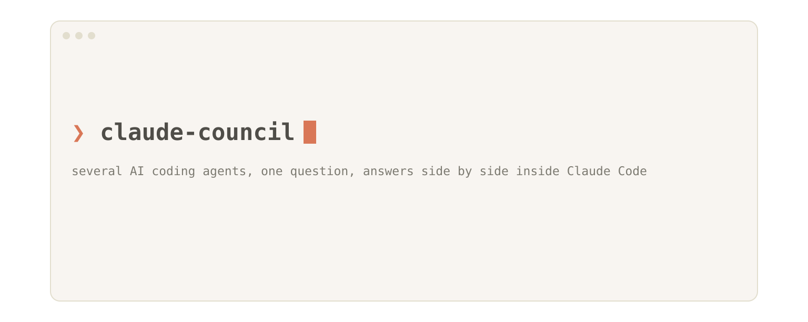

Un plugin de Claude Code que hace la misma pregunta a agentes de programación de IA en
paralelo. Compara sus respuestas cuando el sesgo de un modelo puede engañarte:
decisiones de arquitectura, callejones sin salida al depurar, revisiones de seguridad o
elección de frameworks.


[](https://github.com/hex/claude-council/actions/workflows/tests.yml)

## Dónde se ejecuta

| Dónde | Qué obtienes |
| --- | --- |
| Claude Code en una terminal | `/claude-council:ask`, todas las plazas y el panel junto al chat. |
| Claude Desktop, pestaña Code | El mismo plugin y los mismos comandos. El panel se abre en el panel lateral de Desktop. |
| Claude Desktop, chat normal | La [extensión de Desktop](#claude-desktop): cinco herramientas, un selector de plazas y un panel de respuestas en el chat. macOS y Linux. |


En ambos casos, Claude también puede llamar al consejo como herramienta. Primero pregunta qué plazas y
qué nivel de detalle, después muestra una tarjeta Send y nada sale de tu equipo
hasta que lo confirmes.

El chat de claude.ai y Cowork se ejecutan en un entorno aislado que puede bloquear las llamadas a otros
proveedores, así que el consejo no funciona allí.

## Instalación

Necesitas `curl` y `jq` en macOS, Linux o Windows mediante Git Bash.

```text
/plugin marketplace add hex/claude-marketplace
/plugin install claude-council@claude-code-mods-es
```

Dale al menos un proveedor en el shell desde el que inicias Claude Code:

```bash
export OPENAI_API_KEY="..."
# Or GEMINI_API_KEY, XAI_API_KEY, PERPLEXITY_API_KEY,
# KIMI_API_KEY, OPENROUTER_API_KEY
```

O guarda las claves en la configuración del plugin. Ejecuta `/plugin configure claude-council`,
rellena las filas de clave de API y elige Save configuration. Claude Code las guarda en
su almacenamiento seguro, no en un archivo de ajustes. El mod del consejo establece cada clave
guardada como su variable durante toda la sesión, así que cada comando que inicia Claude Code,
en cualquier proyecto, recibe la clave guardada en lugar de la que exporta tu shell.
La fila de modelos de OpenRouter acepta los ids de modelo que acepta `OPENROUTER_MODELS`, de modo
que las plazas del enrutador tampoco necesitan exportación.
Las claves guardadas requieren Claude Code 2.1.287 o posterior. La pestaña Settings de plugins
de la app de escritorio también las acepta, para sesiones en ese equipo. Nunca llegan
al chat de claude.ai ni a Cowork. [API keys](docs/REFERENCE.md#api-keys) explica dónde se guardan,
cuándo no se carga el mod y cómo se comporta una clave borrada.

Las CLI `codex`, `agy` (Antigravity), `grok`, `kimi` y `cursor-agent` usan
tus suscripciones existentes sin clave de API. Claude Code, Copilot CLI y OpenCode también pueden sentarse, cuando se les nombra en `--providers`. Un modelo local de
`ollama` no necesita clave ni red externa. Sin ninguna de estas opciones, `--local` usa subagentes de Claude. Consulta [selección de proveedores](docs/REFERENCE.md#choosing-providers) y
[consejos locales](docs/USAGE.md#local-council---local).

## Primera ejecución en 60 segundos

Lee [qué se envía y se guarda](docs/REFERENCE.md#what-gets-sent-and-saved)
antes de preguntar sobre tu código.

```text
/claude-council:status
/claude-council:ask "Should I use UUID or BIGINT primary keys for a SaaS users table?"
```

Cada proveedor responde por su cuenta. Claude escribe una síntesis de sus
acuerdos, desacuerdos y recomendación. El acuerdo no es verificación:
los modelos comparten tu descripción y sus supuestos.
[La síntesis nombra la premisa que podría cambiar la respuesta](docs/REFERENCE.md#reading-the-synthesis).

## Claude Desktop

El plugin necesita Claude Code. Para un chat normal de Claude Desktop existe una
extensión de Desktop, `council-<version>.mcpb`, que da a Claude cinco herramientas:
`council_ask`, `council_pick`, `council_result`, `council_status` y
`council_settings`. Solo se ejecuta en macOS y Linux, porque inicia los scripts bash
del consejo.

1. Descarga `council-<version>.mcpb` de la
   [última versión](https://github.com/hex/claude-council/releases/latest).
   Para compilarla tú mismo, ejecuta `bash extension/build.sh` en un checkout limpio.
   Necesita `npm` y escribe `dist/council-<version>.mcpb`.
2. Haz doble clic en el archivo. Desktop avisa de que la extensión obtiene acceso a
   todo tu equipo y no está verificada por Anthropic. Ambas cosas son ciertas para
cualquier extensión instalada desde un archivo: su servidor se ejecuta como tú, con tus
archivos y tu red, y Anthropic no la ha revisado. Instala solo un paquete que
hayas compilado o en el que confíes.
3. En Settings, Extensions, Claude Council, Configure, pega una clave para cada
   proveedor que quieras: Gemini, OpenAI, xAI, Perplexity, Kimi, OpenRouter. Un
   campo vacío deja fuera la API de ese proveedor. Desktop guarda las claves. Para una
   pregunta, cada clave va solo a las plazas de su propio proveedor: la API del proveedor
   y su agente CLI si está instalado (`codex` recibe la clave de OpenAI, `agy`
   la de Gemini, `grok` la de xAI, `kimi` la de Kimi). Una comprobación de estado es
diferente: inicia cada agente CLI instalado pero `claude` y `opencode` con todas
   las claves definidas.
4. En un chat, pide a Claude que abra los ajustes del consejo. Un panel en el chat
   enumera los modelos de cada proveedor con clave, obtenidos en directo de ese proveedor. Elige
   uno por proveedor o activa hasta 12 modelos de OpenRouter, una plaza para cada uno.
   Cada cambio se guarda al instante y se aplica a la siguiente pregunta.
5. Pide a Claude que someta una pregunta al consejo. Desktop te pide aprobar
   la llamada a la herramienta, y esa aprobación es la única comprobación antes de que la pregunta
   salga de tu equipo. Un panel bajo la llamada muestra la respuesta de cada plaza,
   o su error, en una tarjeta propia encabezada con el nombre de la plaza y el
   logotipo de su proveedor, y Claude escribe la síntesis debajo. Desktop espera a
   toda la ejecución, desde segundos hasta unos pocos minutos.

### Preguntar de una vez

Nombra las plazas o un nivel de detalle (standard, brief o
detailed) en tu mensaje, o di que pregunte a todos, y Claude ejecuta la
pregunta de inmediato, en cada plaza predeterminada con detalle standard salvo que nombres otras.
Claude pasa tu pregunta tal como la formulaste y solo añade contexto cuando depende
de mensajes anteriores que el consejo no puede ver.

### El selector

Si no, como en «pregunta al consejo: ¿qué cola usamos?»,
Claude abre `council_pick`, un panel con la pregunta, un interruptor por
plaza y los tres niveles de detalle. Después Claude espera, en el mismo turno, en
`council_result` a la ejecución del selector.

1. Pulsa Ask. Las respuestas aparecen en ese panel y la línea de debajo dice
   «Claude is writing the synthesis».
2. Claude escribe la síntesis sin que tú envíes ningún mensaje. Cuando todas las plazas
   fallan, Claude dice qué falló.

Cuando ninguna plaza responde, el panel lo indica y Ask vuelve a estar disponible.

### Cambiar un modelo en el selector

En una plaza de API o de OpenRouter, el modelo en gris es un botón: haz clic en él para elegir otro modelo de la
lista en directo de ese proveedor (la de OpenRouter tiene un cuadro de filtro). La elección se guarda
al instante, como en el panel de ajustes, y se aplica a esta pregunta y a
las siguientes. Una plaza de OpenRouter cambia solo su propio modelo; añadir o
quitar plazas de OpenRouter se hace en el panel de ajustes.

### Cuando Claude ya no está esperando

Claude espera como máximo 11,5 minutos desde
que se abre el selector. Si ya no está esperando cuando llegan las respuestas, o pulsas Ask por segunda vez en el mismo panel:

- Desktop pone «Synthesise the council's answers (run 3f9a2c).» en el
  cuadro de mensaje, bajo una advertencia sobre contenido malicioso, y la línea bajo
  las respuestas indica que pulses Enter. El panel no puede enviar ese mensaje por sí mismo.
- Claude obtiene entonces las respuestas de esa ejecución con `council_result` y escribe
  la síntesis.
- Si Desktop rechaza el mensaje, la línea da en cambio las palabras que debes enviar
  tú mismo (`Ask Claude: "synthesise council run 3f9a2c"`).
- La extensión conserva las últimas 5 ejecuciones en las que respondió alguna plaza; pasado ese número,
  vuelve a preguntar al consejo.

Una pregunta sin proveedores nombrados va a todos los proveedores con clave y a
todos los agentes CLI que los scripts encuentran (`codex`, `agy`, `grok`, `kimi`,
`cursor-agent`, `ollama`) en tu PATH, `~/.local/bin`, `~/bin`,
`/opt/homebrew/bin` o `/usr/local/bin`. `claude`, `copilot` y `opencode`
la reciben solo si la pregunta los nombra. Un agente CLI responde con su propio
inicio de sesión, así que recibe la pregunta aunque el campo de clave de su proveedor esté
vacío; aparte de la clave de su proveedor no recibe ninguna del formulario. La
[referencia](docs/REFERENCE.md#claude-desktop-extension) enumera los archivos que
conserva y sus límites.

## Funciones

| Capacidad | Guía |
| --- | --- |
| Preguntar a proveedores juntos o nombrar uno con palabras corrientes | [Ejemplos de comandos](docs/REFERENCE.md#command-examples) |
| Elegir proveedores y fijar una lista permanente | [Selección de proveedores](docs/REFERENCE.md#choosing-providers) |
| Asignar roles de especialista | [Roles](docs/USAGE.md#specialized-roles) |
| Hacer que los proveedores cuestionen las respuestas de los demás | [Debate](docs/USAGE.md#debate-mode) |
| Recopilar contexto de código con agentes antes de preguntar | [Modo agente](docs/USAGE.md#agent-enhanced-analysis---agents) |
| Usar subagentes de Claude sin proveedor externo | [Consejo local](docs/USAGE.md#local-council---local) |
| Incluir archivos relevantes o elegir los tuyos | [Auto-context](docs/USAGE.md#auto-context-injection) |
| Adjuntar una captura de pantalla | [Entrada de imagen](docs/USAGE.md#image-input) |
| Preguntar sobre la conversación actual | [`/advise`](docs/USAGE.md#asking-about-the-conversation-itself) |
| Ejecutar en segundo plano y recoger el resultado | [Trabajos en segundo plano](docs/USAGE.md#background-jobs---async) |
| Exportar las respuestas a un archivo | [Exportar](docs/USAGE.md#export-to-file) |
| Mostrar solo la síntesis | [Modo silencioso](docs/USAGE.md#quiet-mode) |
| Ver llegar las respuestas y reintentar las plazas fallidas | [El panel](#the-pane) |
| Recibir una nota de una plaza mientras Claude trabaja | [Comprobación lateral]([#heads-up-side-check](#heads-up-side-check)) |
| Hacer que un segundo modelo revise el diff antes de que Claude pare | [Revisión de Stop-gate](docs/USAGE.md#stop-gate-review-opt-in-off-by-default) |
| Preguntar al consejo desde un chat de Claude Desktop | [Claude Desktop](#claude-desktop) |
| Llamar a los scripts sin Claude Code | [Uso directo de scripts](docs/REFERENCE.md#direct-script-usage) |

La [referencia](docs/REFERENCE.md) enumera todas las banderas, variables, valores por defecto de modelo
y límites. [Arquitectura](docs/ARCHITECTURE.md) cubre la implementación.
[TESTING.md](TESTING.md) cubre pruebas, versiones y cómo añadir un proveedor.

## Comprobación lateral


Se activa en la fila «Heads-up side-check» de `/config` o en el
`.claude/council-heads-up.json` del proyecto. Una plaza, codex por defecto, revisa
los turnos recientes y los resultados de herramientas mientras Claude trabaja. Para un Write o un Edit, recibe el
texto que escribió Claude. La nota muestra qué fue a parar donde.
Learn more la amplía; Tell Claude pone un borrador en el prompt sin enviarlo.
Lee los [límites de datos y el interruptor](docs/REFERENCE.md#what-gets-sent-and-saved)
y la [guía de comprobación lateral](docs/USAGE.md#heads-up-side-check-opt-in-off-by-default).

## El panel

En Claude Code 2.1.287 o posterior, el panel se abre dentro de Claude Code,
como en la animación anterior. Cada plaza tiene una fila con su modelo, una barra de
su estado, su tiempo y un botón para lo que hace ahora: cancelar, reintentar, abrir
o plegar. Cuando termina la ejecución,
la síntesis se abre arriba con las respuestas plegadas debajo. Vuelve a abrir
la última ejecución con `/council-pane`. Dentro de tmux, el mod pregunta una vez qué panel quieres.

La [guía del mod](mods/council-pane/README.md) enumera teclas, ajustes, límites
y cuándo no se carga el mod. También permite a Claude llamar al consejo como herramienta;
cada llamada te lo pregunta primero.

### Qué ejecuta, lee y envía el mod

El mod no hace ninguna llamada de red por su cuenta. Inicia los programas siguientes
desde un array de argumentos, nunca desde una cadena de shell, y nunca entrega a `bash -c` un
script. Tu texto llega a los proveedores de modelos solo przez los dos primeros:

- `bash scripts/run-council.sh` cuando Claude llama a la herramienta del consejo y tú
  eliges `Send to the council`. Envía tu pregunta a los proveedores que
  hayas configurado.
- `bash scripts/heads-up.sh`, solo con la comprobación lateral activada. Lee
  la transcripción de esta sesión (por defecto los últimos 5 turnos y hasta 8 resultados
  de herramienta de 2.000 caracteres cada uno) y envía ese resumen a una plaza,
  `codex` salvo que elijas otra. El directorio de ejecución conserva `digest.md` y
  `prompt.md`, exactamente lo que salió de la máquina, hasta que el mod lee el resultado
  y lo elimina. La plaza de codex se ejecuta en ese directorio con una carpeta propia de codex: tu modelo y esfuerzo, un enlace a tu `auth.json` para que una
  renovación de token llegue a tu inicio de sesión (sin él, tu `CODEX_API_KEY` o
  `OPENAI_API_KEY` inicia sesión en codex), y ninguno de tus plugins, hooks,
  `AGENTS.md`, skills ni servidores MCP.
- `bash scripts/query-council.sh --list-default-models` cuando Claude llama
  a la herramienta del consejo, para enumerar las plazas que puede ofrecerte y comprobar
  las que nombra. Lee tu configuración y no envía nada.
- `bash scripts/seat-info.sh discover`, `model <seat>` o
  `allowlisted <seat>` durante `/heads-up setup` y `/heads-up on <seat>`.
  Comprueba qué plazas puede ejecutar esta máquina y no envía nada.
- `codex debug models` durante `/heads-up setup` con la plaza codex, para listar
  sus modelos. Ese comando pertenece a codex, y también cualquier petición que
  haga.
- `kill -0 <pid>` para comprobar que una ejecución del consejo sigue activa. No envía
  ninguna señal.
- `rm -rf` y `mv -f` en sus propios directorios de ejecución bajo
  `$TMPDIR/council-mod.<session id>`, para limpiar una ejecución terminada y responder
  a la oferta de reintento.

Escribe archivos en ese directorio `$TMPDIR`, incluidos `model.json` y
`avoid.txt`, que lee `heads-up.sh`. Fuera de él, escribe un archivo,
`.claude/council-heads-up.json` en el proyecto, y solo desde
`/heads-up setup`, `/heads-up on`, `/heads-up off` o el `Turn off` de una nota.
Ese archivo es el interruptor de la comprobación lateral. El propio Claude Code no lo lee.

Establece variables de entorno en el proceso de Claude Code. Con una clave de API
o la lista de modelos de OpenRouter guardada en la configuración del plugin, establece esa
variable, como `OPENAI_API_KEY` o `OPENROUTER_MODELS`, cuando empieza la sesión. Cada comando que Claude Code inicia después recibe el valor guardado
en lugar del que exporta tu shell, igual que una exportación. Antes de una ejecución del consejo establece `COUNCIL_MOD_PANE_DIR`.

Toca el prompt en dos lugares. Con `wake_on_async_done` activo, envía
`The background council job <id> has finished. Fetch it with /claude-council:result <id> and summarise it.` cuando termina
un trabajo en segundo plano. El `Tell Claude` de una nota pone un borrador en el cuadro del prompt y tú decides
si enviarlo.

Lee el texto de cada comando Bash que ejecuta Claude, solo para detectar una llamada
a `run-council.sh`. Justo antes de esa llamada establece `COUNCIL_MOD_PANE_DIR`,
para que la ejecución se dibuje en este panel, y lo borra cuando tmux es dueño del panel. Lee `TMPDIR` y `TMUX`. Activa el
ajuste `claude-council.heads_up` solo cuando eliges «todos los proyectos» en
`/heads-up setup`.


Sin el mod, tmux abre un panel lateral que transmite las respuestas y el estado de cada
proveedor. Ofrece reintentar las plazas fallidas. Esc lo cierra.
`--no-pane` o `COUNCIL_NO_PANE=1` lo desactiva. Fuera de ambos modos de panel,
las respuestas llegan al chat. Consulta [integración con terminal](docs/REFERENCE.md#display--terminal-integration).

Las animaciones del consejo y de tmux muestran respuestas reales a
«¿Debe una app de demostración de un solo nodo usar SQLite o Postgres?» Codex y Antigravity
usan suscripciones; Gemini y OpenAI usan sus APIs. Kimi es un fixture de límite de tasa.
La animación de comprobación lateral usa una plaza falsa y un host real de Claude Code.
[Scripts de captura y fotogramas sin procesar](assets/capture/README.md) explican cómo
reproducirlas.

## Qué carga una plaza CLI

Cada plaza CLI se ejecuta desde un directorio vacío, `$TMPDIR/claude-council-<uid>/seat`,
donde `<uid>` es tu id de usuario numérico. El `CLAUDE.md`, `AGENTS.md`, las reglas,
skills, hooks y servidores MCP del proyecto desde el que preguntas no llegan hasta allí. El
directorio no limita lo que una plaza puede leer: codex, por ejemplo, puede seguir
abriendo cualquier archivo por su ruta completa.

El directorio es de solo lectura. Eso impide que una plaza escriba un archivo allí, pero no que
cambie primero los permisos. Una plaza también se niega a arrancar si encuentra
algo en él, y nombra la ruta para que mires antes de borrarlo. Un archivo que aparece
mientras otras plazas se ejecutan puede llegar a ellas; la siguiente plaza que arranca
se niega. Una plaza también se niega a arrancar si `TMPDIR` está dentro de un
repositorio git, y lo nombra: una CLI tomaría todo el repositorio como proyecto de la plaza.

Las plazas siguientes también se ejecutan con una carpeta propia, en
`$TMPDIR/claude-council-<uid>/seat-home`. Solo enlaza lo que la CLI necesita para
iniciar sesión y arrancar. Solo tú puedes abrir cualquiera de los dos directorios, y una plaza se
niega a arrancar si uno pertenece a otro usuario o es un enlace simbólico.

| Plaza | Ya no carga | Sigue cargando |
| --- | --- | --- |
| `cursor-cli` | Skills y plugins de `~/.cursor`, `~/.claude`, `~/.codex`, `~/.grok` y `~/.agents`, hooks de Cursor y Claude, `~/.cursor/mcp.json` | Comandos de equipo de tu panel de Cursor (leídos del paquete de la CLI, no vistos en una ejecución) |
| `grok-cli` | Plugins de Claude, skills de `~/.agents`, memoria de grok entre sesiones | Tu configuración `~/.grok` y los hooks en `~/.grok/hooks`, porque ningún ajuste de grok los desactiva. La carpeta de la plaza enlaza tu llavero de inicio de sesión (macOS) y `~/.docker/run`, para el socket de Docker Desktop |
| `antigravity` | En macOS: tus reglas, skills, servidores MCP y conversaciones guardadas de `~/.gemini` | En Linux: todo bajo `~/.gemini`, porque no está confirmado dónde guarda agy su inicio de sesión |
| `opencode` | Las skills, agentes y `CLAUDE.md` de `~/.claude` y `~/.agents` | Tu inicio de sesión e historial de sesiones en `~/.local/share/opencode` |
| `codex` | Tus plugins, hooks, skills, memorias y servidores MCP. Cada pregunta recibe su propia carpeta de codex con tu modelo, tu esfuerzo y un enlace a `auth.json` | Nada. Sin `auth.json` y con `cli_auth_credentials_store` configurado como `keyring` o `auto`, tu inicio de sesión está en el llavero del sistema, que codex no puede leer desde otra carpeta, así que la plaza se ejecuta con tu propia carpeta de codex y la respuesta empieza con una nota. Un `OPENAI_API_KEY` exportado no cambia esto; un `CODEX_API_KEY` exportado sigue iniciando sesión en codex antes que cualquier login, como cuando ejecutas codex tú mismo. Configura `cli_auth_credentials_store = "file"` y vuelve a ejecutar `codex login` para aislarlo. Sin ningún inicio de sesión, la plaza se detiene y lo dice |
| `claude-cli` | El estado de git y las instrucciones de commit que añade un repositorio | La política de administrador y las instrucciones de tu organización |
| `kimi-cli`, `copilot-cli` | Los archivos del proyecto | Tu carpeta personal: hooks de kimi en `~/.kimi-code/config.toml`, skills de copilot en `~/.copilot` y `~/.agents` |

Cursor y Antigravity conservan el modelo que elegiste en su propia configuración: la plaza
lo lee de tu carpeta real y lo pasa. En Windows las plazas conservan tu
carpeta personal, porque las CLI nativas la encuentran mediante `USERPROFILE`.
[Aislamiento de plazas](docs/ARCHITECTURE.md) tiene los detalles de cada una.

## Resolución de problemas

| Problema | Solución |
| --- | --- |
| Cloné el repositorio y no se carga nada | No clones en `~/.claude/plugins/`. `pluginDirectories` no es un ajuste. Sigue [ejecutar desde un clon local](docs/REFERENCE.md#running-from-a-local-clone). |
| No se encuentran proveedores | Ejecuta `/claude-council:status`. Exporta claves en el shell que inicia Claude Code, guárdalas con `/plugin configure claude-council` o usa `--local`. |
| No se usa una clave guardada | Tras guardar una con `claude plugin configure` en un shell, reinicia Claude Code. Las claves guardadas necesitan el mod del consejo, que se carga en Claude Code 2.1.287 o posterior y no con `--safe-mode` ni `disableAllHooks`. Sin él, exporta la clave en tu shell. |
| Respondió un modelo distinto | Una cabecera como `grok-4.7 (grok-latest unavailable)` registra un [respaldo de modelo](docs/REFERENCE.md#model-fallback). Configurar la variable `_MODEL` de ese proveedor desactiva el respaldo. |
| No hay panel | Usa tmux, o actualiza a Claude Code 2.1.287 o posterior para tener el panel dentro de Claude Code. La [guía del mod](mods/council-pane/README.md) enumera qué impide que se cargue. |
| Actualizar | Ejecuta `/plugin update claude-council` y reinicia Claude Code. |

## Fuente y licencia

- Autor original: [hex](https://github.com/hex/claude-council)
- Repositorio original: https://github.com/hex/claude-council
- Licencia: MIT

Traducción al español y localización de interfaz: proyecto claude-code-mods-es
