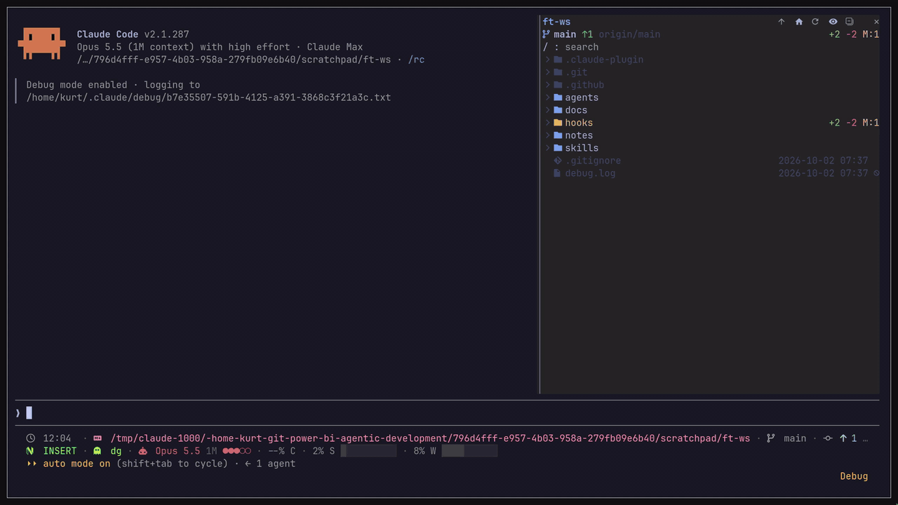

<h1 align="center">Claude Code Filetree</h1>

<p align="center">
  Un árbol de archivos estilo IDE para Claude Code que muestra qué está haciendo Claude y dónde, en los archivos
</p>

<p align="center">
  
  
  
  
</p>

<details open>
<summary><b>CLI de Claude Code</b></summary>

<p align="center">
  
</p>

</details>

<details>
<summary><b>Claude Code en la aplicación de escritorio</b></summary>

<p align="center">
  
</p>

</details>

**Características principales:**

* Muestra y permite recorrer todos los archivos de un directorio (con compatibilidad con el estado de Git y los atajos de nvim)
* Animaciones que muestran dónde está leyendo o trabajando Claude
* Atajos de teclado:
   * Navega por directorios con `z` (similar a zoxide)
   * Busca con `s` o `i` (en la carpeta resaltada) o `q` (en el contenido de los archivos)
   * Compara archivos con `d`, o todos los archivos modificados de una carpeta
* Funciones pensadas para la terminal: vistas previas de archivos, mapa de árbol del tamaño de los directorios y mucho más

---

## Instalación

El repositorio es su propio marketplace de plugins. Ejecuta esto en la terminal:

```bash
claude plugin marketplace add data-goblin/claude-code-filetree
claude plugin install filetree@claude-code-mods-es
```

O dentro de una sesión de Claude Code:

```text
/plugin marketplace add data-goblin/claude-code-filetree
/plugin install filetree@claude-code-mods-es
```

En versiones de Claude Code anteriores a la 2.1.287, la instalación falla con `Unrecognized key: "options"`: ejecuta `claude update` y vuelve a instalar.

## Funciones

- Árbol de archivos del directorio de trabajo o de una carpeta fijada, con columnas de Git, tamaño, número de líneas y fecha ([tree](docs/tree.md))
- Contraer todo y expandir todo hasta tres niveles de profundidad ([tree](docs/tree.md))
- Flechas de enlaces simbólicos, un cerebro en los archivos de instrucciones para agentes y glifos Nerd, simples o de texto ([tree](docs/tree.md))
- Búsqueda por nombre en carpetas no abiertas, con distinción de mayúsculas o expresiones regulares, limitada a una carpeta ([search](docs/search.md))
- Búsqueda dentro de archivos con `git grep` o `grep -r`, y apertura de una coincidencia en su línea ([search](docs/search.md))
- Salto a cualquier carpeta al estilo zoxide con `z` ([search](docs/search.md))
- Estado de Git por archivo y carpeta, recuento de líneas en los archivos modificados y la rama con commits por delante y por detrás ([git](docs/git.md))
- Los comandos de Git y GitHub que ejecuta Claude se muestran como una línea de estado ([git](docs/git.md))
- Las lecturas, escrituras y confirmaciones de Claude se resaltan en el árbol, y el plegado automático cierra las carpetas que abrió ([activity](docs/activity.md))
- El ajuste Activity shimmer desactiva el resaltado en todas las sesiones; el botón Clawd en la cabecera de la aplicación de escritorio lo alterna ([activity](docs/activity.md))
- Las referencias a archivos con una línea en las respuestas de Claude se convierten en enlaces a esa línea ([activity](docs/activity.md))
- Follow work traslada la sesión al repositorio en el que trabaja Claude ([activity](docs/activity.md))
- Selección múltiple estilo IDE; las filas sombreadas se envían a Claude como contexto: la fila seleccionada o hasta 100 filas marcadas ([context](docs/context.md)):
  - un clic selecciona una fila y borra las marcas
  - con filas marcadas, j / k mueven solo el cursor, y `v` marca o desmarca la fila bajo él
  - mayús+clic marca el intervalo desde el último clic o movimiento con j / k, en el orden del árbol
  - ctrl+clic marca o desmarca una fila sin abrirla; en macOS, alt+clic
  - doble clic o Intro abre un archivo
  - el botón de borrar selección limpia todas las filas marcadas y seleccionadas
  - las filas marcadas muestran el fondo de selección; `y`, `Y` y `u` copian las filas sombreadas
  - con filas marcadas, la fila bajo el cursor muestra un tono de acento en la aplicación de escritorio y la marca de cursor de acento en la terminal
- Vista previa dividida de código, Markdown, imágenes, fotogramas de vídeo, páginas PDF y Word ([preview and treemap](docs/preview-treemap.md))
- Mapa de árbol de una carpeta por bytes o líneas, con la actividad de Claude resaltada ([preview and treemap](docs/preview-treemap.md))
- Comparación de un archivo o de todos los archivos modificados de una carpeta, en el panel o con tu herramienta de diff ([diff](docs/diff.md))
- Apertura de archivos en su aplicación predeterminada, un editor en un panel de tmux o herdr, o cualquier comando ([open](docs/open.md))
- Protege archivos y carpetas de las ediciones de Claude, y muestra archivos escritos fuera del repositorio ([guards](docs/guards.md))
- Controlado por teclado: movimientos estilo vim, una capa de atajos y alt+l / alt+h en la terminal ([keys](docs/keys.md))
- Comandos `/filetree` y dónde aparece el panel en la terminal y en la aplicación de escritorio ([sidebar](docs/sidebar.md))




## Ajustes

Todos los ajustes están en `/config`, bajo filetree, cada uno con su propia descripción allí.

```yaml
Claude activity:  reads and writes | writes | reads | none
Activity shimmer: on | off
Follow Claude:    on | off
Jump moves Claude: tree and Claude | tree
Right-click copies: relative | absolute
Follow work:      on | off
Open at start:    on | off
Focus on open:    on | off
Right column:     date | age | size | loc | files
Date format:      year-month-day | day-month | month-day
Clock:            24h | 12h
Long file:        500 | a line count | off
Remote branch:    off | on
Hints:            on | off
Search spacing:   on | off
Column headers:   on | off
Auto-collapse:    off | on
Shortcuts:        auto | always | off
Open with:        empty | editor | preview | a command with {path} and {dir}
Binary files:     Open with | default app
Edit with:        empty | a command with {path} and {line}
Diff with:        empty | a command such as "hunk diff --" or "lazygit -f"
Diff groups:      folder | kind | off
Terminal target:  auto | pane right | pane below | tab | workspace
Ignore:           names to hide, such as ".cache .tmp"
Preview pane:     bottom | top
Treemap:          auto | image | cells | off
Palette:          key=#hex pairs over the terminal colors
Glyphs:           auto | nerd | plain | text
```

En la terminal, el color de acento tiñe las carpetas, la raíz, el cursor, las coincidencias de búsqueda y los recuadros de nivel superior del mapa de árbol de celdas. Es el azul brillante de la terminal con un tema oscuro de Claude y su azul con uno claro. `accent=#hex` en Palette establece otro color para todo ello.

Follow work se describe en [Claude activity](docs/activity.md).

Open at start se aplica a cada nueva sesión, incluida `/clear`. Cuando abres o cierras el árbol con `/filetree`, esa elección dura hasta el siguiente `/clear`. Tras `/clear`, el árbol está abierto o cerrado según indique Open at start.

## Requisitos

```yaml
required:  Claude Code 2.1.306 o superior, git
optional:
  inotifywait:            actualizaciones en directo en Linux (inotify-tools)
  magick or ffmpeg:       imágenes distintas de PNG, fotogramas de vídeo
  pdftoppm or gs:         páginas PDF
  soffice:                páginas de Word y Office
  pandoc, pdftotext:      texto de documentos en tmux, herdr y otras terminales
  tmux or herdr:          un editor o herramienta de diff en un panel nuevo
  Nerd Fonts 3.2+:        iconos para Glyphs auto, que dibuja Unicode simple sin ellas o con una versión anterior
pictures:  Ghostty o kitty, fuera de tmux y herdr, en Linux y macOS
```

## Consideraciones

- La aplicación de escritorio no tiene vista previa dividida ni mapa de árbol
- La aplicación de escritorio resalta como máximo cuatro filas a la vez; las filas adicionales se muestran en su color sin el resaltado, mientras que la terminal las resalta todas. Si el panel sigue desbordándose, el botón Clawd de la cabecera o el ajuste Activity shimmer desactivan el resaltado
- La aplicación de escritorio dibuja como máximo 150 filas alrededor del cursor, y menos si las filas son profundas, tienen rutas largas o muestran cambios de Git; una nota indica las filas que se omiten
- Los GIF y los vídeos muestran un fotograma estático
- Windows calcula el tamaño de las carpetas a partir de los listados de archivos, y el mapa de árbol dibuja un nivel
- Los clics en filas requieren herdr 0.9.1 o posterior; ejecuta `herdr update`

## Contribuir

Abre pull requests contra una rama de versión, no contra `main`:

- Correcciones: la rama de parche, por ejemplo `release/0.8.2`
- Funciones nuevas: la rama minor, por ejemplo `release/0.9.0`

Mantén la versión de esa rama.

Activa los hooks de git una vez por clon. El hook pre-commit ejecuta las comprobaciones rápidas en segundos: reglas grep, tipos, oxlint y `claude plugin validate` cuando cambian los manifiestos. El hook pre-push comprueba la versión contra la rama de versión y ejecuta las pruebas del plugin:

```bash
git config core.hooksPath .githooks
```

Las mismas comprobaciones se ejecutan en macOS, Windows y Linux en CI en cada push que afecte al plugin.

## Licencia

[MIT](LICENSE). Las etiquetas del mapa de árbol usan glifos de [Terminus Font](https://terminus-font.sourceforge.net/) de Dimitar Zhekov (Lat2-Terminus16, SIL Open Font License 1.1).

*Este proyecto está inspirado en mi aplicación de Omarchy [FileBlade](https://github.com/data-goblin/fileblade)*

## Fuente y licencia

- Autor original: [data-goblin](https://github.com/data-goblin/claude-code-filetree)
- Repositorio original: https://github.com/data-goblin/claude-code-filetree
- Licencia: MIT

Traducción al español y localización de interfaz: proyecto claude-code-mods-es
