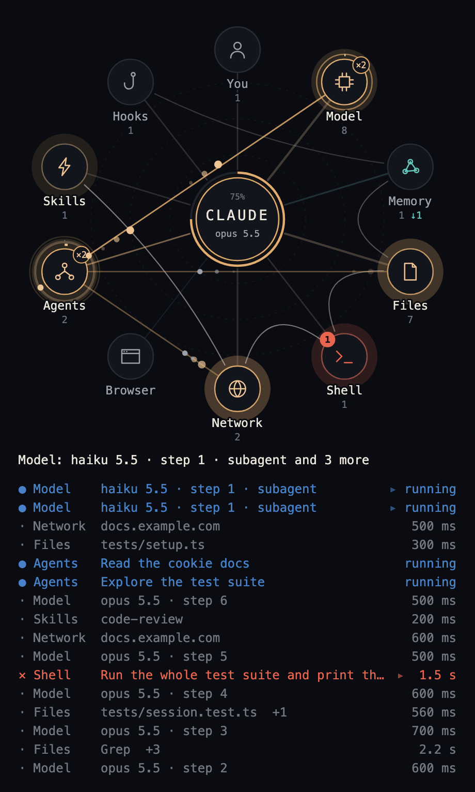
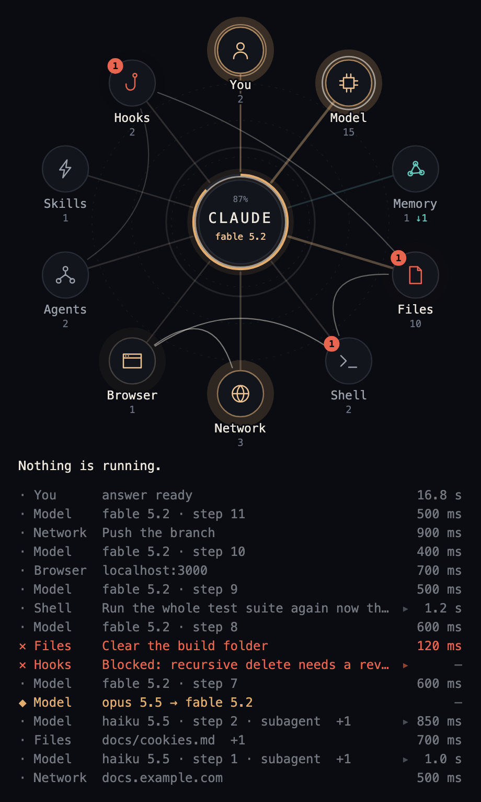

# Lot Map para Claude Code
> Versión en español por el proyecto claude-code-mods-es. El README original en inglés está en [README.en.md](README.en.md).


`lot-map` es un mod para Claude Code: un mapa en vivo del trabajo, en un panel junto al chat. Cada llamada a una herramienta, cada paso del modelo, cada hook y cada skill envía un pulso desde el centro hasta su estación, así ves la memoria, los archivos, el shell, la web y los agentes trabajando en lugar de leer una lista de comandos.

Se ejecuta en tu máquina y no envía nada a ninguna parte. Local no significa ciego: como cualquier mod que sigue las llamadas a herramientas, recibe cada llamada completa y de ahí toma nombres y nada más. [Qué lee y conserva](PRIVACY.md), y [las comprobaciones que lo obligan a eso](PRINCIPLES.md).


*Una sesión inventada reproducida mediante el propio código de dibujo del mod. [Vídeo (MP4)](docs/demo.mp4). O [reproducirlo en tu navegador](https://alexeyw.github.io/lot-map/), donde la página ejecuta el mismo código y muestra qué entrega cada llamada al mod y qué conserva el mod.*

## Instalación

En el prompt de una sesión de terminal:
```
/plugin install lot-map --marketplace alexeyw/lot-map
```
Responde `y` para añadir el marketplace y después elige un alcance. Desde un shell:
```bash
claude plugin install lot-map --marketplace alexeyw/lot-map
```
Si responde que el plugin no se encuentra en ningún marketplace, añade primero el marketplace:
```bash
claude plugin marketplace add alexeyw/lot-map
claude plugin install lot-map@lot-map
```
En la aplicación de escritorio: haz clic en **+** junto a la caja del prompt, luego **Plugins**, **Add marketplace** con `alexeyw/lot-map`, y después **Add plugin**.

El panel se abre solo cuando empieza una sesión; con `openAtStart` desactivado espera a `/lot-map`. En una terminal necesita al menos 144 columnas; si no, escribe `/lot-map`, y solo dibuja texto salvo que pidas el mapa, como imagen o en puntos braille: véase [En una terminal](#in-a-terminal). Compilado y probado en Claude Code 2.1.321 en macOS; usuarios informan de que también funciona en Windows y Linux.

En un inicio de sesión Team o Enterprise el transcript puede recibir avisos como `lot-map: its classic.PreToolUse hook was skipped`. Desactiva `guardedHooks` y dejan de aparecer; [Opciones](#what-it-shows) dice qué pierde el mapa por ello.

## Actualización

Desde un shell:
```bash
claude plugin marketplace update lot-map
claude plugin update lot-map@lot-map
```
Luego inicia una nueva sesión. El primer comando es necesario: sin él, el segundo informa de la versión instalada como la más reciente.

Los cambios de cada versión están en [CHANGELOG.md](CHANGELOG.md).

## Qué se enciende

| Estación | Cuándo |
| --- | --- |
| Tú | tus mensajes, preguntas y archivos enviados a ti, la lista de tareas, el plan y lo que se te pide aprobar |
| Modelo | cada solicitud al modelo, la compactación de contexto |
| Memoria | la carpeta de memoria de Claude Code, más lo que nombres en las opciones |
| Archivos | Read, Write, Edit, Grep, Glob, la inteligencia de código de un servidor de lenguajes, y comandos del shell que trabajan solo con archivos: leen, buscan, mueven, borran o editan en el sitio (`cat`, `grep`, `mv`, `rm`, `sed`, `tee`, `find … -delete`) |
| Shell | cualquier otro comando del shell |
| Red | la búsqueda y recuperación web, los servidores MCP, el trabajo guardado en claude.ai (artifacts, projects, designs) y los comandos del shell conocidos por alcanzar la red: `curl`, `gh`, `ssh`, `rsync`, `git push`, `npm install`, `docker pull` y similares, también dentro de `$(…)` |
| Navegador | las herramientas del navegador |
| Agentes | los subagentes, los workflows, los schedules y la espera de trabajo en segundo plano; sus propias llamadas parten de esta estación |
| Skills | los skills, la búsqueda de herramientas y el catálogo de skills, plugins y conectores |
| Hooks | los hooks de la configuración que rechazan una llamada, piden permiso, añaden contexto o tardan un momento |

En Windows, la herramienta PowerShell se lee igual que Bash, con los nombres propios de PowerShell: `Get-Content` y `Select-String` encienden Archivos, `Invoke-WebRequest` enciende Red. Un programa ejecutado por su ruta completa se lee por su nombre, también desde una ruta entre comillas con espacios, y `CURL.EXE` es `curl`.

Las estaciones de shell se deciden por el nombre del comando, no por lo que hace: un script que abre una conexión por sí mismo, como `python -c "…"`, se muestra como Shell. Un comando detrás de `sudo`, `env`, `timeout`, `nohup`, `xargs` y similares se lee como el comando que ejecuta, y `find … -exec` como el comando que se le ordena ejecutar. Lo mismo con un comando dentro de un bucle o de una condición (`for … do`, `if … then`, `while`, `!`, `{ … }`), y una línea entregada a un shell o a `eval` (`bash -c "…"`). El texto de un here-document no se lee, así que un archivo escrito a través de uno se muestra como Archivos sea cual sea el texto. Se lee una línea hasta sus primeros 8.000 caracteres. `npx` cuenta como Red solo con `-y`, ya que sin él sobre todo ejecuta lo que ya está instalado.

Un pulso sale volando cuando algo empieza y vuelve cuando termina. Los rechazos y los errores se ponen rojos.

## Leer el mapa

- **La ruta.** Una línea delgada une las últimas estaciones por las que pasó el bucle principal, en orden, y su tramo más nuevo se dibuja solo. Un tramo dura 40 segundos y luego se desvanece durante 20, así que un minuto después de que el trabajo se detenga solo quedan los radios; su grosor guarda por dónde fue el trabajo. Los pasos del modelo se omiten, o todos los tramos pasarían por Modelo.
- **Radios gastados.** Un radio se vuelve más grueso y más brillante cuanto más se usa su estación, así que al final de una sesión el mapa muestra por dónde fue el trabajo.
- **Cuánto tarda.** Dos agujas de reloj crecen alrededor de una estación mientras corre una llamada: la interior da una vuelta en un minuto, la exterior en diez.
- **Trabajo en segundo plano.** Un comando enviado al segundo plano, un monitor, un subagente en segundo plano o un workflow sigue encendido en su estación después de que termine el turno que lo inició, con las agujas del reloj creciendo, hasta que la tarea informa de que terminó. Una tarea fallida deja el punto rojo. El propio informe no se muestra como un mensaje tuyo.
- **Varias a la vez.** Las llamadas que empiezan juntas vuelan en paralelo, y la estación lleva su número, como `×3`.
- **Qué salió mal.** Un punto rojo con un recuento permanece en una estación desde un error o un rechazo hasta tu siguiente mensaje.
- **Memoria.** Tiene un color propio. Un pulso sólido es una memoria que Claude pidió; uno hueco sobre una línea discontinua es lo que un hook trajo sin que se le pidiera. Bajo la estación, el número simple cuenta la primera y `↓` la segunda.
- **La ventana de contexto.** El anillo alrededor del centro se llena según avanza la sesión, con el porcentaje sobre el nombre. Se pone ámbar al 70% y rojo al 90%.
- **Un cambio de modelo.** El centro y la estación Modelo se iluminan en un anillo durante unos segundos, y el feed recibe una fila como `opus 5.5 → fable 5.2`. Esto también ocurre cuando una sesión empieza con un modelo distinto al de la última sesión en la misma carpeta.
- **Subagentes.** Cada uno que sigue trabajando rodea la estación Agentes como un punto pequeño, y sus llamadas parten de allí.
- **La respuesta.** Un anillo ancho sale del centro cuando la respuesta está lista.
Debajo del mapa hay una línea que dice qué se ejecuta ahora, y las últimas 16 filas (con `logRows` en `fill`, tantas como quepa en el panel de escritorio): `●` en ejecución, `·` terminada, `✕` fallida o bloqueada, `◆` un cambio de modelo. Las llamadas terminadas que se siguen en una misma estación se pliegan en una sola fila, marcada `+2` por las dos que representa además de la nombrada. Una llamada que sigue en ejecución nunca es sacada de la lista por lo que vino después: se queda como última fila hasta que termina, de modo que la lista y el mapa dicen lo mismo. Tales filas ocupan como máximo la mitad de la lista; con más en ejecución que eso, la última se marca `+22` por el resto.

Cada fila es una línea. Sus palabras se cortan en el borde del panel; su tiempo queda en una columna a la derecha, con un guion para lo que no tardó, como un mensaje que llega, y en la fila de la respuesta, la duración de todo el turno. Una fila con una etiqueta larga tiene un `▸` antes de su tiempo: pulsa para leer la fila entera, y otra vez para cerrarla. Solo hay una fila abierta a la vez. En una terminal, la línea de ahora también lleva el porcentaje de contexto y el modelo a su derecha, ya que no hay dibujo que los muestre.

### Lo que cada llamada añade al contexto

El anillo dice qué tan llena está la ventana de contexto, no qué la llenó. Con `contextCost` activado, la fila de una llamada dice aproximadamente cuántos tokens creció el contexto con su respuesta, después de su tiempo: `85 ms +42k`. En el mapa, la línea de recuento de cada estación añade la suma de la sesión: `9 · 180k`. La cifra toma el color de lo que tiene al lado, el tiempo en la fila y el recuento en el mapa, de modo que se lee donde ellos se leen, en un tema claro y en uno oscuro.

Es una estimación. Claude Code le dice a un mod sobre cuántos tokens se respondió la última respuesta, de modo que el mod ve cuánto creció el contexto de un paso del modelo al siguiente, y lo pone en las llamadas cuyas respuestas fueron con el paso. El crecimiento también contiene las propias palabras del modelo, lo que añadieron los hooks y, al inicio de un turno, tu mensaje.

- **Un paso tarde.** La cifra de una llamada muestra cuándo se ha respondido el siguiente paso, no cuándo termina la llamada. Una llamada hecha en el último paso de un turno, antes de un turno interrumpido o antes de una compactación, nunca recibe ninguna, y una compactación, que reduce el contexto, no pone nada en ninguna parte.
- **Compartido.** Dos o tres llamadas en un paso comparten su crecimiento por partes iguales, y sus cifras se marcan con `~`: `~+14k`. Con más llamadas en un paso, sus filas no reciben ninguna, ya que una parte igual daría la misma cifra a una lectura larga y a un comando corto; cuando todas estuvieron en una estación, la suma de esa estación sigue llevándose todo. Una fila plegada suma las cifras de sus llamadas, marcada `~` cuando alguna de ellas no tiene.
- **Solo el bucle principal.** Un subagente llena un contexto propio, que Claude Code no informa: sus llamadas no reciben cifra. El crecimiento que trajo su respuesta se muestra en la llamada del bucle principal que lo inició.

Las sumas están en todos los dibujos del mapa: el de la app de escritorio, el de VS Code y la imagen de terminal, que son un solo dibujo, y el mapa braille, que escribe la suma de una estación después de su recuento, en el color de su nombre y con el más que llevan las cifras de las filas: `Files 9 +180k`. Una terminal que muestra solo las filas las tiene en su línea de recuentos, escritas de la misma manera.

El mapa braille dibuja las sumas para todas las estaciones o para ninguna. Donde su cuadrícula no tiene sitio para la suma más ancha junto a cada nombre, en un panel estrecho o con nombres largos y recuentos grandes, las omite todas, mantiene cada nombre entero y las filas siguen teniendo sus cifras. Los nombres en inglés con recuentos menores de diez caben desde 50 columnas; con recuentos mayores en cada estación necesitan hasta 68.

| En marcha | Subagentes | Un hook rechaza |
| --- | --- | --- |
|  |  |  |

| Un cambio de modelo | Después de la respuesta | Colores claros |
| --- | --- | --- |
|  |  |  |

## En una terminal

Una terminal muestra solo las filas. Con `terminalView` en `picture`, una terminal que muestra imágenes, como kitty o Ghostty, obtiene el mapa como imagen sobre las filas, moviéndose como lo hace en la app de escritorio. Claude Code debe dibujar en pantalla completa. Si el panel está debajo de la conversación y no al lado, Claude Code está dibujando en la pantalla principal, y las filas se quedan solas: escribe `/tui fullscreen`, o arráncalo como `CLAUDE_CODE_NO_FLICKER=1 claude`. Dentro de tmux, pon `allow-passthrough on` y `focus-events on`. Cualquier otra terminal muestra solo las filas, como antes, y también un panel de menos de 24 columnas.

En iTerm2 la imagen necesita iTerm2 3.7.8 o posterior. Una versión anterior conserva cada imagen que se le envía hasta que se cierra su pestaña: en iTerm2 3.7.7 un mapa en movimiento ocupaba unos 2 MB por fotograma, 17 GB en cinco minutos (#81). Ahí la imagen está desactivada, y una línea sobre las filas lo dice; actualiza iTerm2, o pon `terminalView` en `braille`. El mod conoce iTerm2 por `TERM_PROGRAM`, y por `LC_TERMINAL` sobre ssh o dentro de tmux, y su versión por `TERM_PROGRAM_VERSION` o `LC_TERMINAL_VERSION`; donde no se da la versión, la imagen sigue desactivada.

El mod pinta la imagen él mismo, a partir del mismo dibujo que el de la app de escritorio, con letras de las fuentes de mapas de bits X.Org misc-fixed, que están en el dominio público; [FONTS.md](FONTS.md) dice de dónde proceden. Pinta hasta cinco fotogramas por segundo mientras algo se mueve en el mapa. El núcleo respira en la imagen solo mientras algo se ejecuta, con fluidez durante diez minutos desde que el mapa cambió por última vez y después un fotograma cada cinco segundos; en reposo la imagen se queda quieta una vez que los rastros se han desvanecido.

Con `theme` en `auto` la imagen es clara u oscura según el `COLORFGBG` de la terminal, que fijan iTerm2, rxvt y Konsole; donde nada lo indica, es oscura, y en una terminal clara que no lo indica, pon `theme` en `light`. La imagen no tiene fondo propio, así que el de la terminal se ve a través de ella; donde ese difiera un tono del gris del panel, deja una caja tenue alrededor del mapa. `paneBackground` en `transparent` quita el gris, de modo que la terminal se ve detrás del mapa y de las filas por igual, también donde la terminal es transparente; puesto al color de la terminal como `#rrggbb`, pinta el panel con él. `colors` con `background=#rrggbb` da a la imagen un fondo propio en su lugar.

Tampoco una terminal dice qué tan altas son sus celdas. `cellShape` sí: cuántas veces más alta es una celda que ancha, 2.4 por defecto, tal como iTerm2 dibuja Monaco 12, y unos 2 para Menlo en kitty. Si la imagen deja una banda vacía debajo, súbela; si la banda está a su derecha, bájala.

### El mapa en puntos braille
Con `terminalView` en `braille`, el mapa se alza sobre las filas como celdas de texto: puntos braille para los radios, las estaciones y el centro, letras para los nombres. No necesita imágenes, solo una fuente que tenga braille, así que se muestra en Windows Terminal y en la mayoría de los terminales de Linux, donde `picture` no muestra nada. Nunca es un respaldo: un terminal que no puede mostrar la imagen deja las filas solas hasta que elijas `braille` tú mismo.


Es el mismo tablero, leído de la misma manera, con lo que una celda puede llevar:

- **Estaciones.** Un anillo vacío aún no se ha usado, un anillo con un punto ya se ha usado, y uno completo está trabajando ahora y late. Una estación que acaba de terminar se mantiene brillante unos segundos. El rojo es un error o una negativa, y `!1` tras el nombre los cuenta hasta tu próximo mensaje; `x3` es cuántas llamadas se ejecutan ahí a la vez. Con `contextCost` activado, la suma de la estación va después de su recuento, donde la cuadrícula tiene espacio para el de cada estación: `Files 9 +180k`.
- **Radios.** Un radio toma el color de su estación con la primera llamada y una segunda línea con mucho uso. Se enciende cuando empieza una llamada; un pulso sale volando por él y vuelve cuando la llamada termina. Lo que un hook trajo sin ser pedido entra volando desde su estación.
- **El centro.** Su contorno es la ventana de contexto, que se llena en sentido horario desde arriba, ámbar al 70% y rojo al 90%, con el porcentaje sobre el nombre y el modelo debajo. El nombre del modelo se mantiene brillante unos segundos después de un cambio. Un anillo sale del centro cuando la respuesta está lista.
- **Subagentes.** Cada uno que sigue trabajando rodea la estación Agents como un punto.

Lo que no dibuja, ya que una celda sostiene un solo color y un punto es todo el detalle que hay:

- la ruta entre las estaciones y su rastro que se desvanece;
- las manecillas del reloj alrededor de una estación en trabajo;
- los iconos en las estaciones, los contornos discontinuos y la respiración del centro;
- los anillos donde aterriza un pulso y donde cambia el modelo;
- pulsos uno al lado del otro: las llamadas que empiezan a la vez vuelan como una sola, y `x3` dice cuántas;
- el segundo recuento de memoria, `↓`, de lo que un hook trajo sin ser pedido: un solo número cuenta ambos;
- la llamada de un subagente que sale de la estación Agents: toda llamada vuela desde el centro;
- el desvanecimiento de un brillo: una estación está brillante, y luego ya no.

Sus colores son los del propio mapa, igual que en la aplicación de escritorio. `theme` y `colors` se mantienen; con `auto` es claro u oscuro según `COLORFGBG`, igual que la imagen, y oscuro donde nada lo indique, así que en un terminal claro que no lo indique, pon `theme` a `light`. `background` significa aquí lo que significa allí:

- `solid`, el predeterminado: las celdas se apoyan en el fondo de la paleta y las palabras toman su color de texto, así que el mapa se lee en cualquier panel. El fondo propio del panel viene del tema de Claude Code, que el mapa no puede consultar; donde ese y el terminal difieren, como un terminal claro bajo el tema oscuro, es un mapa claro en un panel oscuro, igual que la imagen.
- `transparent`: las celdas no tienen fondo y las palabras toman el color propio del terminal. Elígelo donde el terminal y el tema de Claude Code coincidan: entonces el mapa se asienta en el panel sin caja alrededor. Donde difieren, las palabras apenas se pueden leer. Con `paneBackground` también en `transparent`, el mapa y el panel muestran ambos el terminal detrás.

`layout` gira el anillo. Con `motion` en `reduced` nada vuela, late ni circula: una llamada enciende su estación y su radio, y los subagentes se quedan junto al suyo.

Como la imagen, el mapa se muestra solo donde el panel está junto a la conversación. Con el renderizador predeterminado de Claude Code el panel queda bajo la conversación y es demasiado corto para el mapa, así que las filas quedan solas: escribe `/tui fullscreen`, o arráncalo como `CLAUDE_CODE_NO_FLICKER=1 claude`. El mapa necesita un cuerpo de panel de al menos 50 columnas y 25 filas, y ocupa hasta 76 por 21; en un panel más pequeño las filas quedan solas. Se vuelve a pintar solo cuando se verá distinto: unas ocho veces por segundo mientras vuela un pulso o circula un subagente, en cada latido de una estación en trabajo, y en absoluto en reposo. Diez minutos después de que el mapa cambió por última vez, lo que sigue en marcha recibe un fotograma cada cinco segundos.

## En VS Code

En la extensión de VS Code el panel es corto, y el mapa dibujado tan ancho como el panel no cabe en él. Allí, y solo allí, tres botones están al final de la línea de ahora. **Zoom out** y **Zoom in** dibujan el mapa a una de seis anchuras, de 160 a 400 píxeles, o tan ancho como el panel. **Hide map** pliega el panel a esa sola línea, y **Show map** devuelve el mapa. Lo que elegiste se conserva para la próxima sesión.

## Opciones

El instalador los ofrece en una pantalla. Más adelante, usa `/config` en un terminal o `claude plugin configure`, y luego reinicia la sesión. Vienen en cuatro grupos abajo. Cada uno tiene un valor predeterminado, y el mapa funciona sin ninguno configurado.

### Cómo se ve

Cada uno de estos con una imagen de sus valores: [Cómo se ven las opciones](docs/options.md).
| Opción | Predeterminado | Significado |
| --- | --- | --- |
| `language` | `en` | `en`, `ru`, `es`, `fr`, `de`, `it` o `pt` |
| `coreName` | `CLAUDE` | lo que dice el círculo en el centro, hasta diez caracteres |
| `theme` | `auto` | los colores del mapa: `dark`, `light` o `auto`, que es oscuro sobre una superficie oscura y claro sobre una clara |
| `background` | `solid` | el fondo propio del mapa, o `transparent`, que deja ver el panel de detrás. El borde alrededor de las etiquetas conserva el color del fondo, así que sobre una superficie de otro tono se ve como un halo tenue |
| `paneBackground` | `theme` | con qué se pinta el propio panel: `theme`, el de Claude Code; `transparent`, que deja ver el terminal de detrás, con fondo de pantalla y desenfoque incluidos; o un color como `#rrggbb`, para combinar con un terminal opaco. Una superficie que no puede hacerlo conserva la suya. Ver [In a terminal](#in-a-terminal) |
| `colors` | none | colores propios, cada uno como `name=#rrggbb`; ver [Colours of your own](#colours-of-your-own) |
| `layout` | `you-top` | dónde estás tú en el mapa: `you-top`, o `you-bottom`, que gira el anillo media vuelta para que estés abajo y la red y el navegador arriba |
| `motion` | `full` | `full` o `reduced`: nada vuela, se despliega o gira. Una llamada aun así ilumina su estación y hace parpadear su radio, la ruta aun así recibe su tramo, y todo eso solo se desvanece; las agujas del reloj alrededor de una estación en marcha se quedan, tan lentas como las de un reloj |
| `textSize` | `footnote` | el tamaño de las filas bajo el mapa: `caption`, `footnote` o `body`. Un terminal tiene un solo tamaño y lo ignora |
| `openAtStart` | `true` | si el panel se abre solo cuando empieza una sesión. Con `false` permanece cerrado hasta que escribes `/lot-map`; el mapa se guarda igual desde la primera llamada de la sesión, así que está completo cuando lo abres |
| `logRows` | `16` | cuántas filas muestra la lista bajo el mapa: `16`, o `fill`, tantas como quepa el panel debajo del mapa, nunca menos de 16. Las filas más antiguas que no caben se cortan por abajo, por encima de las llamadas aún en curso. Solo en el panel acoplado de la app de escritorio; un terminal, el editor y la app móvil mantienen 16 |

### Lo que muestra

| Opción | Predeterminado | Significado |
| --- | --- | --- |
| `hookReasons` | `false` | muestra la primera línea de la negativa de un hook, hasta 72 caracteres; desactivado, el mapa solo dice qué herramienta se detuvo |
| `guardedHooks` | `true` | desactívalo en un inicio de sesión Team o Enterprise donde la transcripción recibe avisos como `lot-map: its classic.PreToolUse hook was skipped`. El guardia de una organización mantiene alejados a los mods de cinco eventos allí, y con esto desactivado el mod no añade ningún hook sobre ellos. El mapa entonces pierde la estación Hooks, los registros que añade un hook, la fila de un comando con barra escrita y la marca de una compactación; una llamada que un hook rechaza aun así recibe su `✕`, como llamada fallida y no como bloqueada |
| `subagentNames` | `false` | el paso de modelo de un subagente dice qué subagente es, por las pocas palabras con las que se inició, hasta 40 caracteres; desactivado, solo dice que es un subagente |
| `contextCost` | `false` | cada fila dice aproximadamente cuántos tokens creció el contexto con la respuesta de su llamada, y el mapa suma el total de cada estación a su contador. Una estimación, mostrada un paso tarde; ver [What each call adds to the context](#what-each-call-adds-to-the-context) |
| `contextWindow` | `model` | contra qué mide el anillo y su porcentaje el contexto: `model`, la ventana completa del modelo, como hace la línea de estado; o `compaction`, la ventana de auto-compactación, como una fijada con `autoCompactWindow`, donde es menor que la del modelo. Sin una, o con la auto-compactación desactivada, `compaction` muestra lo mismo que `model`. La ventana se lee en el primer paso de modelo de una sesión, después de una compactación y al cambiar de modelo; con `guardedHooks` desactivado, no después de una compactación |

### Memoria y servidores

| Opción | Predeterminado | Significado |
| --- | --- | --- |
| `memoryServers` | `memory` | servidores MCP cuyas herramientas iluminan Memory |
| `memoryCommands` | none | comandos de shell o scripts que iluminan Memory; un nombre cuenta cuando es el propio comando o empieza por él y `-`, `_` o `.`, así que `recall` también nombra `recall-sync.py` |
| `memorySubcommands` | none | palabras después de un comando de memoria que el mapa puede mostrar, como `add` o `search`; sin ellas el comando va por su propio nombre |
| `memoryPaths` | none | partes de una ruta que hacen de un archivo una memoria |
| `memoryLabels` | none | nombres cortos para las herramientas de memoria, cada uno como `tool=name` |
| `serverStations` | none | coloca las herramientas de un servidor MCP en una estación de tu elección, cada una como `server=station`, con `files`, `shell`, `web`, `browser`, `agents`, `skills` o `you`; la fila sigue diciendo `server: tool`. Lo que tú fijes prevalece sobre las rutas propias del mod para los servidores que conoce. Memory conserva `memoryServers`, que prevalece si un servidor está en ambos; una estación desconocida se ignora |
| `hookRecords` | `false` | actívalo si un hook tuyo añade registros de memoria numerados como `[#123]`; aparecen en Memory solo por número. Tal número en el texto de cualquier hook cuenta, no solo el de un hook de memoria |

### Solo en una terminal

| Opción | Predeterminado | Significado |
| --- | --- | --- |
| `terminalView` | `text` | cómo se ve el mapa en un terminal: `text`, solo las filas; `picture`, la imagen del mapa encima de ellas en un terminal que muestra imágenes, en iTerm2 desde 3.7.8; o `braille`, el mapa encima de ellas en puntos braille, en cualquier terminal cuya fuente tenga braille. Ver [In a terminal](#in-a-terminal) |
| `cellShape` | `2.4` | para la imagen del terminal: cuántas veces más alta que ancha es una celda de terminal, de 1.2 a 4, para que la imagen llene su recuadro; ver [In a terminal](#in-a-terminal) |

Por ejemplo, etiquetas en ruso y tu propio servidor de memoria:
```bash
echo '{"language":"ru","memoryServers":"my-memory"}' | claude plugin configure lot-map@lot-map --values-stdin
```
El propio mapa en un terminal que no muestra imágenes:
```bash
echo '{"terminalView":"braille"}' | claude plugin configure lot-map@lot-map --values-stdin
```
Sin avisos sobre hooks omitidos en un inicio de sesión Team o Enterprise:
```bash
echo '{"guardedHooks":"false"}' | claude plugin configure lot-map@lot-map --values-stdin
```
Cada valor se escribe como cadena, `"false"` y `"2.4"` también, y las listas se escriben con comas.

| Etiquetas en ruso | `layout` en `you-bottom` |
| --- | --- |
|  |  |

## Colores propios

`colors` reemplaza los colores del mapa uno por uno. Fija uno, unos cuantos o los trece; lo que dejes fuera se queda como está.
```bash
echo '{"theme":"dark","colors":"accent=#7fb4ff,active=#b8d6ff,text=#e6edf7"}' | claude plugin configure lot-map@lot-map --values-stdin
```
| Nombre | Qué colorea |
| --- | --- |
| `background` | el fondo del mapa y el borde alrededor de las etiquetas |
| `node` | el interior de una estación y del centro |
| `line`, `spoke` | los contornos discontinuos y los radios en reposo |
| `text`, `label`, `faint` | el nombre en el centro y las etiquetas iluminadas, las demás etiquetas, los recuentos |
| `accent`, `active` | el color principal y una estación en funcionamiento |
| `error` | errores y negativas |
| `memory`, `memoryActive` | la estación Memory y su radio |
| `route` | la ruta entre estaciones |


- Solo se aceptan `#rgb` y `#rrggbb`. Cualquier otra cosa, y cualquier otro nombre, cuenta como no configurado.
- Con `theme` en `auto`, un color propio se mantiene también sobre una superficie clara, y el resto se repinta como antes. Con una paleta propia completa, pon `theme` a `dark` o `light`.
- Con `background` en `transparent`, pon en `background` aquí el color de tu panel: el borde alrededor de las etiquetas lo toma, y el halo desaparece.

## Qué muestra y qué conserva

El mod no hace peticiones de red, no lee archivos, no ejecuta procesos, no llama a ningún modelo y no añade nada a la conversación. Sus filas viven solo durante la sesión. Lo mismo en una sola página: [Privacidad](PRIVACY.md).

Como cualquier mod que sigue las llamadas a herramientas, se le entrega toda la entrada de cada llamada, incluidas las líneas de comando y el texto escrito en archivos. De ahí toma nombres y nada más; el código que hace eso es `classify` en `hooks/classify.ts`. Un marketplace añadido desde este repositorio sigue su rama `main`, así que una actualización trae lo que haya ahí: lee el diff antes de actualizar si eso te importa.

Por defecto le pide a Claude Code una sola cosa: qué tan llena está la ventana de contexto, después de cada paso del modelo. Con `contextCost` activado también conserva, de la misma respuesta, cuántos tokens es eso, y pone un número en cada fila y en cada estación; para eso no lee nada más. Con `contextWindow` en `compaction` también pregunta cómo se divide el contexto, en el primer paso del modelo de una sesión y otra vez después de una compactación o un cambio de modelo, y toma de la respuesta solo el tamaño de la ventana de auto-compactación. Entre sesiones conserva una sola cosa, el nombre del modelo usado por última vez en cada carpeta, para poder mostrar un cambio. Cada uno se guarda bajo la ruta completa de la carpeta, en el almacén propio de Claude Code para el plugin.

Qué hacen sus hooks. El mod escucha el inicio de la sesión, los prompts, los turnos, los pasos del modelo, las llamadas a herramientas, las skills y la compactación, con `subagentNames` el inicio de un subagente, y tres eventos de los hooks de ajustes: `PreToolUse`, donde ve si un hook rechazó la llamada, pidió permiso o se demoró, y `UserPromptSubmit` y `SessionStart`, donde ve el contexto que añadió un hook. Cada uno de sus hooks pasa el evento tal como llegó y devuelve lo que volvió tal como estaba: no cambia ninguna entrada, ningún resultado, ningún contexto ni ninguna decisión de permiso, y no toma ninguna por sí solo. Su único comando, `/lot-map`, abre el panel.

Una etiqueta contiene un nombre, nunca contenido:

- un archivo: las dos últimas partes de su ruta;
- una dirección web: solo el host, sin usuario, contraseña, ruta ni consulta; una dirección que puede leerse de dos maneras muestra solo su esquema;
- un comando de shell o un monitor: la descripción corta que Claude escribió para él, o el nombre del comando, nunca la línea de comando. La descripción es el texto propio del modelo, y el mod lo muestra tal como está escrito;
- una búsqueda: el nombre de la herramienta para `Grep` y `Glob`, las palabras `web search` para una búsqueda web y `loading tools` para una búsqueda de herramientas, en el idioma del mapa, nunca el patrón ni la consulta;
- una llamada de memoria: el nombre de la herramienta y un número de registro o identificador corto, nunca el texto ni la consulta;
- un comando de memoria: su nombre, y la palabra siguiente solo si has listado esa palabra en `memorySubcommands`;
- un subagente: la descripción corta con la que se inició; con `subagentNames` activado, sus primeros 40 caracteres también en los pasos del modelo de ese subagente;
- el informe de una tarea en segundo plano: que la tarea terminó y si falló, nunca su resumen ni su salida;
- el rechazo de un hook: el nombre de la herramienta que detuvo. Su primera línea solo se muestra con `hookReasons` activado, porque un rechazo puede citar lo que el hook encontró.

Los caracteres de control se eliminan de cada etiqueta antes de dibujarla.

Un fallo en el mapa nunca llega a una llamada a herramienta ni a un turno del modelo.

## Desarrollo
```bash
claude plugin test .
claude plugin validate .
```
Las palabras viven en `hooks/text.ts`; un idioma nuevo es una tabla más allí y un valor más de `language` en `.claude-plugin/plugin.json`.

La imagen de terminal se hace con tres archivos: `hooks/scene.ts` lee el dibujo que hace `drawMap`, `hooks/raster.ts` lo pinta y `hooks/png.ts` empaqueta los píxeles para el terminal. Una prueba pinta todo tipo de dibujos y falla ante cualquier cosa que el pintor no conoce, así que un cambio en el dibujo que necesite más de SVG se muestra ahí primero. Otra, `the terminal picture's font has every letter the map writes, in every language`, nombra las letras que un idioma nuevo necesita añadir a `hooks/font.ts`; [FONTS.md](FONTS.md) explica cómo volver a hacer ese archivo.

El mapa braille lo dibuja `hooks/braille.ts`: un segundo dibujo del mismo tablero, que toma sus estaciones de `STATIONS` y sus tiempos de `hooks/draw.ts`. Las pruebas en `hooks/braille.test.tsx` lo atan a cada estación bajo ambas disposiciones, y una en `hooks/lot-map.test.tsx` a los nombres de cada idioma. Algo nuevo en el mapa o se dibuja también ahí o se añade a la lista de lo que el braille deja fuera, en [En un terminal](#the-map-in-braille-dots): el `INVENTORY` en `hooks/braille.test.tsx` tiene una línea por cada cosa que muestra el primer dibujo, una prueba ata ambos dibujos a él, y `scripts/check-surface.mjs` ata esa lista a las mismas líneas.

Antes de enviar un cambio, lee [CONTRIBUTING.md](CONTRIBUTING.md). A lo que se atiene el mod, y la comprobación detrás de cada punto, está en [PRINCIPLES.md](PRINCIPLES.md).

## Licencia

[MIT](LICENSE)

## Fuente y licencia

- Autor original: [alexeyw](https://github.com/alexeyw/lot-map)
- Repositorio original: https://github.com/alexeyw/lot-map
- Licencia: MIT
- Traducción al español y localización de interfaz: proyecto claude-code-mods-es
