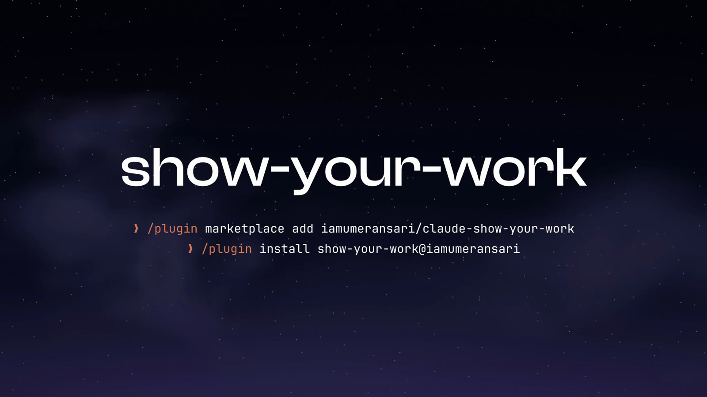

<p align="center">
  
</p>

<h1 align="center">claude-show-your-work</h1>

<p align="center">Mira, revisa e itera sobre el trabajo de tu agente sin salir del terminal.<br>Imágenes, vídeos y QA visual para Claude Code.</p>

<p align="center">
  <a href="https://github.com/iamumeransari/claude-show-your-work/stargazers"></a>
  <a href="#install"></a>
  <a href="#install"></a>
  <a href="LICENSE"></a>
</p>

## Instalación

Ejecuta estos dos comandos en Claude Code:
```
/plugin marketplace add https://github.com/iamumeransari/claude-show-your-work.git#releases
/plugin install show-your-work@iamumeransari
```
Admite Ghostty y kitty, en macOS y Linux, con Claude Code 2.1.286 o superior. Los vídeos y el audio también necesitan ffmpeg: instálalo con tu gestor de paquetes (`brew install ffmpeg` en macOS), o pídele a Claude que lo instale. Las páginas HTML necesitan Chrome, Chromium o el navegador de Playwright, y los PDF necesitan poppler (`brew install poppler`).

Cuando termine la instalación, una breve bienvenida te enseña el entorno. Ejecuta `/show-your-work` en cualquier momento para cambiar tus ajustes.

## Uso

Claude te muestra su trabajo en el chat siempre que crea o cambia algo visual. También puedes pedírselo directamente:

- "Dame cuatro direcciones para el hero de la página de inicio y muéstralas lado a lado."
- "Construye el formulario de registro, pruébalo y muéstrame la grabación."
- "Corrige el interruptor de facturación y muéstrame el antes y el después."

### QA visual con grabaciones de antes y después

<p align="center"></p>

Cuando Claude crea una función o corrige un error, prueba el cambio con Playwright, graba la ejecución y reproduce la grabación en el chat, con todo lo que necesitas para revisar el trabajo en un solo lugar:

- **Antes y después:** Para cualquier cambio, desde una función nueva hasta la corrección de un error, Claude graba los mismos pasos en la versión antigua y en la nueva. Luego, Compare reproduce ambas lado a lado, en sincronía.
- **Marcadores de cambios:** Cada cambio que hizo Claude se lista junto al vídeo con su marca de tiempo, y al hacer clic en uno saltas directamente al momento en que aparece.
- **Comprobaciones en vivo:** Cada comprobación de la prueba se pone verde o roja a medida que el vídeo la alcanza, así ves exactamente dónde funciona la corrección y dónde algo sigue fallando.
- **Un solo lugar para revisar:** No necesitas abrir un navegador, volver a ejecutar las pruebas ni leer registros, porque la grabación y sus resultados están ahí mismo en el chat.

### Imágenes

<p align="center">
  
  
</p>

Sea lo que sea que diseñe Claude, lo ves directamente en el chat: páginas de aterrizaje, pantallas de la aplicación, componentes, conceptos de diseño, diapositivas, gráficos e imágenes generadas. Pide unas cuantas direcciones y aparecen lado a lado, y luego sigue iterando en la que más te guste.

- **Compara direcciones:** Varios conceptos se muestran juntos, así puedes elegir uno de un vistazo en lugar de abrir los archivos uno por uno.
- **Cada versión guardada:** Cada versión nueva llega al mismo reproductor, y History te permite retroceder por cada borrador anterior.
- **Antes y después:** Cambia entre el diseño antiguo y el nuevo, o ponlos lado a lado, para ver exactamente qué cambió.

### Vídeo

<p align="center">
  
  
</p>

Más allá del QA de producto, Claude puede mostrarte un vídeo de casi cualquier cosa en la que trabaje. ¿Estás construyendo un sitio web y quieres ver cómo se siente al desplazarte de arriba abajo? Solo pídelo, y la grabación se reproduce en el chat, con animaciones y todo.

¿Estás haciendo un anuncio, una animación o un vídeo de lanzamiento? Cada corte se reproduce directamente en el chat, en un reproductor de vídeo con todas las funciones:

- **Controles de vídeo:** Reproduce, pausa, recorre la línea de tiempo y salta adelante o atrás hasta el momento que quieras. Un vídeo con sonido se reproduce con su sonido; Silenciar desactiva el sonido durante la sesión.
- **Marcas de tiempo:** La barra lateral te guía por lo que ocurre en el vídeo, paso a paso. Cada paso lleva su marca de tiempo, así que un solo clic te lleva directamente a ese momento.
- **Compara versiones:** Cuando Claude hace una versión nueva de un vídeo, se abre en el mismo reproductor. Puedes cambiar entre borradores en History o reproducir las versiones antigua y nueva lado a lado, en sincronía.
- **Funciones rápidas:** Abre el vídeo en QuickTime Player para verlo más grande, o guárdalo directamente en tu carpeta de Descargas con un solo clic.

## Terminales

show-your-work admite Ghostty y kitty, en macOS y Linux. Las imágenes funcionan ahí directamente.

- **Rex y la aplicación Herdr:** las imágenes y los vídeos se dibujan, pero Claude Code solo los activa ahí cuando se inicia con `CLAUDE_CODE_FORCE_TERMINAL_IMAGES=1`. El botón Activar imágenes del aviso añade una línea a tu perfil de shell que lo configura solo en ese terminal, y copia un comando para reabrir el chat.
- **Warp, WezTerm y Konsole:** estos admiten el protocolo gráfico de kitty, pero no los marcadores de posición Unicode con los que Claude Code dibuja imágenes, así que las imágenes aún no pueden mostrarse en ellos.
- **Otros terminales basados en Ghostty o kitty:** Claude Code no los reconoce y deja las imágenes desactivadas. Inícialo con `CLAUDE_CODE_FORCE_TERMINAL_IMAGES=1` (el aviso copia un comando que hace esto), o añade `export CLAUDE_CODE_FORCE_TERMINAL_IMAGES=1` a tu perfil de shell.
- **tmux:** funciona dentro de Ghostty o kitty. Claude Code deja las imágenes desactivadas en tmux a menos que se inicie con `CLAUDE_CODE_FORCE_TERMINAL_IMAGES=1`, así que la primera vez el plugin lo activa para los nuevos paneles de tmux y el aviso copia un comando que reabre el chat con ello. El plugin también activa `allow-passthrough` para su propio panel y hace pasar las imágenes. No se cambia nada de tu configuración de tmux.

Las versiones 0.6.7 a 0.6.9 ofrecían un botón Activar imágenes en Warp, WezTerm y Konsole, que añadía una línea a tu perfil de shell. Hacía que las imágenes se dibujaran como una cuadrícula de cajas, así que el plugin ahora elimina esa línea por sí solo.

## Preguntas frecuentes

<details>
<summary><b>¿Puede Claude Code mostrar imágenes en el terminal?</b></summary>

Sí, Claude Code puede mostrar imágenes en el terminal con el plugin show-your-work. Una vez instalado, Claude muestra capturas de pantalla, diseños, gráficos y otras imágenes directamente en el chat. Funciona en Ghostty y kitty.

</details>

<details>
<summary><b>¿Puede Claude Code reproducir vídeos en el terminal?</b></summary>
Sí, Claude Code puede reproducir videos en la terminal con el plugin show-your-work. Reproduce grabaciones de pantalla, animaciones, anuncios y videos de lanzamiento dentro del chat de Claude Code. Viene con un reproductor de video lleno de funciones, con desplazamiento por la línea de tiempo, controles de salto, marcas de tiempo clicables y comparaciones lado a lado.

</details>

<details>
<summary><b>¿Cómo veo lo que Claude Code creó sin abrir un navegador?</b></summary>

Puedes ver lo que Claude Code creó instalando el plugin show-your-work. Cuando Claude crea o cambia algo visual, toma una captura de pantalla o lo graba y te muestra el resultado en el chat. No tienes que cambiar a un navegador y buscar la página tú mismo.

</details>

<details>
<summary><b>¿Puede Claude Code probar mi app y mostrarme una grabación?</b></summary>

Sí, Claude Code puede probar tu app y mostrarte una grabación con el plugin show-your-work. Claude prueba las funciones que crea con Playwright, graba cada ejecución y reproduce la grabación en el chat. Los pasos se enumeran junto al video con marcas de tiempo. Cada comprobación se vuelve verde o roja cuando el video la alcanza.

</details>

<details>
<summary><b>¿Puede Claude Code mostrarme un antes y después de un cambio o una corrección de un error?</b></summary>

Sí, Claude Code puede mostrarte un antes y después de un cambio o una corrección de un error con el plugin show-your-work. Claude graba los mismos pasos de Playwright en la versión antigua y en la nueva. Compare reproduce ambas grabaciones lado a lado, sincronizadas. Cada comprobación de prueba se vuelve verde o roja cuando el video la alcanza.

</details>

<details>
<summary><b>¿Existe un plugin de Claude Code para QA visual?</b></summary>

Sí, show-your-work es un plugin de Claude Code para QA visual. Graba las ejecuciones de pruebas de Playwright de Claude y las reproduce en el chat. Cada grabación viene con marcas de cambio clicables y comprobaciones que se vuelven verdes o rojas mientras el video se reproduce. Para un cambio o una corrección de un error, reproduce el antes y después lado a lado, sincronizados.

</details>

<details>
<summary><b>¿Cómo compruebo que Claude Code realmente corrigió un error?</b></summary>

La forma más fácil de comprobar que Claude Code realmente corrigió un error es que grabe la corrección con show-your-work. Pídele a Claude que corrija el error y te muestre el antes y después. Las versiones antigua y nueva se reproducen lado a lado, sincronizadas, con las comprobaciones que ahora pasan marcadas en verde.

</details>

<details>
<summary><b>¿En qué se diferencia show-your-work de simplemente ver imágenes en la terminal?</b></summary>

show-your-work va más allá de ver imágenes en la terminal. Su principal fortaleza es el QA visual. Reproduce grabaciones de Playwright antes y después sincronizadas, lista los cambios en los que puedes hacer clic para saltar a ellos, y vuelve cada comprobación verde o roja mientras el video se reproduce. Puedes revisar una función o una corrección sin salir de Claude Code.

</details>

<details>
<summary><b>¿Mostrar imágenes y videos consume tokens?</b></summary>

No, show-your-work apenas usa tokens extra, porque está construido desde cero para ser eficiente tanto en tokens como en memoria. Las imágenes y los videos se dibujan directamente en tu terminal con el protocolo gráfico de kitty, sin usar ningún token. Los videos también se decodifican y transmiten de forma eficiente, así que se usa muy poca memoria.

</details>

<details>
<summary><b>¿En qué terminales funciona?</b></summary>

El plugin show-your-work es compatible con Ghostty y kitty, en macOS y Linux.

</details>

<details>
<summary><b>¿Es gratis?</b></summary>

Sí, show-your-work es gratuito y de código abierto bajo la licencia MIT.

</details>

<details>
<summary><b>¿Tengo que actualizar el plugin yo mismo cuando salgan nuevas funciones y correcciones?</b></summary>

No, no necesitas actualizarlo tú mismo. El plugin se actualiza solo, así que nunca te quedas atrás. Puedes elegir entre las versiones Stable y Latest durante la incorporación, o en cualquier momento con `/show-your-work`.

</details>

<details>
<summary><b>¿Cómo vuelvo a ver la incorporación?</b></summary>

Puedes volver a ver la incorporación ejecutando `/show-your-work tour`. Cubre las grabaciones, el antes y después, el historial de versiones y la configuración.

</details>

<details>
<summary><b>¿Ocupa mucho espacio?</b></summary>

No, no ocupa mucho espacio. Guarda las imágenes y videos recientes para que puedas volver a verlos, y borra los más antiguos cuando sumen unos 1 GB.

</details>

<details>
<summary><b>¿Recopila algún dato?</b></summary>

Tú decides si compartir datos de uso anónimos. Puedes tomar esa decisión durante la incorporación, o cambiarla en cualquier momento con `/show-your-work`. Nunca recopila ningún dato sensible. Los detalles están en la [Política de privacidad](PRIVACY.md).

</details>

<details>
<summary><b>¿Qué ejecuta, conserva y a qué se conecta en mi computadora?</b></summary>

Aquí está todo lo que el plugin hace en tu computadora, para que sepas exactamente qué estás instalando. Tus imágenes y videos nunca salen de tu máquina.

Para preparar imágenes y videos, usa `ffmpeg` y `ffprobe` (convertir un video en fotogramas y leer su duración) y, en macOS, `sips` (convertir una imagen a PNG). Cuando reproduces un video con sonido, `ffplay` (parte de ffmpeg) reproduce su sonido y, en macOS, `osascript` lee cuánto tardan tus altavoces o auriculares en reproducirlo, para que la imagen espere al sonido. Cuando pulsas View, Show in Finder o Save to Downloads, abre el archivo con `open` en macOS o `xdg-open` en Linux. En macOS, `mdfind` ayuda a `/img` a encontrar una imagen que pegaste. Para mostrar una página HTML o un documento Markdown o Mermaid, lo renderiza en un Chrome o Chromium oculto con un perfil desechable (nunca tus inicios de sesión); para PDFs usa `pdftoppm` y `pdfinfo` de poppler.

Unos scripts cortos se ejecutan con `sh` y `perl`. Buscan `ffmpeg` y tu carpeta de inicio, leen el tamaño de celda de la terminal para que las imágenes encajen, ordenan la carpeta temporal del plugin, abren un visor en Linux y cambian entre los canales Stable y Latest. También usa `cp`, `mkdir`, `rm`, `cat` y `touch` para sus propios archivos temporales, y `claude plugin` para instalar sus propias actualizaciones desde este repositorio, como máximo una vez al día. Puedes desactivar las actualizaciones. El actualizador se desactivará después de que el plugin se mueva al directorio de plugins de Claude Code, que lo mantiene actualizado en su lugar.

Conserva estos archivos:

- Los fotogramas de video y las imágenes convertidas van a una carpeta temporal (`$TMPDIR/claude-show-your-work-<your user id>`), y todo lo que tenga más de una semana se limpia.
- Una copia de cada archivo que Claude te muestra va a `.show-your-work/` en tu proyecto, para que puedas revisar las versiones anteriores.
- Save to Downloads pone una copia en `~/Downloads`.
- Si el perfil de tu shell tiene la línea que añadió Turn on pictures de una versión anterior (ver [Terminales](#terminals)), elimina esa única línea.
- Con `SHOW_YOUR_WORK_DEBUG=1`, escribe un `debug.log` en la carpeta temporal.

Una vez al día lee el número de versión más reciente del plugin desde `raw.githubusercontent.com`.
Si en `/show-your-work` está configurado compartir datos de uso, envía recuentos de uso anónimos a `us.i.posthog.com`. Se trata de nombres de eventos y recuentos, junto con las versiones del plugin y de Claude Code, tu terminal, tu sistema operativo y si ffmpeg está instalado, bajo un id de instalación aleatorio. Nunca incluyen nombres de archivos, rutas, prompts, nada que escribas ni tu dirección IP. La clave que hay en el código es la clave pública de PostHog, que solo puede enviar eventos.

Dentro de Claude Code, usa estos hooks:

- `prompt.submit` envía una línea corta con tu mensaje, indicando a Claude que esta terminal puede mostrar imágenes (o por qué no puede). Se envía una vez por sesión, otra vez después de una compactación, y cuando eso cambia.
- `prompt.submit` cierra los ajustes cuando envías un mensaje y recuerda los nombres de las imágenes que pegas, para que `/img` pueda encontrarlas. Tu mensaje no se modifica.
- `tool.call` gestiona las propias herramientas del plugin `show_image`, `show_video`, `show_html`, `show_audio` y `show_document`. Nunca toca otras herramientas.
- `command.run` ejecuta `/img`, `/page`, `/audio`, `/doc` y `/show-your-work`. Justo después de instalar, ejecuta `/show-your-work tour` una vez para enseñarte el recorrido.
- `ui.render` dibuja el reproductor, los avisos, los ajustes y el recorrido del plugin.
- `session.start` y `session.end` preparan la carpeta temporal y la terminal al inicio, y envían los recuentos de uso pendientes al final. Dentro de tmux también inician y detienen el paso de imágenes del panel del plugin (ver [Terminales](#terminals)).

</details>

## Comentarios

Para informar de un error o sugerir un cambio, [abre una incidencia](https://github.com/iamumeransari/claude-show-your-work/issues).

## Para desarrolladores

<details>
<summary>Herramientas, ajustes y desarrollo local</summary>

El plugin ofrece a Claude cinco herramientas: `show_image`, `show_video`, `show_html` (una instantánea de una página HTML), `show_audio` (MP3 y WAV, con una forma de onda) y `show_document` (PDF, Markdown y Mermaid, página por página). Una llamada básica solo necesita una ruta. Para una comparación antes y después, Claude también pasa el archivo antiguo y los resultados de la prueba:
```jsonc
{
  "path": "qa/after.webm",          // the run on the fixed version
  "compare": "qa/before.webm",      // the same steps on the old version
  "title": "Pricing page",
  "url": "http://localhost:3000/pricing",
  "changes": [                      // what changed, and the second it shows up
    { "title": "Annual toggle sets prices", "at": 3.2 },
    { "title": "Plan buttons line up", "at": 5.4 }
  ],
  "summary": [                      // the test results, at most three lines
    { "label": "Billing: toggle works", "ok": true, "passed": 1, "total": 1 },
    { "label": "Layout: plans, buttons", "ok": true, "passed": 3, "total": 3 }
  ]
}
```
Los vídeos se cortan en fotogramas a un máximo de 12 por segundo, con el ancho que la ventana muestra (como máximo 2400 px), con un límite de 3.600 fotogramas (cinco minutos a velocidad completa). Para abrir un archivo tú mismo, ejecuta `/img path/to/file.png`.

Para trabajar en el plugin, edita los módulos de `hooks/` (`register.tsx` es el punto de entrada) y ejecuta `/reload-plugins` para cargar tus cambios. Antes de enviar un cambio, ejecuta `claude plugin validate .` y `claude plugin test .`.

</details>

## Estado

show-your-work está en mantenimiento activo. Es el primer plugin que lleva imágenes, vídeos y pruebas visuales automatizadas con grabaciones de Playwright a la terminal de Claude Code. Su vídeo de lanzamiento ha superado las 275.000 visualizaciones. Desde entonces se ha convertido en la opción popular entre los desarrolladores que quieren ver lo que Claude construye sin salir de la terminal. Está listado en algunos de los catálogos de plugins de Claude Code más grandes y actualmente se encuentra entre los plugins en tendencia para Claude Code.

Si quieres que Claude Code te muestre capturas de pantalla, grabaciones de pantalla o comparaciones antes y después de su trabajo sin salir de la terminal, este plugin está hecho exactamente para eso.

## Licencia

[MIT](LICENSE). La fotografía de los ejemplos procede de [Unsplash](https://unsplash.com), usada bajo la Licencia de Unsplash. [Privacidad](PRIVACY.md).

<p align="center"><a href="#install"></a></p>

## Fuente y licencia

- Autor original: [iamumeransari](https://github.com/iamumeransari/claude-show-your-work)
- Repositorio original: https://github.com/iamumeransari/claude-show-your-work
- Licencia: MIT
- Traducción al español y localización de interfaz: proyecto claude-code-mods-es
