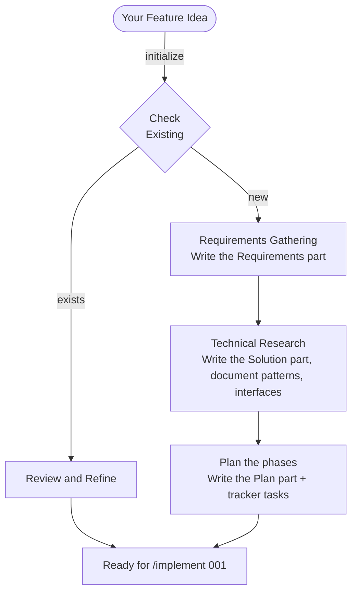
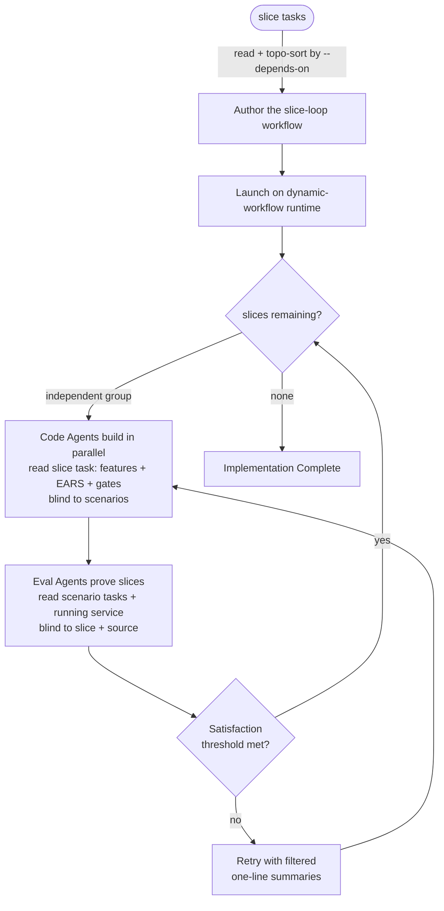
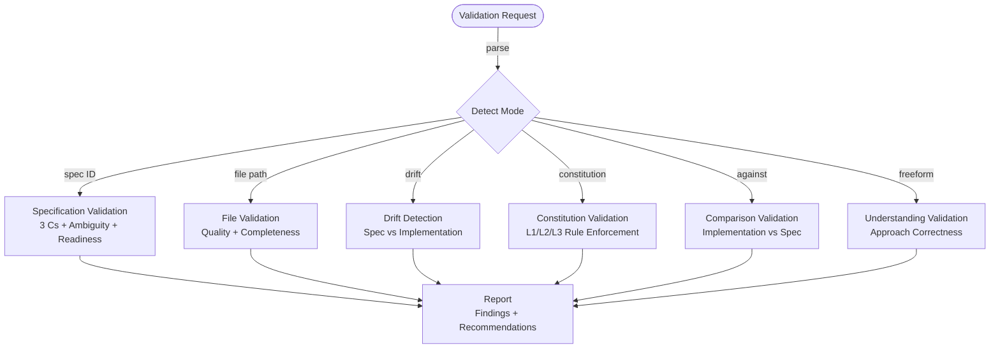
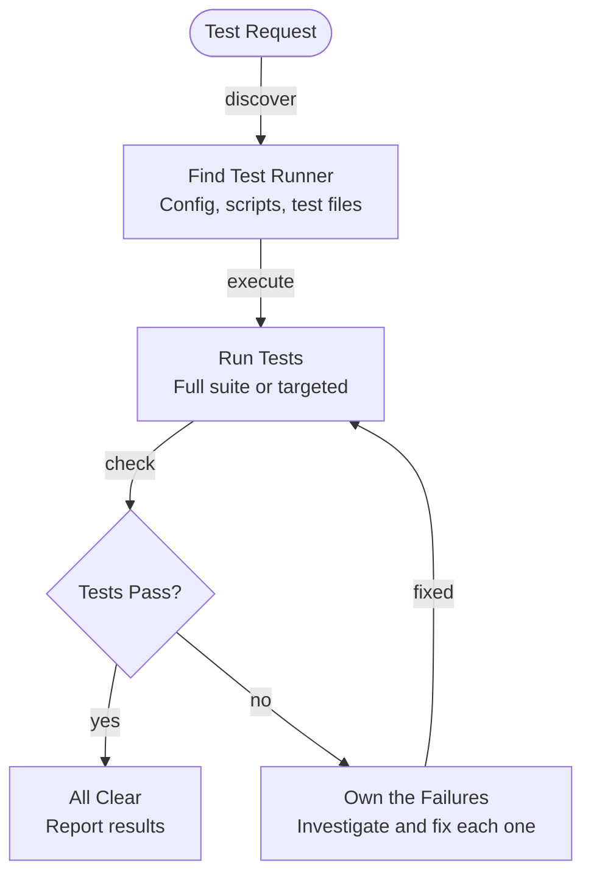
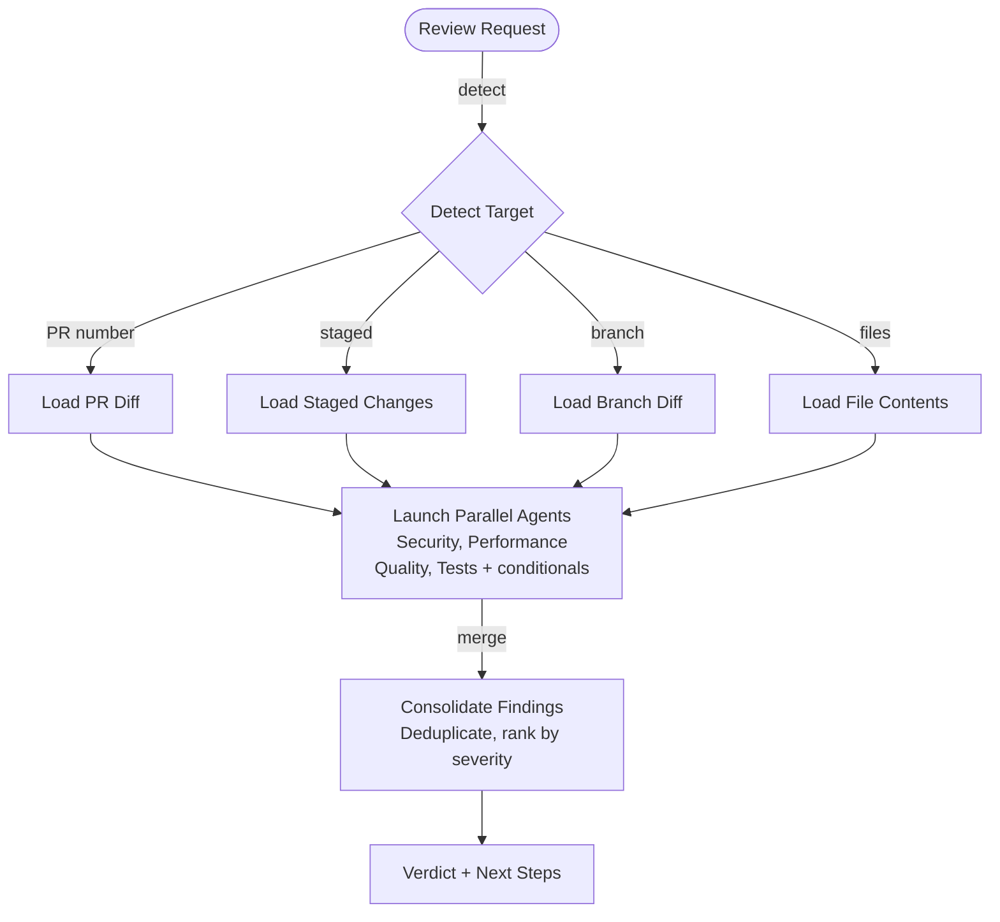
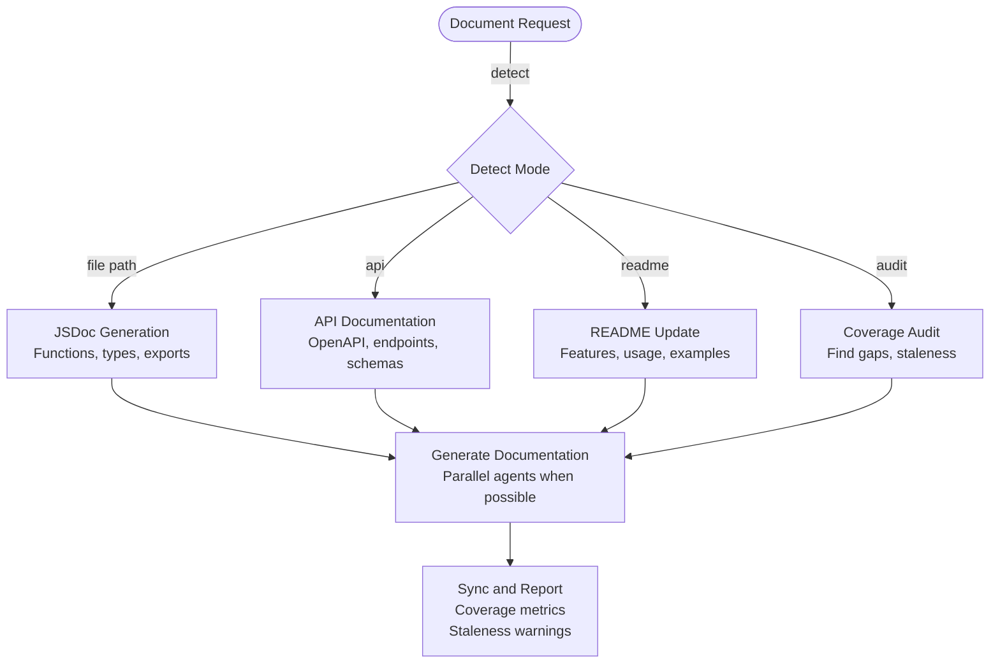
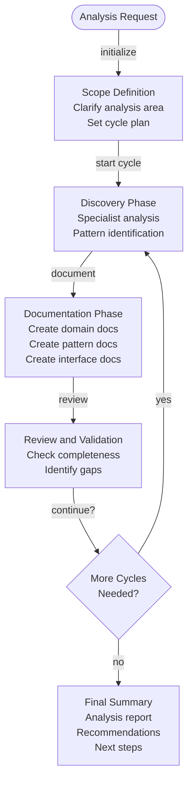
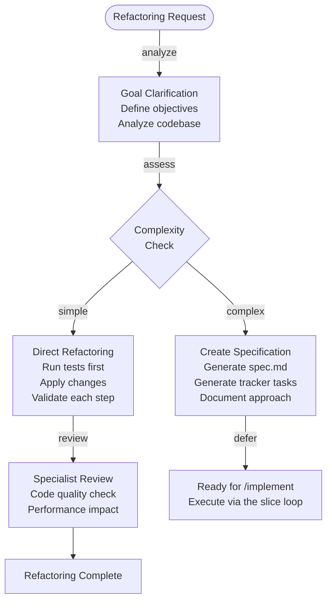
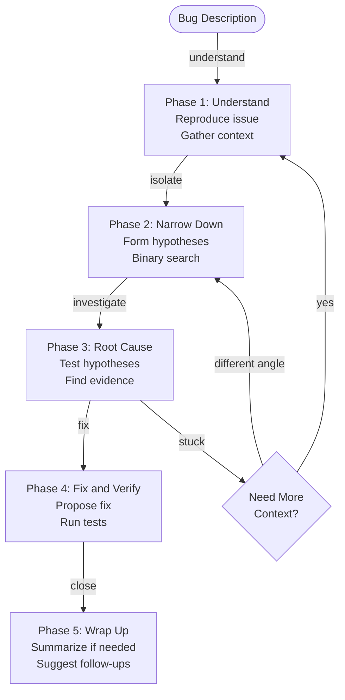
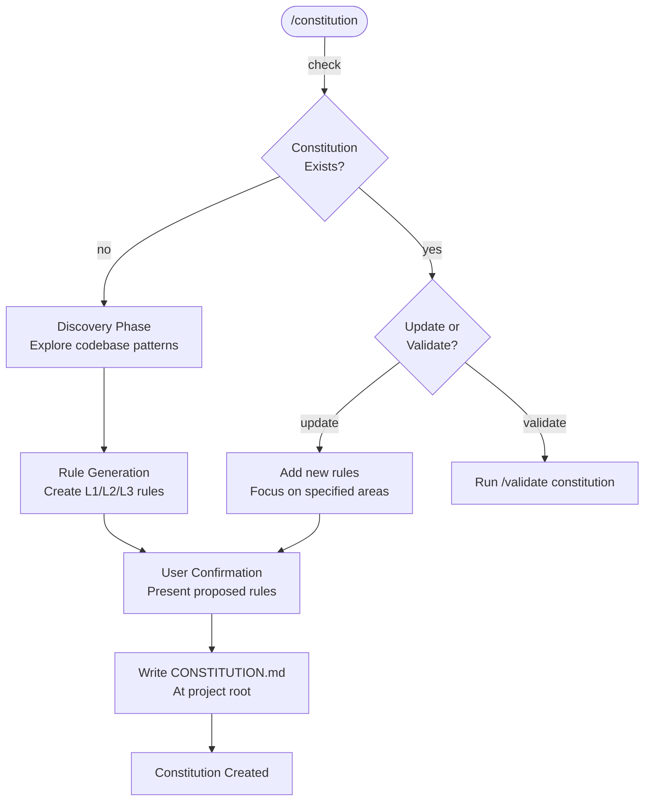

# Start Plugin - The Agentic Startup

**Plugin de orquestación de flujos de trabajo para desarrollo guiado por especificaciones en Claude Code.**

El plugin `start` ofrece diez skills de flujo de trabajo invocables por el usuario, cinco skills autónomas y tres estilos de salida para transformar la forma en que construyes software con Claude Code.

**Para un inicio rápido, la guía de flujos y la selección de skills, consulta el [README principal](../../README.md).**

---

## Tabla de contenidos

- [Skills invocables por el usuario](#user-invocable-skills) — specify, implement, validate, test, review, document, analyze, refactor, debug, constitution
- [Skills autónomas](#autonomous-skills) — 5 skills activadas por contexto
- [Estructura de documentación](#documentation-structure) — specs, dominio, patrones, interfaces
- [Estilos de salida](#output-styles) — The Garage, The Startup, The ScaleUp
- [Flujo de desarrollo típico](#typical-development-workflow) — flujos principales y de mantenimiento
- [Skills en acción](#skills-in-action) — ejemplos reales
- [Plantillas](#templates) — PRD, SDD, Plan, Escenario
- [Filosofía](#philosophy) — principios del desarrollo guiado por especificaciones

---

## Skills invocables por el usuario

Estas skills se invocan mediante comandos de barra (p. ej., `/specify`). A diferencia de las skills autónomas, que se activan automáticamente según el contexto, las invocables por el usuario esperan a una invocación explícita.

### `/specify <description>`

Crea especificaciones completas a partir de breves descripciones mediante investigación profunda y coordinación de agentes especialistas, produciendo un plan narrativo más las tareas de slice que ejecuta `/implement`.

**Propósito:** convertir ideas en especificaciones listas para implementar con requisitos de producto, diseño de solución y un plan: un `spec.md` más las tareas de implementación en el gestor de seguimiento.

**Uso:**
```bash
/specify Build a real-time notification system with WebSocket support
/specify 001  # Resume existing specification work
```

**Características principales:**
- **IDs de spec autoincrementales**: crea directorios numerados automáticamente (001, 002, etc.)
- **Capacidad de reanudación**: permite continuar trabajos de especificación existentes por ID
- **Plan por slices**: divide el trabajo en tareas de slice autónomas, cada una correlacionando funcionalidades (AC), comportamiento EARS y compuertas de calidad, con escenarios de reserva como tareas hijas de escenario separadas
- **Ordenadas por dependencias**: los slices declaran `--depends-on` entre sí; ese grafo es el contrato de paralelización que usa `/implement`
- **Documentación de patrones**: documenta automáticamente los patrones descubiertos en `docs/patterns/`
- **Documentación de interfaces**: captura contratos de servicios externos en `docs/interfaces/`
- **Documentación de dominio**: registra reglas de negocio en `docs/domain/`
- **Compuertas de calidad**: exige la aprobación del usuario entre fases importantes

**El brief de código de cada slice correlaciona tres facetas:**

| Faceta | Fuente | Función |
|-------|--------|------|
| **Funcionalidades** (criterios de aceptación) | Parte de requisitos | qué entrega el slice |
| **Comportamiento** (EARS) | Parte de solución | cómo debe comportarse |
| **Compuertas de calidad** | derivada | condiciones comprobables |

Sus **escenarios de aceptación** son tareas hijas de escenario separadas (evidencia de reserva): cómo se demuestra.

<details>
<summary><strong>Ver detalles</strong></summary>

**Qué obtienes:** un documento, `.start/specs/[NNN]-[name]/spec.md`, en tres partes, cada una cerrada por su propia compuerta de aprobación:

- **Requisitos**: historias de usuario, especificaciones de funcionalidades, criterios de éxito, requisitos no funcionales
- **Solución**: arquitectura técnica, componentes del sistema, modelos de datos, stack tecnológico
- **Plan**: el estado objetivo y las fases con sus resultados; las tareas de implementación (fases → slices → tareas hijas de escenario) viven en **.tracker/**

Su parte Ledger contiene las preguntas abiertas, suposiciones, registro de decisiones y compensaciones de revisión aceptadas.



</details>

---

### `/implement <spec-id>`

Ejecuta una especificación corriendo sus tareas de slice en el entorno de flujos de trabajo dinámicos de Claude Code.

**Propósito:** transformar especificaciones validadas en código funcionando mediante un solo bucle: cada slice lo construye un agente de código y lo demuestra un agente de evaluación, con una barrera de información entre ellos y reintentos hasta un umbral de satisfacción.

**Uso:**
```bash
/implement 001
/implement path/to/custom/spec/
```

**Cómo funciona:**

`/implement` lee las tareas de slice de la especificación desde el gestor de seguimiento y las ordena topológicamente por `--depends-on`. Después redacta y ejecuta un único flujo de trabajo dinámico:

| Paso | Qué ocurre |
|------|--------------|
| **Leer** | Lee las tareas de slice (`task.js graph`); cada una lleva un brief de código (funcionalidades + EARS + compuertas) con sus escenarios de reserva como tareas hijas de escenario |
| **Lanzar** | Escribe el script del flujo de trabajo a partir del contrato de bucle de la skill y lo ejecuta mediante la herramienta Workflow; los slices independientes corren concurrentemente |
| **Bucle** | Por fase: los agentes de código construyen sus slices — un agente para una fase cuyos slices dependen entre sí en cadena, uno por slice para los que pueden ejecutarse en paralelo (leen las tareas de slice, sin ver los escenarios) → un agente de evaluación demuestra la fase con un script de reserva guardado fuera del proyecto (lee las tareas de escenario, sin ver los slices ni el código fuente) → reintentos con resúmenes filtrados hasta el umbral o el máximo de iteraciones |

**Características principales:**
- **Un bucle, escala emergente**: un plan de 1 slice es un bucle corto; un plan de 40 slices se despliega. No hay que elegir nivel ni estrategia
- **Barrera de información estructural**: la barrera es qué tarea lee cada agente: agente de código → tarea de slice; agente de evaluación → tareas hijas de escenario
- **Reanudabilidad**: el entorno de flujos dinámicos reanuda desde caché los agentes completados dentro de una sesión
- **Detección de deriva**: ejecuta comprobaciones de deriva con `Skill(start:validate)`
- **Aplicación de la constitución**: las violaciones L1/L2 bloquean la finalización
- **Actualizaciones en tiempo real**: `/workflows` muestra el progreso por slice en directo

<details>
<summary><strong>Ver detalles: el bucle de slice</strong></summary>

Lee las tareas de slice de la especificación desde el gestor de seguimiento y las ordena topológicamente por `--depends-on`. Ejecuta un flujo de trabajo dinámico escrito a partir del contrato de bucle de la skill. Cada fase pasa por un bucle código→evaluación con barrera: los agentes de código construyen sus slices (leyendo las funcionalidades + EARS + compuertas de las tareas de slice y AGENTS.md, pero nunca sus tareas hijas de escenario), un agente de evaluación demuestra la fase frente a esas tareas de escenario con un script de reserva que guarda fuera del proyecto (accediendo al servicio en ejecución y, para escenarios de interfaz, a un navegador real, pero nunca a los slices ni al código fuente), y resúmenes filtrados de una línea alimentan el siguiente reintento hasta el umbral de satisfacción o el máximo de iteraciones. Una fase cuyos slices forman una cadena de dependencias la construye un solo agente de código; los slices que pueden ejecutarse en paralelo reciben un agente cada uno, concurrentemente.



</details>

---

### `/validate <target>`

Valida especificaciones, implementaciones o la comprensión mediante detección inteligente de contexto y el marco de las 3 C (Integridad, Coherencia, Corrección).

**Propósito:** compuerta de calidad que funciona en cualquier etapa del ciclo de vida: durante la especificación, antes de la implementación o tras la finalización.

**Uso:**
```bash
/validate 001                                          # Validate spec by ID
/validate .start/specs/001/spec.md                      # Validate specific file
/validate Check the auth implementation against SDD    # Compare implementation to spec
/validate drift                                        # Check for spec-implementation drift
/validate constitution                                 # Validate constitution compliance
/validate Is my caching approach correct?              # Validate understanding
```

**Características principales:**
- **Detección inteligente de modo**: determina automáticamente el tipo de validación a partir de la entrada
- **Marco de las 3 C**: comprueba Integridad, Coherencia y Corrección
- **Detección de ambigüedad**: busca lenguaje vago («debería», «varios», «etc.»)
- **Trazabilidad entre documentos**: verifica la alineación requisitos → solución → manifiesto
- **Detección de deriva**: comprueba la alineación especificación-implementación
- **Aplicación de la constitución**: valida las reglas de gobernanza L1/L2/L3
- **Solo consultivo**: ofrece recomendaciones sin bloquear
- **Validación comparativa**: compara implementaciones con especificaciones

<details>
<summary><strong>Ver detalles</strong></summary>

**Seis modos de validación** detectados automáticamente a partir de la entrada:

| Tipo de entrada | Modo | Qué se valida |
|------------|------|---------------------|
| ID de spec (`005`) | Especificación | Calidad y preparación completas de la spec |
| Ruta de archivo (`src/auth.ts`) | Archivo | Calidad de un archivo concreto |
| `drift` o `check drift` | Detección de deriva | Alineación spec-implementación |
| `constitution` | Constitución | Cumplimiento de reglas de gobernanza |
| «Check X against Y» | Comparación | Implementación frente a especificación |
| Texto libre | Comprensión | Corrección del enfoque |

**El marco de las 3 C:**

1. **Integridad** (Completeness): todas las secciones rellenas, sin marcadores `[NEEDS CLARIFICATION]`, listas completas
2. **Coherencia** (Consistency): trazabilidad entre documentos, terminología alineada, sin contradicciones
3. **Corrección** (Correctness): ADR confirmadas, dependencias válidas, criterios de aceptación comprobables



</details>

---

### `/test [target]`

Ejecuta pruebas con aplicación estricta de propiedad del código: no se admiten excusas de «fallos preexistentes».

**Propósito:** descubrir y ejecutar pruebas, garantizar que la base de código quede en estado correcto y exigir la propiedad de cualquier fallo encontrado.

**Uso:**
```bash
/test                            # Run full test suite
/test all                        # Run full test suite (explicit)
/test src/auth/                  # Run tests for specific path
/test baseline                   # Capture current test state
```

**Características principales:**
- **Descubrimiento de pruebas**: encuentra automáticamente el ejecutor, la configuración y los archivos de prueba
- **Propiedad del código**: si las pruebas fallan, tú eres responsable de arreglarlo — nada de culpar a problemas previos
- **Captura de línea base**: registra el estado actual de aciertos y fallos antes de los cambios
- **Paralelismo multiagente**: puede distribuir suites entre agentes paralelos
- **Ejecución dirigida**: ejecuta archivos, directorios o la suite completa concretos

<details>
<summary><strong>Ver detalles</strong></summary>

**El mandato de propiedad:**

Cuando las pruebas fallan, la skill exige propiedad estricta:
- Nada de «estos fallos ya existían»
- Nada de «no lo causaron mis cambios»
- Nada de dejar pruebas fallidas al usuario

**Modos de prueba:**

| Entrada | Modo | Qué ocurre |
|-------|------|--------------|
| (vacío) o `all` | Suite completa | Descubre y ejecuta todas las pruebas |
| Ruta de archivo/directorio | Dirigido | Ejecuta pruebas de un ámbito concreto |
| `baseline` | Captura | Registra el estado actual de pruebas para comparar |



</details>

---

### `/review [target]`

Revisión de código multiagente con perspectivas especializadas ejecutándose en paralelo.

**Propósito:** revisión exhaustiva del código antes de fusionar, con agentes especializados que examinan distintas cuestiones simultáneamente.

**Uso:**
```bash
/review                          # Review staged changes
/review 123                      # Review PR number
/review feature/auth             # Review branch changes
/review src/auth/ src/users/     # Review specific files/directories
/review staged                   # Explicitly review staged changes
```

**Características principales:**
- **Especialistas en paralelo**: agentes de Seguridad, Rendimiento, Calidad y Pruebas revisan a la vez
- **Perspectivas condicionales**: Concurrencia, Dependencias, Compatibilidad y Accesibilidad se activan cuando procede
- **Detección automática de objetivo**: detecta número de PR, cambios preparados, ruta de archivo o diferencias de rama
- **Puntuación de confianza**: cada hallazgo incluye su nivel de confianza (HIGH/MEDIUM/LOW)
- **Clasificación de gravedad**: hallazgos CRITICAL, HIGH, MEDIUM y LOW
- **Modo estándar o de equipo**: subagentes de lanzar y olvidar o compañeros persistentes con coordinación

<details>
<summary><strong>Ver detalles</strong></summary>

**Perspectivas de revisión principales (siempre activas):**

| Perspectiva | Áreas de enfoque |
|-------------|-------------|
| **Seguridad** | Inyección SQL, XSS, secretos codificados, evasiones de autenticación, validación de entradas |
| **Rendimiento** | Consultas N+1, índices ausentes, fugas de memoria, algoritmos ineficientes |
| **Calidad** | Complejidad del código, nombres, principios SOLID, manejo de errores, duplicación |
| **Pruebas** | Lagunas de cobertura, casos límite ausentes, calidad de pruebas, integridad de aserciones |

**Perspectivas condicionales (activadas cuando procede):**

| Perspectiva | Disparador |
|-------------|---------|
| **Concurrencia** | Se detecta async/await, Promise o hilos |
| **Dependencias** | Cambios en archivos de dependencias |
| **Compatibilidad** | Cambios en API pública o esquema |
| **Accesibilidad** | Cambios en componentes de frontend |
| **Constitución** | Existe CONSTITUTION.md en el proyecto |



</details>

---

### `/document [target]`

Genera y sincroniza documentación, incluidos docs de API, README, comentarios JSDoc y auditorías de documentación.

**Propósito:** mantener la documentación al día del código, generar documentos que faltan e identificar contenido obsoleto.

**Uso:**
```bash
/document src/api/               # Generate API documentation
/document readme                 # Update project README
/document src/utils/             # Add JSDoc to code files
/document audit                  # Audit documentation coverage
```

**Características principales:**
- **Múltiples modos de documentación**: código, API, README, auditoría, módulo
- **Detección de obsolescencia**: identifica documentación desactualizada
- **Métricas de cobertura**: informa del porcentaje de integridad de la documentación
- **Generación OpenAPI**: crea especificaciones OpenAPI/Swagger a partir del código de API
- **Paralelismo multiagente**: varios agentes de documentación trabajan simultáneamente

<details>
<summary><strong>Ver detalles</strong></summary>

**Modos de documentación:**

| Entrada | Modo | Salida |
|-------|------|--------|
| Ruta de archivo/directorio | Código | Comentarios JSDoc/TSDoc |
| `api` | API | Especificación OpenAPI, documentación de endpoints |
| `readme` | README | Actualizaciones de README.md |
| `audit` | Auditoría | Informe de cobertura |

**Detección de obsolescencia:**

La skill detecta automáticamente cuándo la documentación está desactualizada:
- Comparando marcas de tiempo de documentos con cambios de código
- Comprobando si las API documentadas siguen coincidiendo con la implementación
- Identificando exportaciones nuevas sin documentar



</details>

---

### `/analyze <area>`

Descubre y documenta reglas de negocio, patrones técnicos e interfaces de sistema mediante exploración iterativa.

**Propósito:** extraer conocimiento organizacional de la base de código existente y crear documentación reutilizable.

**Uso:**
```bash
/analyze security patterns in authentication
/analyze business rules for user permissions
/analyze technical patterns in our microservices architecture
```

<details>
<summary><strong>Ver detalles</strong></summary>

Usa un flujo cíclico de descubrimiento-documentación-revisión para extraer conocimiento organizacional. Agentes especialistas exploran la base de código para identificar patrones, reglas e interfaces en áreas de negocio, técnicas, seguridad, rendimiento, integración, datos, pruebas y despliegue. La documentación se organiza automáticamente en los directorios `docs/domain/`, `docs/patterns/` y `docs/interfaces/`.



</details>

---

### `/refactor <description>`

Mejora la calidad del código preservando estrictamente todo el comportamiento existente mediante cambios incrementales validados por pruebas.

**Propósito:** refactorización segura y sistemática con reversión automática ante fallos de pruebas.

**Uso:**
```bash
/refactor Simplify the authentication middleware for better testability
/refactor Improve the WebSocket connection manager
```

<details>
<summary><strong>Ver detalles</strong></summary>

Preserva estrictamente el comportamiento mediante cambios incrementales validados por pruebas. Todas las pruebas deben pasar antes de empezar la refactorización y tras cada cambio. Reversión automática ante fallos. Para refactorizaciones simples, aplica cambios directamente con validación continua. Para las complejas, crea documentos de especificación y las delega en `/implement` para su ejecución planificada.



</details>

---

### `/debug <description>`

Diagnostica y resuelve errores mediante investigación conversacional con análisis sistemático de causa raíz.

**Propósito:** compañero de depuración en lenguaje natural que ayuda a identificar y corregir problemas mediante diálogo, no procedimientos rígidos.

**Uso:**
```bash
/debug The API returns 500 errors when uploading large files
/debug Tests are failing intermittently on CI but pass locally
/debug Users report slow page loads after the latest deployment
```

**Características principales:**
- **Flujo conversacional**: diálogo natural, no listas ni procedimientos rígidos
- **Divulgación progresiva**: empieza con un resumen y revela detalles a petición
- **Solo acciones observables**: informa únicamente de lo que se comprobó y encontró realmente
- **Dirigido por el usuario**: propone siguientes pasos y deja que el usuario guíe la dirección
- **Seguimiento de hipótesis**: formula y prueba hipótesis ordenadas sistemáticamente
- **Basado en evidencia**: nunca inventa razonamientos; todas las conclusiones se respaldan con evidencia

<details>
<summary><strong>Ver detalles</strong></summary>

Usa un enfoque conversacional en cinco fases naturales: entender el problema, acotarlo, encontrar la causa raíz, corregir y verificar, y cerrar. El depurador informa solo de acciones observables («Comprobé X y encontré Y») y nunca inventa razonamientos. Los usuarios pueden preguntar «¿qué comprobaste?» en cualquier momento y recibir respuestas honestas y verificables.



**Los cuatro mandamientos:**
1. **Conversacional, no procedimental**: es un diálogo, no una lista de comprobación
2. **Solo observable**: «miré X y encontré Y», no «esto probablemente es...»
3. **Divulgación progresiva**: empieza breve, amplía a petición
4. **El usuario al mando**: «¿Quieres que...?», no «Ahora voy a...»

</details>

---

### `/constitution [focus-areas]`

Crea o actualiza una constitución de proyecto con reglas de gobernanza mediante análisis de patrones basado en descubrimiento.

**Propósito:** establecer reglas de proyecto comprobables que se aplican durante la implementación, la revisión y la validación.

**Uso:**
```bash
/constitution                                    # Create new constitution via codebase discovery
/constitution security and testing               # Focus on specific areas
/constitution Add API patterns                   # Update existing constitution
```

**Características principales:**
- **Reglas basadas en descubrimiento**: analiza patrones reales de la base de código, nunca supone frameworks
- **Sistema de niveles L1/L2/L3**: L1 (bloqueante + autocorrección), L2 (bloqueante, manual), L3 (consultivo)
- **Aplicación en tres capas**: se comprueba durante specify (SDD), implement y review
- **Reglas de patrón + comprobación**: admite patrones regex y comprobaciones semánticas interpretadas por LLM
- **Degradación elegante**: el sistema funciona con normalidad si no existe constitución

<details>
<summary><strong>Ver detalles</strong></summary>

Crea `CONSTITUTION.md` en la raíz del proyecto (como README, LICENSE, CODE_OF_CONDUCT). La constitución define barreras comprobables que detectan violaciones durante el desarrollo.

**Distinción clave:**
- **CLAUDE.md** = descripción del proyecto, guía para la IA («Usa React con TypeScript»)
- **CONSTITUTION.md** = reglas comprobables que detectan violaciones («Sin exportaciones barrel»)

**Definiciones de nivel:**

| Nivel | Nombre | Bloqueante | Autocorrección | Caso de uso |
|-------|------|----------|---------|----------|
| **L1** | Must (debe) | Sí | La IA corrige automáticamente | Seguridad, corrección, arquitectura crítica |
| **L2** | Should (debería) | Sí | No | Reglas importantes que requieren juicio humano |
| **L3** | May (puede) | No | No | Preferencias de estilo, sugerencias |

**Ejemplo de formato de regla:**

```markdown
### No Hardcoded Secrets

```yaml
level: L1
pattern: "(api_key|secret|password)\\s*[:=]\\s*['\"][^'\"]{8,}['\"]"
scope: "**/*.{ts,js}"
exclude: "**/*.test.*, .env.example"
message: Hardcoded secret detected. Use environment variables.
```

Secrets must never be committed to source control.
```

**Aplicación en tres capas:**

| Fase | Comando | Aplicación |
|-------|---------|-------------|
| **Planificación** | `/specify` (SDD) | La SDD no debe violar los principios constitucionales |
| **Tarea** | `/implement` | El orden de tareas respeta las prioridades constitucionales |
| **Implementación** | `/implement` | Se comprueba el código generado; las violaciones L1/L2 bloquean la finalización |



</details>

---

### Instalación

Instala el framework The Agentic Startup con el instalador interactivo:

```bash
npx the-startup
```

**Qué hace:**
- Admite instalaciones desde marketplace de Claude e instalaciones basadas en archivos para otros entornos
- Pide una selección múltiple de plugins
- Pide el entorno y la ruta de instalación cuando se usa el modo de archivos
- Copia los artefactos del repositorio remoto de GitHub

**Banderas:**
- `--help` - Muestra información de uso

**Nota:** los estilos de salida se seleccionan con `/config` — consulta [Estilos de salida](#output-styles).

---

## Skills autónomas

El plugin `start` incluye cinco skills autónomas que se activan automáticamente según el contexto. Nunca hace falta invocarlas explícitamente: trabajan cuando se necesitan.

### Skills de especificación

| Skill | Propósito |
|-------|---------|
| `specify-meta` | Creación del directorio de spec, seguimiento de README, transiciones de fase |
| `specify-requirements` | Plantilla de requisitos de producto, validación, recopilación de requisitos |
| `specify-solution` | Plantilla de diseño de solución, diseño de arquitectura, gestión de ADR |
| `specify-plan` | Redacta el plan narrativo más las tareas de slice y escenario en el gestor de seguimiento |

### Skills de implementación

| Skill | Propósito |
|-------|---------|
| `implement` | Ejecuta el bucle de slice como flujo de trabajo dinámico — reintento código→evaluación con barrera por slice |

---

## Estructura de documentación

El plugin fomenta la gestión estructurada del conocimiento:

```
.start/
└── specs/
    └── [3-digit-number]-[feature-name]/
        ├── spec.md                          # Parts Requisitos, Solución, Plan + Ledger
        ├── review.md                        # Informe de revisión de la solución
        ├── events.jsonl                     # Registro de eventos que reproduce el panel
        └── .tracker/                        # Tareas de implementación (fase → slices → escenarios)

docs/
├── domain/                                  # Reglas de negocio
│   ├── user-permissions.md
│   ├── order-workflow.md
│   └── pricing-rules.md
│
├── patterns/                                # Patrones técnicos
│   ├── authentication-flow.md
│   ├── caching-strategy.md
│   └── error-handling.md
│
└── interfaces/                              # Integraciones externas
    ├── stripe-payments.md
    ├── sendgrid-webhooks.md
    └── oauth-providers.md
```

### Autodocumentación

La perspectiva Capture de la skill `document` crea automáticamente archivos en la ubicación correcta cuando se descubren patrones, interfaces o reglas de dominio durante:
- La creación de especificaciones (`/specify`)
- La implementación (`/implement`)
- El análisis (`/analyze`)

### Deduplicación

El flujo de captura siempre comprueba la documentación existente antes de crear archivos nuevos, evitando duplicados.

---

## Estilos de salida

El plugin `start` incluye tres estilos de salida: un registro por etapa de la empresa. Un estilo cambia cómo se comunica Claude y cuánto proceso aplica, no lo que sabe. Los tres conservan las instrucciones de ingeniería integradas de Claude Code (`keep-coding-instructions: true`), y un estilo afecta solo a la conversación principal: los subagentes y los flujos del plugin no se ven afectados.

Elige el registro que corresponda a quién va dirigido el trabajo:

| Estilo | Registro | Cuándo usarlo |
|-------|----------|-------------------|
| **The Garage** | Pre-startup: construye lo mínimo que funciona y di lo mínimo al respecto | Prototipos y sondeos; nada es aún estructural, estás averiguando si la cosa funciona |
| **The Startup** | En solitario: un ingeniero, un agente, sin ceremonial | Eres tú solo; sin delegación, sin teatro de planes para aprobación, sin estados para terceros |
| **The ScaleUp** | Coordinado: trabajo que pasa por otras personas | Alguien que no estuvo en la conversación leerá lo que escribes y tocará lo que cambias; delega y deja rastro |

### Activación de un estilo

El comando `/output-style` se eliminó en Claude Code v2.1.91. Formas actuales de seleccionar:

- **Interactivo:** `/config` → Output style.
- **Directo:** `/config outputStyle=The Startup` (Claude Code v2.1.181+).
- **Fijado para un proyecto** (compartido con el equipo mediante git) en `.claude/settings.json`:

  ```json
  { "outputStyle": "The Garage" }
  ```

  Usa `.claude/settings.local.json` para una elección personal por proyecto, o `~/.claude/settings.json` para todos los proyectos. Precedencia: local > proyecto > usuario. Un cambio surte efecto en la siguiente sesión (o tras `/clear`).

Este plugin deliberadamente **no** fuerza un estilo (`force-for-plugin` no está definido en los tres): la etapa la decides tú, y un estilo forzado anularía tanto tu selección en `/config` como cualquier ajuste fijado mientras el plugin esté activado.

---

## Flujo de desarrollo típico

### Configuración (opcional)

```
/constitution ──> Crear reglas de gobernanza del proyecto
                  Reglas L1/L2/L3 aplicadas automáticamente en el flujo BUILD
                  CONSTITUTION.md en la raíz del proyecto
```

### Flujo principal: Especificar > Validar > Implementar > Revisar

```
/specify ──> /validate ──> /implement ──> /review
   |              |              |              |
Crear specs  Comprobar   bucle de slice   Revisión de código
PRD+SDD+Plan  calidad     código↔eval      Seguridad+Rendimiento
   |          3 Cs            |              |
Constitución  Constitución  Constitución   Constitución
comprobada    disponible +  aplicada       comprobada
 en SDD       deriva
```

*Si existe `CONSTITUTION.md`, las reglas se comprueban automáticamente en cada etapa.*

**1. Crear la especificación**

```bash
/specify Add real-time notification system with WebSocket support
```

**Qué ocurre:**
- Crea `.start/specs/001-notification-system/`
- Genera spec.md y las tareas del gestor de seguimiento
- Documenta patrones e interfaces descubiertos
- Opcional: crea la rama git `spec/001-notification-system`

**2. Validar antes de implementar (recomendado)**

```bash
/validate 001
```

**Qué ocurre:**
- Comprueba integridad, coherencia y corrección (3 Cs)
- Detecta ambigüedades y lenguaje vago
- Analiza seguridad en busca de vulnerabilidades comunes
- Verifica la trazabilidad entre documentos

**3. Ejecutar la implementación**

```bash
/implement 001
```

**Qué ocurre:**
- Opcional: crea la rama git `feature/001-notification-system`
- Ejecuta el bucle de slice como flujo de trabajo dinámico
- Por slice: un agente de código lo construye, un agente de evaluación lo demuestra frente a tareas de escenario de reserva
- Reintentos con resúmenes filtrados de fallos hasta alcanzar el umbral de satisfacción
- Opcional: crea un PR al terminar

**4. Revisar antes de fusionar**

```bash
/review
```

**Qué ocurre:**
- Revisión de especialistas en paralelo (Seguridad, Rendimiento, Calidad, Pruebas + condicionales)
- Genera un informe consolidado con clasificación por gravedad

**5. Generar documentación (opcional)**

```bash
/document src/notifications/
```

**Qué ocurre:**
- Añade comentarios JSDoc/TSDoc
- Actualiza el README si hace falta
- Informa de la cobertura de documentación

---

### Flujos de mantenimiento

**Entender el código existente**

```bash
/analyze security patterns in authentication
```

Documenta los hallazgos en `docs/patterns/`, `docs/domain/` y `docs/interfaces/`.

**Refactorización**

```bash
/refactor Restructure the authentication module for better testability
```

Para cambios arquitectónicos: crea especificaciones, planifica la migración y gestiona cambios incompatibles.

**Corregir errores**

```bash
/debug The notification system stops working after 100 concurrent users
```

Investigación conversacional con evidencia observable y dirección marcada por el usuario.

**Auditar documentación**

```bash
/document audit
```

Informa de la cobertura de documentación e identifica documentos obsoletos o ausentes.

---

## Skills en acción

### Ejemplo: captura de conocimiento con la skill Document

**Escenario:** durante la implementación, un agente descubre un patrón.

```
Salida del agente: «Implementé un mecanismo de reintento con retroceso exponencial para las llamadas a API»
```

**Qué ocurre automáticamente:**
1. Se activa la perspectiva Capture de la skill Document
2. Comprueba `docs/patterns/` en busca de patrones de reintento existentes
3. No los encuentra — crea `docs/patterns/api-retry-strategy.md`
4. Usa la plantilla de patrón
5. Informa: «Created docs/patterns/api-retry-strategy.md»

**No tuviste que:** pedir documentación manualmente ni especificar la ruta.

---

## Plantillas

Plantillas completas para documentación estructurada, junto a sus skills:

```
plugins/start/skills/
├── specify-meta/template.md             # estructura de spec.md: Requisitos, Solución, Plan, Ledger
├── specify-plan/templates/scenario.md   # Plantilla del cuerpo de tarea de escenario de reserva
└── document/templates/                  # Plantillas de captura de conocimiento
    ├── domain-template.md               # Reglas de negocio
    ├── pattern-template.md              # Patrones técnicos
    └── interface-template.md            # Integraciones externas
```

**Uso:** las usan automáticamente `/specify` y `/document` al crear documentación.

---

## Filosofía

### Desarrollo guiado por especificaciones

**El problema:** las funcionalidades construidas sin requisitos claros generan deuda técnica, retrabajo e incoherencia.

**Nuestro enfoque:**

1. **Especificar primero**: especificaciones completas antes del código
2. **Revisar y refinar**: validar con las partes interesadas
3. **Implementar con confianza**: ejecutar planes validados
4. **Documentar y aprender**: capturar patrones para reutilizarlos

### Principios fundamentales

- **Medir dos veces, cortar una** - La planificación inicial ahorra tiempo
- **Documentación como código** - Las specs evolucionan con tu base de código
- **Ejecución en paralelo** - Varios especialistas, límites claros
- **Compuertas de calidad** - DOR/DOD imponen estándares
- **Divulgación progresiva** - Carga detalles solo cuando se necesitan

---

## Lecturas adicionales

- **[README principal](../../README.md)** - Visión general del proyecto e instalación

## Fuente y licencia

- Autor original: [rsmdt](https://github.com/rsmdt/the-startup)
- Repositorio original: https://github.com/rsmdt/the-startup
- Licencia: MIT

Traducción al español y localización de interfaz: proyecto claude-code-mods-es
